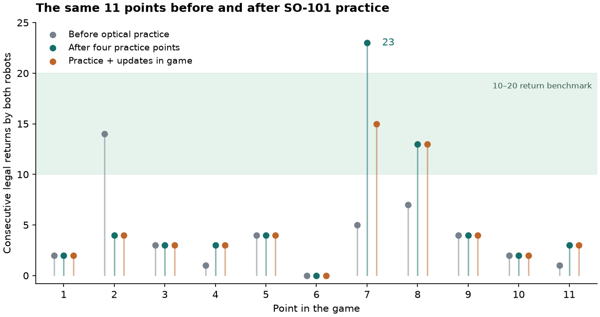

# How long can the clamped SO-101 rally in a complete game?

A scored game began at 0–0 with ordinary release speed and spread. Service rotated every two points. Both robots moved real simulated rackets. The SO-101 saw the fixed stereo pair, estimated incoming flight and selected a stroke using its factory arm model. The five-axis practice partner used simulator state to return the ball toward a region it had learned was playable. A return counted once the referee credited a legal shot after the serve. All three complete games reproduced their service order, referee events and scores from both arms' motor commands.

| SO-101 stroke calibration | Own legal returns | Partner legal returns | Points lasting at least 10 | Longest rally | Final game |
|---|---:|---:|---:|---:|---:|
| Before optical practice | 19 | 24 | 1/11 | 14 | 0–11 |
| After four practice points, calibration frozen | 28 | 33 | 2/11 | 23 | 0–11 |
| Same four points, keep updating during play | 24 | 29 | 2/11 | 15 | 0–11 |

All arms had the same physical stroke search and edge and net penalties. The four practice points gave seven observations of differences between predicted and visible outgoing flight. Point seven lasted 5, 23 and 15 returns respectively. On point two the arm with zero practice did best, lasting 14 versus 4 in both practiced conditions. Every condition made all five of its serves legally. Four points of practice helped over this match, and updating further shortened its longest point. The initial zero-practice control was added after the long match was observed. Independent games are needed to establish the size and frequency of the advantage.

The longest rally started with the SO-101 serving at 0–6. It lasted 451 control frames (15.0 simulated seconds). The SO-101 made 11 legal returns and the partner made 12. The final SO-101 stroke landed on its own side. The video includes the two actual input cameras. Replaying every joint command reproduced their combined RGB digest, the event log and the point outcome. [Watch the rally](ordinary-rally-frozen.mp4) · [Video verification](ordinary-rally-frozen-video.json) · [Practiced games](ordinary-game.json.gz) · [Zero-practice game](ordinary-zero-practice.json.gz)

The source-game preference was absent from all three game policies. A separate [Pong transfer experiment](source-transfer.md) measured the advantage of prior Pong experience for first contact. The causal contribution of Pong to acquiring long arm rallies remains open.
