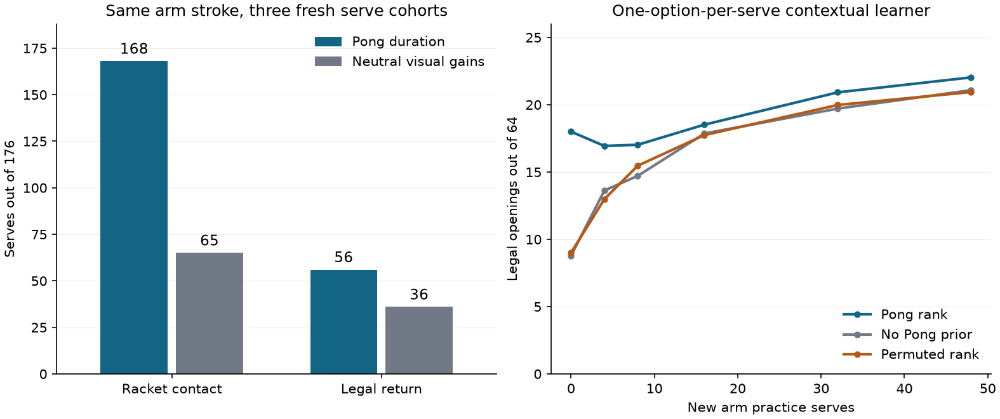

# What prior Pong play buys the arm

The clearest effect is on contact. In the 48-serve receiving drill, training a signed visual preference on native Pong episode duration led to 47 physical contacts, versus 19 with neutral visual gains, and 20 first legal returns versus 9. On a second cohort of 64 with the same two lane distributions, that frozen preference hit the ball on 62 serves versus 25 with neutral gains. **Both returned 18 legally.** These policies use the same SO-101 stroke, previously found by physical return rewards. Eight unlabelled camera frames choose which moving region to follow. Its position and velocity feed an arm movement in a supplied body coordinate frame. The clocked stroke makes one visual choice per point. [Native Pong learning](duration.md) · [First cohort](duration-transfer.json.gz) · [Second cohort and all motor options](population-transfer.json.gz)

## Source versus all sixteen original options

All sixteen signed candidates reached the second 64-start cohort. The Pong winner scored 18/64 and tied for seventh by legal first returns. Its advantage over a uniformly drawn *other* candidate was 8.4 percentage points (paired, serve-stratified bootstrap interval 0.6 to 16.8). The best option retrospectively scored 30/64. The association between all 16 native duration scores and arm legal-return rates was Spearman 0.45, with a two-sided permutation probability of 0.084. Each held start has the same RGB input, initial commands and body setup for every option. [Frozen design](population-design.md) · [Scoring implementation](../../scripts/experimental/tt22_population_transfer.py)

To test online adjustment, 256 paired order/exploration draws traversed the original 48 practice openings with a one-choice-per-point bandit. A complete matrix of actual simulated points supplied the outcome for the selected option. The learner received that single outcome. Reordering those 48 points tests sensitivity to exploration. It adds no independent physical starts. The learner was scored separately on the second set of 64.

| Prior for selecting a motor option | No arm practice | 4 practice serves | 8 | 16 | 32 | 48 | Own legal returns during 48 practice serves |
|---|---:|---:|---:|---:|---:|---:|---:|
| Pong duration rank | 18.0 | 19.1 | 19.2 | 19.1 | 19.8 | 20.3 | 14.5 |
| Uniform | 12.1 | 16.5 | 19.1 | 20.5 | 22.3 | 22.4 | 13.0 |
| Permuted rank | 12.7 | 15.9 | 18.1 | 19.2 | 22.1 | 22.2 | 13.0 |

The native ranking bought earlier returns and cost later held performance. Independent physical replays checked the winner and neutral outcomes on all 64 held starts. [Full option scores and trial curves](population-transfer.json.gz)

## Joint online adjustment of visual and motor parameters

A separate six-stream learner adjusted visual gains and four dimensions of its target-trained joint stroke. It saw one new physical point per trial and updated with actual return rewards in batches of eight. Each frozen checkpoint was tested on the same 64 held starts for the distribution in question. Rates are averages across six learners. A two-way paired bootstrap resampled the training streams and held starts separately. All 128 distinct RGB prefixes and 256 frozen physical outcomes for the starting Pong and neutral policies were reproduced independently. [Design](anonymous-practice-design.md) · [Replays and intervals](practice-report.json.gz)

| Held serve lanes | Starting visual preference | No new arm practice | 8 points | 16 points | 24 points |
|---|---|---:|---:|---:|---:|
| Moderate | Point-trained Pong | 32.8% | 37.2% | 37.0% | 40.9% |
| Moderate | Neutral | 28.1% | 34.1% | 35.7% | 37.0% |
| Moderate | Unselected signed candidate | 21.6% | 20.6% | 29.7% | 29.9% |
| Farther off center | Point-trained Pong | 0.0% | 6.5% | 6.5% | 12.2% |
| Farther off center | Neutral | 0.0% | 0.8% | 1.8% | 4.2% |
| Farther off center | Unselected signed candidate | 3.4% | 1.6% | 5.5% | 4.2% |

For Pong minus neutral, the mean difference over the first three checkpoints was +3.0 percentage points on moderate serves (paired 95% interval −11.8 to +17.5) and +3.5 farther off center (−0.3 to +8.0). Individual training streams varied considerably. [Six learning traces](anonymous-joint-practice.json.gz) · [Wider held test](anonymous-wide-hold.json.gz)

## The independent third cohort and the conversion to legal returns

A third draw of 64 new serves gave 59 contacts and 18 legal openings for the frozen Pong-duration policy, versus 21 contacts and 9 legal openings for the frozen neutral policy. Across all **176 unique matched starts**, the same physically practiced arm made contact **168/176 versus 65/176** and landed a first legal return **56/176 versus 36/176**. On 38 it returned legally when neutral missed. On 18 the reverse happened (descriptive two-sided paired binomial probability 0.0105). These cohorts use two strata of initial lateral placement, the same target-trained motor pulse, and separate opening resets. No model receives a hidden object ID, contact label, or oracle trajectory when deciding how to move. The table coordinate system, calibrated stereo and recipe for turning relative position and motion into a possible command are given. [Paired counts](source-summary.json.gz) · [Third cohort](contextual-motor.json.gz)

The neutral controller touched 65 serves. On those exact serves, the Pong-guided arm touched all 65, but landed just 26 versus neutral's 36. On the other 103 balls that the Pong policy alone touched, it landed 30. Of its 39 failed legal conversions on common contacts, all 39 ended in an own-half fault. This separates getting the paddle to the ball from choosing a useful blade angle and stroke.

The third cohort also tested a context-sensitive online option learner. It compared nearby optical positions, velocities and proposed motor targets with previously earned return rewards. Each of 160 paired order/exploration draws saw one outcome per practice point from the same original 48 starts. At 0/4/8/16/32/48 practice serves, the native-ranked policy averaged **18.0/16.9/17.0/18.5/20.9/22.0** held returns out of 64. The uniform policy averaged **8.8/13.6/14.7/17.9/19.7/21.1**. The gap was largest before target practice, and the fixed neutral policy alone scored 9/64 on this cohort. Resampling evaluation orders does not create additional independent starts. [Learning implementation](../../scripts/experimental/tt22_contextual_motor.py)

