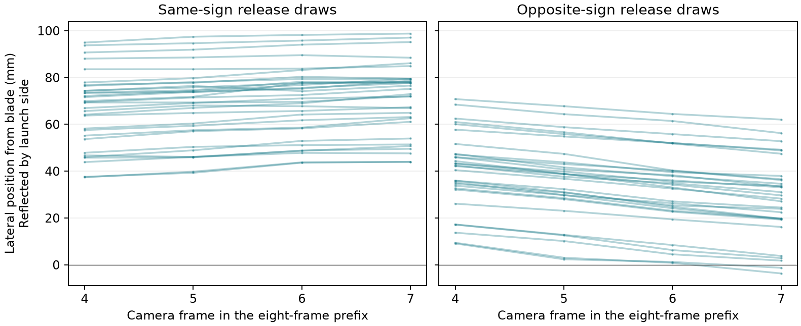

# Native Pong direction choices when release position and throw vary independently

The frozen native direction learner made 17 legal openings on 64 new SO-101 starts. Its pooled duration shuffle made 16 and holding center made 36. The difference concentrated in the opposite-sign release group. There the learned policy returned four balls, center returned 24 and reversing the learned direction returned 11. [Frozen plan](crossflight-plan.json.gz) · [Physical results](crossflight-results.json.gz)

| Fixed policy | All contacts / legal | Same-sign contacts / legal | Opposite-sign contacts / legal |
|---|---:|---:|---:|
| Native Pong ordinal fit | 44 / 17 | 32 / 13 | 12 / 4 |
| Within-start native duration shuffle | 40 / 16 | 32 / 13 | 8 / 3 |
| Center | 43 / 36 | 14 / 12 | 29 / 24 |
| Reversed native direction | 21 / 11 | 0 / 0 | 21 / 11 |

The two sign groups each contained 32 launches. In the same-sign group, the native policy reached 18 more balls than center and converted just one additional legal return. On the opposite-sign group, the native policy converted one start that center missed, while center converted 21 that the native policy missed. Three of the five independent native fits beat their own shuffled labels overall. Their mean difference was +2.4 openings per 64, with a paired held-start 95% interval from −0.8 to +5.6. All five learned fits converted 13 on same-sign draws and three to five on opposite-sign draws. The full-point gate remained closed. [Independent fits and paired counts](crossflight-results.json.gz)

| Independent source | Learned legal openings | Its shuffled control |
|---|---:|---:|
| Original 72 native starts | 18 | 16 |
| 48-start native set 1 | 18 | 18 |
| 48-start native set 2 | 16 | 16 |
| 48-start native set 3 | 16 | 11 |
| 48-start native set 4 | 17 | 12 |

## Camera evidence

The triangulated lateral position and velocity pointed in opposite directions in 28 of the 30 detected opposite-sign approaches and in zero of the 32 detected same-sign approaches. On the 28 mixed approaches, the learned jog pointed toward the observed position on 21 and along the lateral motion on seven. The median absolute observed lateral position fell from 7.0 cm on same-sign draws to 2.7 cm on opposite-sign draws. The fixed jog was 7.6 cm. The opposite-sign group therefore tested a different motion relation and often a smaller lateral excursion. [Recorded RGB-derived tracks and physical releases](crossflight-arm.json.gz)

## Physical protocol

Sixteen fresh launches occupied each native sign combination of the start coordinate and the throw offset. Their magnitudes were drawn separately, within the original release ranges. The native arm, racket, release equations, physics and official referee carried over. The policy used the stock eight-frame anonymous stereo prefix. Release draws, trajectory signs and simulator state served only the evaluator. Returning the two draws to their previous coupled values reproduced the complete observed RGB prefix and physical robot and ball states on four archived launches. [Design and decision rule](crossflight-design.md)

The experiment executed all three stock motor choices on every launch. Each set used identical initial release state and eight-frame physical integration digest. All 192 exact command tapes reproduced the terminal event sequences and scores. The original physical trials used 9,353 control frames, 5.2 minutes of simulated play at 30 Hz, and each scored point contributed at most one legal near return. [Executable protocol](../../scripts/experimental/tt23_crossflight.py) · [Tapes and replay fingerprints](crossflight-arm.json.gz)

Run `python -m scripts.experimental.tt23_crossflight --chart artifacts/tt23/crossflight-tracks.png` in the project environment with EGL and one thread for OpenBLAS, OpenMP and llvmpipe. The command freezes the course before collecting the native physical points.
