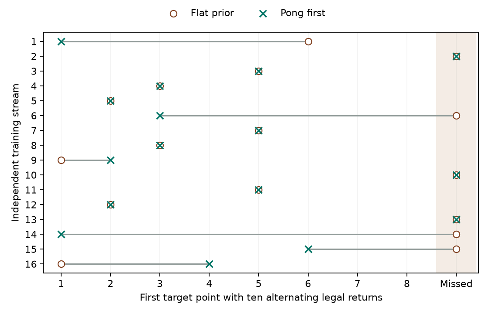

# Direct independent confirmation with three fixed motor actions

The simulated arm opened each point by selecting among a small leftward jog, a hold and a small rightward jog. In the Pong-first arm, native elapsed reward associated visual contexts with motor directions; the flat arm started with equal action values. Both updated their contextual estimates solely from the elapsed time of their chosen target points, with identical target body training, geometric continuation and physical partner. Sixteen independent, previously unplayed courses supplied eight receiving starts each. Every learner played through the first qualifying point, or through its eighth point. This confirmation used exactly one exploration draw per point and played each selected trajectory in MuJoCo. All 147 included trajectories reproduced by strict two-arm command replay. [Prospective design](implicit-confirm-design.md) · [Trial receipts and paired test statistic](implicit-confirm-summary.json.gz)

| Independent stream | Pong first · point of first ten (time) | Flat prior · point of first ten (time) |
|---|---:|---:|
| 1 | 1 (6.8 s) | 6 (13.2 s) |
| 2 | >8 (10.9 s observed) | >8 (13.8 s observed) |
| 3 | 5 (16.4 s) | 5 (16.2 s) |
| 4 | 3 (12.7 s) | 3 (14.0 s) |
| 5 | 2 (8.2 s) | 2 (7.9 s) |
| 6 | 3 (9.3 s) | >8 (13.1 s observed) |
| 7 | 5 (11.4 s) | 5 (11.2 s) |
| 8 | 3 (8.7 s) | 3 (9.0 s) |
| 9 | 2 (11.6 s) | 1 (6.9 s) |
| 10 | >8 (11.6 s observed) | >8 (12.3 s observed) |
| 11 | 5 (16.2 s) | 5 (16.3 s) |
| 12 | 2 (7.6 s) | 2 (7.9 s) |
| 13 | >8 (21.6 s observed) | >8 (19.4 s observed) |
| 14 | 1 (6.5 s) | >8 (20.0 s observed) |
| 15 | 6 (15.9 s) | >8 (12.8 s observed) |
| 16 | 4 (13.6 s) | 1 (6.5 s) |

The source learner reached ten in 13/16 streams versus 10/16. Every qualifying exchange reached ten within forty simulated seconds. All nine censored learner-streams played eight full points and ended before forty seconds, so the direct claim is about the eight-point observation budget. Scoring those failures as nine launches gives means of 4.31 and 5.44, a reduction of 1.125 launches, or 21%. The exact one-sided paired randomization p is .09375. The four-stream archival comparison had a similar proportional reduction (4.80 versus 6.09). The independent physical sample remains too small to establish the average speedup at the .05 threshold on its own. [Earlier experience-controlled comparison](implicit-online.md)

On stream 16 the flat-prior learner reached twelve returns on its first point and stopped. The source learner reached 62 on its fourth, making 31 legal arm returns under the shared high-ceiling physical continuation. This complete uninterrupted exchange establishes a rally capability. The flat learner had already reached the speed endpoint in this stream. [Full two-arm recording](implicit-confirm-16.json.gz)
