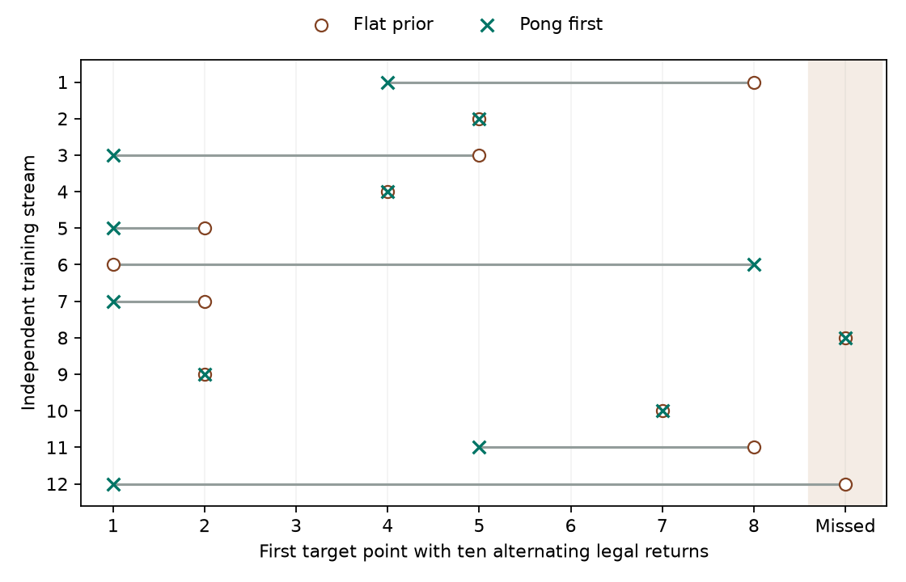

# Independent wide-serve time-to-ten study

The previous physical bank suggested a larger advantage for Pong-trained direction when the incoming serve was drawn from the wider of the two ordinary release distributions. We tested the same frozen source, unbiased flat control, arm stroke, learned opponent and point-duration updates in twelve entirely new streams. Every stream contained eight wide starts with both lateral sides. We selected the wider course after examining the earlier data and froze these new launches before execution. All 107 selected policy episodes reproduced from the two robots’ motor commands. [Prospective design](implicit-wide-design.md) · [Trial receipts](implicit-wide-summary.json.gz)

| Wide stream | Pong first · point of first ten (time) | Flat prior · point of first ten (time) |
|---|---:|---:|
| 1 | 4 (11.8 s) | 8 (16.4 s) |
| 2 | 5 (12.7 s) | 5 (12.7 s) |
| 3 | 1 (6.4 s) | 5 (11.3 s) |
| 4 | 4 (14.3 s) | 4 (11.0 s) |
| 5 | 1 (6.3 s) | 2 (8.2 s) |
| 6 | 8 (25.0 s) | 1 (6.7 s) |
| 7 | 1 (6.7 s) | 2 (7.9 s) |
| 8 | >8 (12.8 s observed) | >8 (11.6 s observed) |
| 9 | 2 (11.3 s) | 2 (8.1 s) |
| 10 | 7 (16.3 s) | 7 (16.9 s) |
| 11 | 5 (13.2 s) | 8 (17.8 s) |
| 12 | 1 (7.0 s) | >8 (21.8 s observed) |

The source learner reached ten by point eight on 11/12 streams; flat reached it on 10/12. Capping non-success at nine points, mean exposure was 4.00 versus 5.17 launches. The saving was 1.17 launches (23%), above the predeclared practical size of one launch. The exact paired randomization p was .148. There were 6 gains, 1 losses and 5 ties on launch count. Among the 10 streams solved by both, cumulative median simulated times were 12.2s for source and 11.1s for flat. The magnitude in launch count resembles the 1.125 saving on the separate mixed course. This experiment did not establish that making the serves wider increases that effect. [Sixteen mixed streams](implicit-confirm.md)

Across both prospective experiments the raw count was 24/28 versus 20/28 streams solved. Both primary comparisons estimated about a one-point head start for the same learned source direction. The 28 direct streams shared the same cooperative opponent, practiced physical continuation and ordinary release mechanics. The separate independent-height and crossflight tests show why the result does not extend automatically to different approaches. [Changed flight mechanics](crossflight.md)
