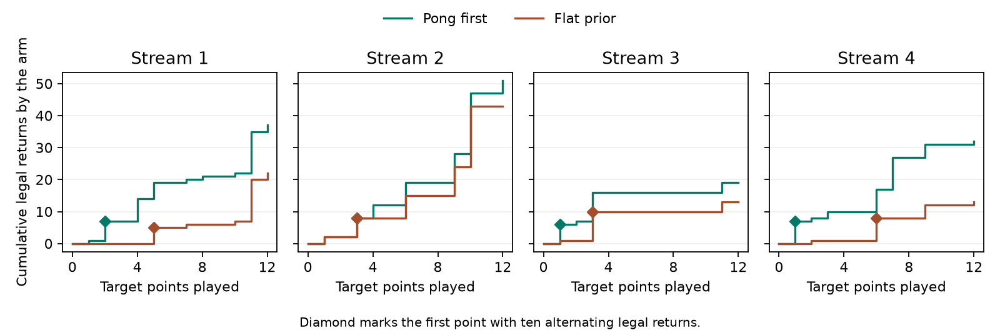

# Does Pong shorten the time to a ten-return rally?

Two learners played through four independent streams of twelve scored receiving points against the trained five-axis partner. Both could change opening selection across points from the duration of their own play. One started with a ranking learned from actual native Pong durations. The flat prior knew the same motor choices, trained arm stroke and camera-driven continuation. Its selector received no native ranking. A point resets the physical game and carries the learner’s value estimates. All 96 policy-point records passed two-arm physical replay. [Design and source lineage](online-rally-design.md) · [Verified learning curves](online-rally-summary.json.gz)

| Target stream | Point of first ten, Pong / flat | Seconds to first ten, Pong / flat | Own legal returns over twelve points, Pong / flat |
|---|---:|---:|---:|
| 1 | 2 / 5 | 9.0 / 12.0 | 37 / 22 |
| 2 | 3 / 3 | 11.8 / 11.8 | 51 / 43 |
| 3 | 1 / 3 | 6.8 / 9.7 | 19 / 13 |
| 4 | 1 / 6 | 6.5 / 13.4 | 32 / 13 |

Across 48 receiving points per policy, the Pong prior produced 139 legal arm returns versus 91, reached ten on 13 points versus eight, and reached twenty on three versus two. Both produced a 38-return rally. A visible consequence of the prior was reduced early selection of a motor rule whose direction was reversed. The source advantage on launch count occurred on three streams, with a tie on the fourth. Eight independent confirmation streams were reserved after observing these early successes. [Prospective time-to-ten confirmation](online-rally-confirm-design.md)

The opening choices in this test contain a parameterized relative-position and motion rule supplied by the experimenter. Native Pong determined a preference among choices, and each arm’s measured online point time subsequently updated that preference. The approaching ball, the swing and legal landing are computed using geometric and body structure in the long-rally controller. This addresses whether the source experience accelerates deployment of these available skills. A separate experiment trains direction from elapsed reward under fixed anonymous actions. [Anonymous action training](anonymous-action.md)
