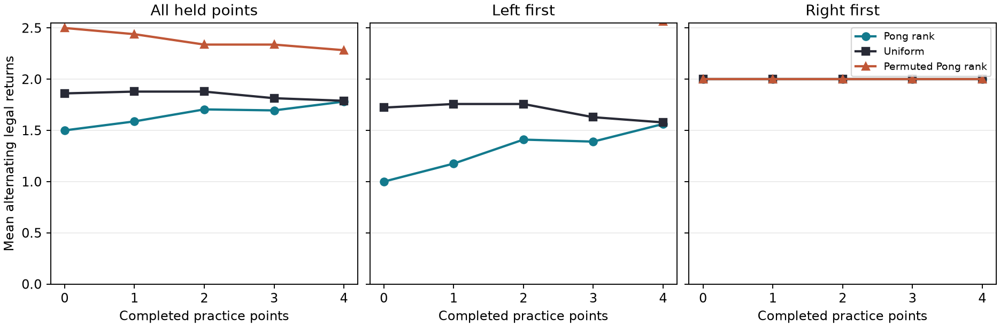

# Using Pong duration to learn cross-court rally choices

The frozen native Pong winner selected strokes that yielded an average of 1.5 alternating legal returns on four held physical points. The permuted rank selected a different native Pong option and averaged 2.5. The longest held rally was five returns. It came on one left-first opening where the positive-motion option made two legal near-side returns and both negative-motion options made zero. [Design](source-lanes-design.md) · [Physical receipts](source-lanes-physical.json.gz)

| Held launch | Requested first rival lane | Native winner 6 | Positive motion 10 | Smaller displacement 7 |
|---|---|---:|---:|---:|
| 972873847 | Left | 1 | 1 | 1 |
| 481720467 | Right | 3 | 3 | 3 |
| 1039151683 | Left | 1 | 5 | 1 |
| 72092330 | Right | 1 | 1 | 1 |

The rival requested alternating lateral locations 12 cm from center, with opposite starting sides in the two held cohorts. It retained its stock physical arm and depth, height and pace targets. Observed first replies ranged from −25 cm to +11 cm in the held near stroke corridor. The five-return point received replies near −12 cm, +6 cm and −13 cm. The receiver used two native RGB views, the unchanged near service program, the existing inverse flight fit, seven optical calibration outcomes from four earlier target points and the same motor stroke search. All policies could make fine placement within the same eight-centimetre cell selected by their respective gains.

| Option | Native mean episode ticks on the common screen | Position gain | Motion gain |
|---|---:|---:|---:|
| 6 | 713.3 | 1.014 | −0.547 |
| 10 | 569.3 | 1.376 | 0.829 |
| 7 | 421.8 | 0.222 | −0.437 |

The three learners had the same full choice menu. They started with either a native Pong duration rank, a uniform rank or a one-position shift of the Pong rank. Two pseudo-observations initialized each estimate. Each learner sampled one option for the upcoming target point, observed the resulting strict alternating return count and updated using that count transformed to a bounded reward. It received each selected point as a single experience. Held points remained separate from all updates. [Target learner and physical runner](../../scripts/experimental/tt23_source_lanes.py)

## Held performance as target experience accumulated

| Initialization | 0 practice points | 1 | 2 | 3 | 4 |
|---|---:|---:|---:|---:|---:|
| Pong duration rank | 1.50 | 1.59 | 1.71 | 1.70 | 1.78 |
| Uniform | 1.86 | 1.88 | 1.88 | 1.81 | 1.79 |
| Permuted Pong duration rank | 2.50 | 2.44 | 2.34 | 2.34 | 2.28 |

The values average alternating legal returns per held point. All conditions averaged two returns on the right-first cohort at each budget. The left-first cohort accounted for the entire difference. The Pong-ranked learner closed its initial gap to uniform, while the permuted rank kept the lead. Each budget reused the same four held starts. The 512 paired replays varied practice order and exploration draws from the same four practice points. The longest in-bank rally was five, so the rates of ten and twenty were zero at each budget. [Curves, selections and feedback sequence](source-lanes-curves.json.gz)

All 24 two-arm tapes reproduced every strict event and final outcome. Where the candidate independently chose the same full action tape from captured RGB observations, the separate physical replay reused that observation record. The complete receipt includes 12 physical held tapes and 12 physical practice tapes, every optical corridor sample, and the shared service commands. [Complete physical bank](source-lanes-physical.json.gz)

Run `python -m scripts.experimental.tt23_source_lanes --chart artifacts/tt23/source-lanes-curves.png` in the project environment from the repository root, with `MUJOCO_GL=egl LP_NUM_THREADS=1 OPENBLAS_NUM_THREADS=1 OMP_NUM_THREADS=1`. Add `--curves-only` to use the verified physical bank.
