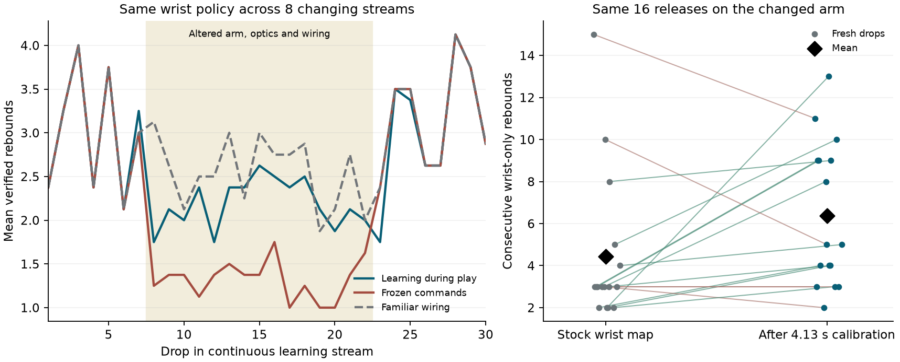

# SO-101 direct control and transfer

[Load the continual wrist learner](continual-wrist.md) · [Watch it use an unfamiliar control interface](motor-interface-paired.mp4) · [See the learned interface in table tennis](settled-match-witness.mp4)

A 1.45-second movement test recovered 383 rebounds on 32 drops with previously unknown five-axis controls. The unchanged controller scored 31 and the supplied inverse scored 416. On stock the learned map matched the supplied inverse on the ten-rebound threshold. [Motor discovery and retention](motor-settle.md) · [Recovered map checkpoint](motor-bank.npz)

On a new common-launcher test the released wrist policy made 40–56 consecutive rebounds on all eight stock starts, even as gravity changed twice. Only two of eight altered-arm starts lasted the full 15 seconds. After a surprise sideways impulse on a separate course, live feedback scored 105 post-kick rebounds versus 23 from its original motor commands. [Combined physical stresses](integrated-stress.md) · [Surprise flight intervention](carried-perturb.md) · [Wrist-only body recalibration](wrist-source-only.md)

A reference preference learned in native Pong transferred to the five-joint arm. In a twelve-cohort confirmation, 51/72 new stock releases reached ten rebounds versus 22/72 using shuffled Pong credit. On the changed arm the counts were 11/48 and 4/48. Both groups used a motor policy that had already learned powered bouncing on other arms. [Load the carried wrist policy](carried-wrist.md) · [Paired video](reference-transfer-paired.mp4) · [All transfer controls and native-game results](reference-transfer.md)

A five-joint controller trained from rebound rewards on three other simulated arms reached ten consecutive bounces on **12 of 16** stock SO-101 wrist-only drops, with zero stock motor practice and zero action demonstrations. Its wrist observer had eight earlier unlabelled calibration drops. On another twelve drops with a 15 s horizon it averaged 31.08 and reached 57. Eight lasted the full interval and three scored zero. [Watch the first drop](donor-first-drop.mp4) · [Watch all 57 from both cameras](donor-longest-drop.mp4) · [Donor bodies, source exposure and physical controls](tt24_donor.md)

Seven of twelve fresh wrist-only starts stayed in play through five gravity changes and all 30 seconds. The other five ended before the first change. [Watch the first release](continuous-gravity-first.mp4) · [Gravity interventions](continuous-gravity.md) · [Playing from a much wider range of joint angles](ready.md)

The end-clamped arm drives its five motor joints continuously. Its gripper holds the paddle. A separate six-hinge experiment adds a physical wrist motor. All reported policy learning and calibration in TT24 use non-backpropagation methods.

| Question | Independently tested result | Evidence |
| --- | --- | --- |
| Can the arm play table tennis without executing prescribed strokes? | The direct stereo pupil won one 25-return point (13 near, 12 far). Across other held cohorts, the best frequency of ten alternating returns was 3/24. Five additional service demonstrations enabled 6/12 legal services in two regulation losses, 1–11 and 0–11. | [Watch 25](match-bridge-native.mp4) · [Held rally experiments](rally-improve.md) · [Complete matches](match-and-transfer.md) |
| Does the arm react to surprises in flight? | In table tennis, live feedback returned 9/24 disturbed starts and 5/12 later replies, versus 2 and 1 with its nominal motor tape. In wrist bouncing, live feedback made 47 consecutive post-kick rebounds across eligible stock drops versus 18 on replay, and 20 versus 9 on the recalibrated arm. | [Table disturbance replay](tt24_disturbance.mp4) · [Matched wrist perturbations](bounce-perturb.md) |
| How well does the wrist-only arm bounce? | A public wrist calibration carried the four-demonstration motor readout to a 23.30 mean over 20 fresh drops. Ten lasted the full 15 s and the longest streak was 43. The original observer scored 12.95 over the same drops. | [Matched long runs](source-world-transfer.md#wrist-sensing-from-eight-unlabelled-drops) · [Watch the first held comparison](public-carry-first-drop.mp4) · [Training and weights](bounce-ident.md) |
| How quickly does it adapt its camera? | Four probe drops on the altered body, 2.57 s of wrist and two calibrated outside RGB views, raised mean wrist-only streaks from 4.19 to 7.94 on sixteen fresh drops. Twelve improved. Previously learned stock and target calibrations were recognized on the first wrist image in 24/24 mixed starts. | [Four-drop body recalibration](public-morph.md) · [Recall and comparisons](wrist-transfer.md) |
| Can it learn new motor assignments during play? | With a practiced wrist policy, estimation from voluntary movements earned 263 rebounds through the fifteen altered drops of eight independent streams, versus 158 frozen and 306 with familiar wiring. It used all five motors as it learned. Five probes learned in bouncing separately restored twelve table-tennis returns from zero after rewiring. | [Adaptation and restoration](body.md) · [Ten alternating after bounce practice vs zero frozen](match-bridge-changed.mp4) |
| Can it use physically different joints? | Twelve unlabelled probes (3 s) carried the stock wrist controller onto a body with a sixth actuated hinge. Jamming the original wrist pitch left 89 rebounds on twelve fresh drops with the distal hinge available, versus 23 when both were jammed and 107 with the normal six-joint arm. | [Six-joint control](redundant.md) · [Wrist-joint failure and ranges of motion](redundant-jam.md) |
| What transfers from native Pong without bouncing demonstrations? | After sixteen practice drops in a planar powered task, the Pong-informed learner earned 140 rebounds over 160 held drops, versus 25 cold and 23 shuffled. Carrying that controller into the physical wrist did not beat holding still. Native Pong causal credit improved an already practiced arm over cold and shuffled updates; its advantage over leaving the practiced arm untouched remains uncertain. | [Planar experiments](planar.md) · [Physical grounding](ground.md) · [Native causal transfer](recurrence.md) |
| What does a single eye contribute in table tennis? | Four short wrist/stereo calibration clips let a previously trained motor policy make a second legal return on 4/12 new wrist-only starts and a third on 3/12. The longest was six alternating, versus sixteen for the same controller on stereo. | [Wrist match](wrist-match.md) · [Watch the onboard view](wrist-match-held.mp4) · [Earlier eye-transfer tests](eyes.md) |
| Does online motor learning recognize a returning body? | After an unannounced in-flight change, the practiced wrist policy recalled its former motor map in 0.13–0.23 s. On a fresh schedule it made 22 rebounds versus 5 frozen after adaptation and retained all 22 on restoration. | [Learning during a drop](body.md#switching-motors-during-an-ongoing-bounce) |
| How far does reward-only bouncing generalize across bodies? | A reward-trained Cartesian controller struggled on the five-hinge arm. Direct control trained on three other hinged arms transferred immediately to stock wrist-only play, reaching 11.94 consecutive on average versus 2.56 stationary. | [Hinged donors](tt24_donor.md) · [Cartesian source experiments](source-world-transfer.md) |

The original wrist experiment with direct target reward learning averaged 3.36 rebounds against 2.50 stationary on its first independent qualification. The physical simulator can reliably sustain much longer runs with a fully informed controller. Native Pong by itself has yet to produce a consistently long five-joint wrist bounce after a small target budget. [Reward-only training](motor-results.md) · [Appearance and paint tests](tt24_anonvision.md) · [Physical ceiling](bounce-ceiling.md) · [Design](design.md)

[Eight-drop target adaptation and source retention](donor-adaptation.md) · [Unknown camera delay and recovery](latency.md) · [Side-fed native Pong test](tt24_side_feed.md)

[Can partner rallies teach solo bouncing?](partner-transfer.md) · [Single-flight delivery](tt24_volley_source.md) · [Reverse transfer to delivery](donor-volley.md) · [Recognizing a returning body](context-residual.md) · [Learning generic motor features from donor wrist recordings](universal-donor-images.md) · [Native Pong outcome credit](tt24_outcome_pong.md) · [Two visually similar balls](object-transfer.md)

[Continual recall across two physical games](dual-game.md) · [Learning motor responses from real simulated table-tennis points](forehand-carry.md) · [Single-flight action effects](flight-effects.md) · [Training for the first catch](acquisition.md) · [Conditional ready posture](ready-geometry.md)

[Learning visual delay compensation in native Pong](pong-temporal.md) · [Testing in-flight actuator discovery in the carried wrist](drive-spontaneous.md)

[Watch 15 alternating table-tennis returns after motor calibration](settled-match-witness.mp4) · [Cross-game controls](settled-match.md) · [Recovering with a sixth hinge](carried-six.md) · [Visual workspace under changing physics](workspace-stress.md) · [Unannounced motor changes](autonomous-drive.md) · [Learning from delayed wrist images](online-temporal-memory.md)
