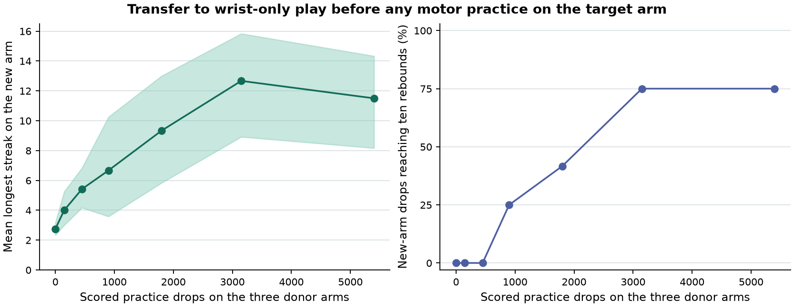

# Eight online trials after learning to bounce on other bodies

A single five-joint control policy first learned to bounce from rewards on three different simulated hinged arms. The target learner used its wrist camera and encoders. Eight consecutive target practice drops gave it a chance to adjust its weights before each independent twelve-drop evaluation. Each practice drop had a different seed. The same schedule and reward budget applied to every adaptive treatment. [Donor source](tt24_donor.md) · [Registered settings and starts](donor-adapt-plan.json)

The experiment used the donor archive to estimate which weight changes mattered differently across bodies and launches. It fitted local regressions of historical score on perturbations to the 100 parameters of the feedback law and extracted two directions of variation. The target tried positive and negative adjustments along both axes twice, then interpolated using its observed rebound rewards. The shuffled control permuted past donor outcomes before fitting the directions. A second control used two random orthogonal directions of the same norm. The final controller still issued fresh commands to every joint every frame. Training cost here includes the eight actual target games in addition to source pretraining. [Implementation](../../scripts/experimental/tt24_donor_adapt.py)

| Target configuration, 12 fresh drops each | Donor-derived directions | Shuffled directions | Random directions | Frozen donor head | Stationary |
| --- | ---: | ---: | ---: | ---: | ---: |
| Stock gravity and mass | 212 | 189 | 206 | 204 | 38 |
| 0.78× gravity, 1.24× ball mass, weaker drive | 157 | 172 | 171 | 137 | 34 |
| 1.26× gravity, 0.83× mass | 159 | 139 | 140 | 136 | 28 |
| 0.87× gravity, 0.78× mass, weaker drive | 111 | 66 | 99 | 111 | 30 |
| Sum of longest streaks | 639 | 566 | 616 | 588 | 130 |

The carried learning improved on the already competent frozen head in three settings and tied in one. Its advantage over generic exploration was smaller and depended on the setting. Returning **the same modified weights** to 72 fresh starts spread over the three original donor bodies exposed forgetting. The original head averaged 12.71 consecutive rebounds. The four adapted donor-direction heads scored 10.46, 11.79, 7.50 and 12.71 on the earlier source bodies. New target performance alone therefore overstates continual learning. [Stock](donor-adapt-0.json.gz) · [Low gravity and weak drive](donor-adapt-1.json.gz) · [High gravity](donor-adapt-2.json.gz) · [Second weak-drive setting](donor-adapt-3.json.gz) · [Same-weight retention](donor-adapt-retention.json.gz)

On the novel tilted-axis arm with lower gravity and more drag, a different intervention replaced the stock camera and body estimator with a map learned in four generic paired-camera drops (147 frames). With the donor motor weights frozen, that new map gave 59 summed longest streaks in 16 fresh games, versus 84 with the stock map, 84 with the earlier altered-arm map, and 33 stationary. The gain from this optical method with a demonstrated stock motor did not carry over to the donor-trained motor. [Public calibration](donor-morph-fit.json.gz) · [Paired physical outcomes](donor-morph.json.gz)

## Physical and visual changes in the same stream

A different test kept the previously demonstrated wrist motor fixed and changed the camera/body assembly between drops and the five-channel motor routing during play. A learned image comparison selected an old calibration. A motor observer estimated effective rates from encoders and voluntary commands. In four 15-drop streams, once the unfamiliar wiring had persisted and the stock body returned, the combined adapter scored 51 summed streaks against 16 for vision adaptation alone. It lost ground after wiring restoration, scoring 97 against 140 on the four post-restoration drops in each stream. The familiar-wiring comparator scored 120 and 140 in those phases. [Combined stream 1](compound-carry-0.json.gz) · [Stream 2](compound-carry-1.json.gz) · [Stream 3](compound-carry-2.json.gz) · [Stream 4](compound-carry-3.json.gz)

A second observer estimated each known body's nominal motor response from its unlabelled calibration movements and four previously archived ordinary games per body. On three disjoint streams, the body-specific observer scored 250 across all drops against 219 with the original observer, 194 using only visual adaptation, and 320 with familiar wiring. The six entirely changed drops scored 72 against 57, 24 and 134 respectively. The added model especially helped after several drops of shifted motor operation. The initiation of a surprise change remains costly. [Second comparison A](compound-observer-0.json.gz) · [B](compound-observer-1.json.gz) · [C](compound-observer-2.json.gz)

## Training speed and diversity of the source tasks

Archived source checkpoints were played with wrist vision on the same twelve fresh stock starts. The sum of the twelve longest runs progressed through 33, 48, 65, 80, 112, 152 and 138 after 0, 150, 450, 900, 1,800, 3,150 and 5,400 reward-training episodes respectively. The last two reached ten bounces on nine starts each. These counts exclude the donor validation episodes used to choose parameters during training. [Physical tapes](donor-curve.json.gz)

Continuing the strongest original head across five more varied donor settings cost 3,648 training and 1,470 validation drops. On twelve fresh wrist-only drops per body, this lowered the stock mean from 12.25 to 9.50 and a newly constructed arm from 7.67 to 4.25. The previously shifted arm changed from 6.00 to 6.17. The broader checkpoint is archived for comparison. The original remains the reference for transfer. [Source training and variation](broad-donors-training.json.gz) · [Stock](broad-donors-stock.json.gz) · [Previously shifted](broad-donors-previously_shifted.json.gz) · [New arm](broad-donors-new_body.json.gz)
