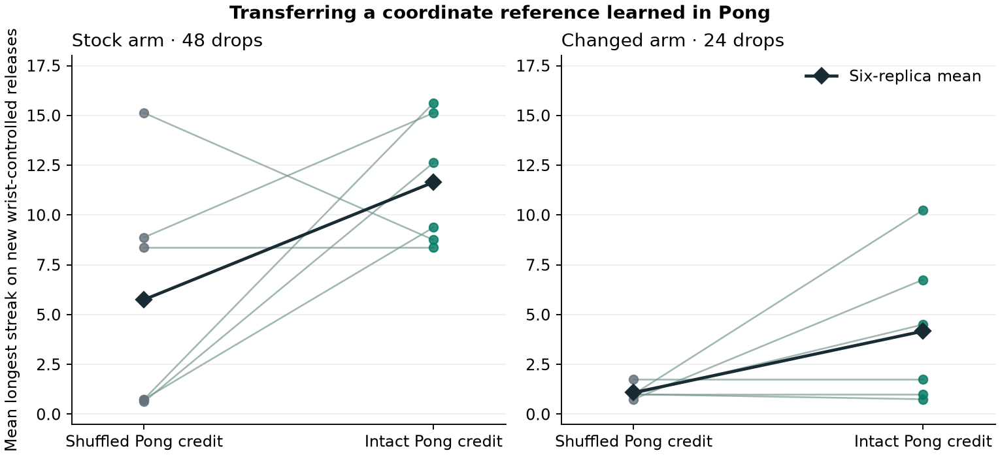

# A coordinate reference learned in native Pong transfers to five-joint wrist control

The transferable quantity was one number. At zero the learner treated its current paddle position as the origin at each release. At one it reused a familiar position from earlier experience. The same number set both the zero point of its sensory coordinates and the equilibrium of its motor commands. Pong moved one paddle along one axis. The wrist-controlled SO-101 issued five joint-rate commands every frame. The meaning of the shared coefficient and the connection to the arm were supplied; the numerical preference came from actual native Pong outcomes. The arm already knew the motor skill from rewards on three donor arms and had previously calibrated its wrist camera. The experiment isolates a transferable preference about coordinates. The source of the powered five-joint behavior is the separate donor-arm training. [Source fit and original checkpoints](tt24_pong_origin.md) · [Physical endpoint and registered controls](reference-transfer-plan.json)

In the first native fit, both real and shuffled outcomes selected full reference reuse. Consequently the physical actions were identical. Both reached ten consecutive rebounds on 13/20 wide-pose stock starts, versus 0/20 with half reuse and 0/20 resetting the reference each time. On the changed arm the counts were 1/12, 1/12 and 0/12; on a stock launcher positioned above the particular starting paddle they were 7/12, 0/12 and 0/12. That first comparison establishes the mechanical effect but cannot attribute it to Pong reward. [Stock](reference-transfer-fixed_stock.json.gz) · [Changed body](reference-transfer-fixed_changed.json.gz) · [Moving launcher](reference-transfer-roving.json.gz)

Six new native training cohorts and six independent within-serve reward shuffles were locked before evaluating the arm. Each source fit used the same reward-trained native player, 96 shifted starting positions and eleven candidate reference coefficients per position. The native fits chose 0.913–1.000. On 384 new shifted native points they returned at least once on 305, versus 283 for shuffled and 290 for half reuse. On the arm each cohort was tested on eight independently seeded stock drops and four independently seeded altered-body drops. At release the ball was already visible during a 0.23–0.63 second preparation interval. There were no target updates. [Source-only selection bank](tt24_pong_origin-bank.json.gz) · [Physical evaluator](../../scripts/experimental/tt24_reference_bank.py)

| Source of reference preference | Stock mean | Stock ≥10 of 48 | Changed mean | Changed ≥10 of 24 |
| --- | ---: | ---: | ---: | ---: |
| True Pong reward | **11.65** | **29** | **4.17** | **4** |
| Shuffled Pong reward | 5.75 | 12 | 1.08 | 0 |
| Fixed half reuse | 1.06 | 0 | 1.54 | 1 |
| Always use initial position | 0.88 | 0 | 1.00 | 0 |
| Always use familiar position | 12.85 | 33 | 2.75 | 2 |

On stock, native preferences beat their paired shuffle on four source replicas, lost on one and tied on one. On the altered arm they won three, tied two and lost one. Resampling the six independent source replicas gives descriptive 95% intervals for the mean native-minus-shuffled difference of −0.13 to +11.44 on stock and +0.50 to +6.17 on the changed arm. A fixed full-reuse heuristic scored slightly higher than native on stock. Results are limited to one shared coefficient and the two tested morphologies. Every physical command sequence was replayed with the same launcher trajectory. [Replica 1](reference-bank-0.json.gz) · [2](reference-bank-1.json.gz) · [3](reference-bank-2.json.gz) · [4](reference-bank-3.json.gz) · [5](reference-bank-4.json.gz) · [6](reference-bank-5.json.gz)

## Independent confirmation on 120 fresh physical releases

Twelve additional native cohorts each comprised 96 physical Pong starts at eleven coefficient settings. All twelve selected full reference reuse. Their twelve newly randomized credit controls selected the exact same value five times, zero four times, and intermediate values three times. The source cohort and sham identities were frozen before arm evaluation. On 768 independent native starts, the selected coefficients returned at least once on 633, versus 583 shuffled. [Source-only lock](tt24_pong_origin-confirmation-bank.json.gz) · [Native held games](tt24_pong_origin-confirmation-held.json.gz)

| Physical arm | True Pong mean streak | Shuffled mean streak | Half reuse | Reset at each start | Ten bounces, true vs shuffled |
| --- | ---: | ---: | ---: | ---: | ---: |
| Stock, 72 starts | 13.43 | 6.46 | 1.47 | 0.81 | **51/72 vs 22/72** |
| Altered body and camera, 48 starts | 5.69 | 2.67 | 1.38 | 0.85 | **11/48 vs 4/48** |

The true-reward fit beat the shuffled fit on both arm bodies in each of the seven source pairs that selected different values; the other five pairs used identical commands. Source-replica bootstrap intervals for the mean paired improvement are +3.47 to +10.43 on stock and +1.06 to +5.27 on the altered arm. Fixed full reuse exactly reproduced the native fit in this independent confirmation. The learner got no motor reward practice on either receiving arm. This establishes useful transfer of a coordinate convention under the tested distribution; the motor skill, calibrated observation map and shared meaning of the coefficient were already available. [Watch a paired release from the first bank](reference-transfer-paired.mp4) · [Reproducible held evaluator](../../scripts/experimental/tt24_reference_bank.py)

[Physical replication 1](reference-confirmation-0.json.gz) · [2](reference-confirmation-1.json.gz) · [3](reference-confirmation-2.json.gz) · [4](reference-confirmation-3.json.gz) · [5](reference-confirmation-4.json.gz) · [6](reference-confirmation-5.json.gz) · [7](reference-confirmation-6.json.gz) · [8](reference-confirmation-7.json.gz) · [9](reference-confirmation-8.json.gz) · [10](reference-confirmation-9.json.gz) · [11](reference-confirmation-10.json.gz) · [12](reference-confirmation-11.json.gz)
