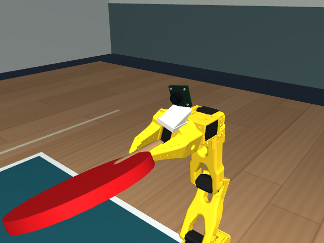
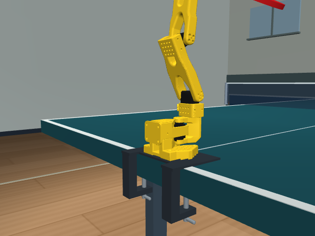

# Camera-controlled rallies with speed-dependent motor torque

[Watch the complete 200-return game](coupled-camera200.mp4) · [See all 200 contact and landing locations](coupled-placement200.png) · [Second film, 100 returns](coupled-camera100.mp4)

Two fixed RGB cameras observed one continuous ball in regulation table tennis. A simulated SO-101 stayed clamped to the near table edge. The powered practice partner selected a new forehand target on each return. The recorded opening launched the ball once. Each counted return required a new paddle contact and a legal landing on the other half. The opening launch was excluded. [Fixture and camera photographs from simulation](fixture.md) · [Native referee](../../scripts/experimental/tt29_endurance.py) · [Measured opening source](../tt25/recorded-secondary-reference.json)

| Measured opening | Consecutive legal returns | Simulated duration | Median departure speed | Median time between hits | Live CPU time |
| --- | ---: | ---: | ---: | ---: | ---: |
| 7271 | 50 by the arm + 50 by the partner | 71.12 s | 4.68 m/s | 0.704 s | 81.8 s |
| 4187 | 50 + 50 | 69.18 s | 4.79 m/s | 0.665 s | 122.7 s |

The arm's five stroke joints had a 3.35 N·m stall cap. Available motoring torque fell to zero at the 5.45 rad/s no-load reference. The model retained braking authority. An independent signed-force audit found zero violations in 170,680 and 166,040 joint samples. Full CAD replay reproduced every referee event, sampled 34,137 and 33,209 states, and found 18.6 mm minimum excluded-geometry clearance in both points. The motor curve is a hardware-informed simulation assumption. The source dataset's 10th, 50th and 90th percentile launch speeds were 4.22, 5.50 and 7.18 m/s. These are cooperative rally speeds. [Signed forces and joint speeds](rally-physics-torque-envelope.json) · [4187 referee and geometry replay](coupled-fresh100-audit.json)

The long rallies followed three continuous practice sequences. In the first sequence scores were 52, 8, 46 and **100**. A second sequence started with 120 rewarded movements and scored **95**, 10 and **100** on a different random opponent schedule. On its final point the arm started with 173 examples, retrieved 49 movements and selected two fresh plans. A third schedule carried the resulting 223 examples and scored 10, **95**, 0 and **100**. The two 95s ended after a legal near-side return. On 7271 the arm intercepted the ball across a 6.8 cm lateral span. Its shots landed across 62.5 cm of the opponent's half. Moving the opponent's targets across a wider region is substantially harder. [First course](rally-objective-envelope.json.gz) · [Second course](envelope-carry.json.gz) · [Third course](envelope-fresh.json.gz) · [Physical net-cord recovery](tt29_partner_short.md)

The live arm received camera pixels, its own encoders, issued command history and legal-return feedback. It used a designed ball detector, a calibrated optical model, candidate arm movements and an isolated simulator to check predicted outcomes. It learned a reusable library of rewarded joint movements without backpropagation. The opponent had access to simulator state. The solo warm-up supplied actuator timing in separate delayed games. Its measured contribution was 10 to 60 and 16 to 30 returns. These 100s used stereo and the retained table movement library. [Matched learning comparisons](endurance.md) · [Warm-up and perturbations](adaptation.md)

## A 200-return point and the learning control

With the stop set to 200, a fresh run on opening 7271 landed **100 returns by the arm and 100 by the partner**. It lasted 138.02 simulated seconds, with 0.683 s median between hits and 4.51 m/s median ball departure speed. Its live loop consumed 169.0 CPU seconds. Each side used physical paddle contacts from the measured opening to the last bounce. The referee stopped the point at the target. The replay reproduced 1,006 contact and referee events. All 66,249 geometry samples cleared the exclusion pairs, with a minimum separation of 18.6 mm. All 331,240 signed joint samples stayed inside the motor model. The maximum observed stroke-joint speed was 3.45 rad/s. [Full video and geometry receipt](coupled-camera200-audit.json) · [Signed torque audit](coupled-camera200-motors.json) [Full action stream and event log](envelope-extended.json.gz)

A fresh optical tracker started each comparison. The arm that carried 173 previously rewarded movements landed 100 returns. The arm beginning with an empty movement library landed 28, and the partner missed that last shot. Total rally lengths were 200 and 55 on the same measured opening and opponent seed. The warm arm added 100 more rewarded movements during play and selected 98 actions by retrieval. It also selected three by search. This pair tests the effect of retained table experience. Solo-to-table timing transfer was tested independently. [173-movement starting checkpoint](coupled-173-movements.json.gz) · [Empty-memory control](coupled-cold.json.gz) · [Solo hold before and after table play](tt29_coupled_retention.md)

To reproduce the longer point, run the live command below with `--ids 7271 --seed-offset 41157 --return-target 200 --checkpoint artifacts/tt29/coupled-173-movements.json.gz` in place of its opening IDs, opponent seed and input checkpoint.

Two earlier tests trained arm movement from outcome feedback without the table-specific stroke planner. On held feeds, the learned controllers touched 9 of 32 and 20 of 40 balls respectively. Neither produced a legal return. Their stationary controls had zero touches. The 200-return milestone relies on the model-based planner and the rewarded movement library. [Reward-only movement experiments](reward-practice.json.gz) · [Shaped movement experiments](shaped-practice.json.gz)

## Camera, table and motor changes

| Change | Matched observations |
| --- | --- |
| Shorter, narrower table | A stereo measurement of painted edges changed 0 and 54 returns to 100 and 100. Motor torque was capped independently of speed for this comparison. |
| Loaded arm, same checkpoint | A 32-control-tick encoder probe changed 15 and 12 to 100 and 44. This comparison also used the independent torque cap. |
| Wider opponent, coupled motors | Four points scored 22, 2, 8 and 6. The opponent sampled 96 combinations of position, height and pace. The last near-side contact went short in two losses and off the table in another. |
| Changed materials, arm load, camera pose, command and image lag, and command noise together | Scores of 0, 2 and 2 became 4, 2 and 3 when the arm used solo timing, surveyed the court lines and probed its own joints. Later optical updates gave 4, 5 and 6. |
| Wrist camera alone | A 32-return point reproduced all 166 events, with positive clearance at all 11,146 CAD states. Its peak joint speed was 6.46 rad/s under the independent torque cap. Another opening scored zero. |

[Table survey](table-survey.json.gz) · [Loaded-arm and registration details](adaptation.md) · [Wide-target runs](envelope-variety.json.gz) · [Compound baseline](envelope-compound-stale.json.gz) · [Compound calibration](envelope-compound-adapt.json.gz) · [Compound late visual updates](envelope-compound-late.json.gz) · [Wrist-only test](tt29_wrist_only.md)

| Wrist-mounted board camera | Base clamped to the end of the table |
| --- | --- |
|  |  |

In the compound condition, a controller that learned from missed movements as well as rewarded ones raised six matched point totals from 19 to 28 returns. Three points improved and three tied. Both controllers reached a longest rally of six. Compute increased from 2.57 to 4.17 CPU seconds per return. On the wider targets they made identical movements. Independent RGB drop probes detected softer paddle rebound, but changing the private model's damping left one matched control sequence and loss unchanged. [Failure feedback and controls](tt29_outcome_feedback.md) · [Observed material response](rgb-material-probe.md)

Raising the planner’s preferred ball departure speed to 4.9 m/s produced 28 and 10 returns on two practice openings. The first point’s median was 5.02 m/s. Screening plausible optical errors on the first wide-target opening reduced the score from 22 to 8. Screening alternative materials on the first compound opening tied the calibrated controller at 4. Those screens were stopped after their first completed point. [Pace experiment](envelope-paced.json.gz) · [Optical screen](envelope-variety-screen.json.gz) · [Material screen](envelope-compound-ensemble.json.gz)

## Replay the 7271 point

Run the following after obtaining the pinned feeds and installing MuJoCo as described in the [benchmark instructions](endurance.md).

```sh
MUJOCO_GL=egl OPENBLAS_NUM_THREADS=1 OMP_THREAD_LIMIT=1 LP_NUM_THREADS=1 \
python -m scripts.experimental.tt29_vision_replay /tmp/tt29-feeds.json \
  --source artifacts/tt29/envelope-carry.json.gz --id 7271 \
  --movie /tmp/coupled-camera100.mp4 --receipt /tmp/coupled-camera100.json
```

To run the second course live, let the first two points update the same memory before the final opening.

```sh
MUJOCO_GL=egl OPENBLAS_NUM_THREADS=1 OMP_THREAD_LIMIT=1 LP_NUM_THREADS=1 \
python -m scripts.experimental.tt29_action_memory /tmp/tt29-feeds.json /tmp/coupled-live.json.gz \
  --ids 7345 4187 7271 --checkpoint artifacts/tt29/envelope-practice-prefix.json.gz \
  --seed-offset 41155 --camera-period 2 --fast-partner --cached-stereo \
  --rated --motor-envelope --rally-objective --recent --blend --robust-contact
```
