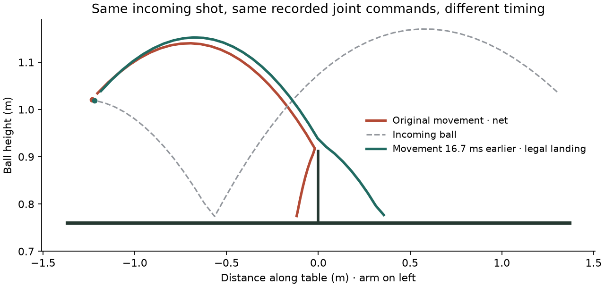

# Correcting a table-tennis return after seeing the mistake

This pass kept the table-edge SO-101, coupled joint torque and speed, physical practice partner and stereo RGB of the [200-return game](../tt29/coupled-endurance.md). The harder opponent samples 96 combinations of lateral position, depth, height and pace. A return counts when the ball lands legally after paddle contact. Scores count both players’ alternating returns.

## What the arm learned

The arm used successive stereo observations after its own stroke to estimate where its ball would land and how high it crossed the net. It compared those quantities with the forecast made when selecting the stroke. Its rolling memory stores up to 64 signed errors with the incoming flight and the proposed contact geometry. When scoring another movement, it uses errors from similar strokes to revise the predicted landing and net margin. An unobserved departure supplies no placement label. The learner uses no backpropagation. The court geometry, ball detector and model-based stroke generator remain explicit supports. [Implementation](../../scripts/experimental/tt29_optical_outcomes.py) · [Course measurements](../tt29/optical-outcomes.md)

A second controller uses a later incoming camera observation to revise an already selected movement. It measures the change in predicted impact time and position and tests small timing and joint-target adjustments in its private dynamics model. A legal return can add the revised movement to the existing archive. The online adjustment itself uses kinematics and simulation. Selecting and adapting a movement from a repertoire has a precedent in cooperative robot table tennis. This implementation uses the outcome of its own strokes for feedback. [Motor-edit implementation and comparison](../tt29/motor-correction.md) · [Mülling et al., 2013](https://doi.org/10.1177/0278364912472380)

## Retry exactly the same incoming ball

A changed first stroke normally causes the opponent to send back a different ball. We isolated the last failed arm stroke from each of four wider points. We replayed the original physical game through the far player's impact and then issued the recorded near-arm commands at their original time or one or two control ticks earlier or later. The command-state, position and velocity digest matched at handover for every variant. Unmodified retries reproduced the archived referee events. The replay harness used the far-contact timestamp to schedule the comparison. The live learning policies have no access to that timestamp.

| Measured opening | Original terminal result | Timing changes that made it legal |
| --- | --- | --- |
| 7271 | Miss | 33.3 ms earlier |
| 7345 | Miss | 16.7 ms earlier |
| 11292 | Miss | None of the four changes |
| 4187 | Miss | 16.7 or 33.3 ms earlier |

All four previously successful control strokes also landed under all four changes. Both attributable near-side terminal misses on the separate compound course could be repaired by either advance. The third compound point ended with an opposing miss. These trials test whether changing timing can cause a physical recovery. Choosing each game's best offset after replay is a diagnostic. [Wide retries](wide-retry.json.gz) · [Compound retries](compound-retry.json.gz) · [Replay code](../../scripts/experimental/tt30_retry.py)

## Frozen transfer across new openings

The comparison selected two previously unused measured opening IDs near each of the four original launches using standardized distance in the three initial positions and three velocities. Selection used no rally scores. Every policy drew the same seeded partner placements. Different arm shots subsequently changed the physical replies. Each point started afresh with the same 223-movement checkpoint and a fresh optical tracker. Within-point movement learning remained enabled. The stop was 24 alternating legal returns, so scores at 24 are censored. [Opening selection](../../scripts/experimental/tt30_openings.py) · [Evaluation](../../scripts/experimental/tt30_transfer.py)

The donor consists of 24 measured placement errors from six earlier wide points. The frozen comparison carries only that extra error memory into new points. Its sign-reversed control uses the same contexts and residual magnitudes, reverses all three error signs, and leaves the spread correction intact. A separate online comparison starts each point with an empty error memory and learns after strokes it can see. [Donor checkpoint](wide-shot-errors.json.gz)

The carried signed errors improved the estimated depth of a return on new trajectories. Across the 49 observable shots actually played by the carried controller, mean absolute depth error fell from 11.4 to 10.2 cm. Reversing the same stored signs offline raised it to 14.4 cm. Lateral error moved from 5.3 to 5.6 cm and net-height error from 6.38 to 6.33 cm. Across the 50 observable shots on the reversed controller's own trajectories, applying the correctly signed correction offline reduced depth error from 10.7 to 9.6 cm. These forecast comparisons rescore identical observed strokes. The game comparisons below required each controller to choose and execute its own movements.

Coverage was selective. On the six-point opponent schedule 80631, stereo estimated outgoing placement on 21 of 23 *legal* arm returns. It produced no placement estimates on any of the three contacted misses. Each had an associated predicted strike within 20 ms of real contact, but the forward-arc detector collected zero accepted segment samples. Three more losses had no near-paddle contact. Shifting the old motor commands one or two ticks earlier repaired only one of those six terminal failures, while all five previously successful strokes stayed legal. [Coverage receipt](label-coverage.json) · [Same-shot retries](held-retry.json.gz) · [Unmodified source](retry-held-source.json.gz)
