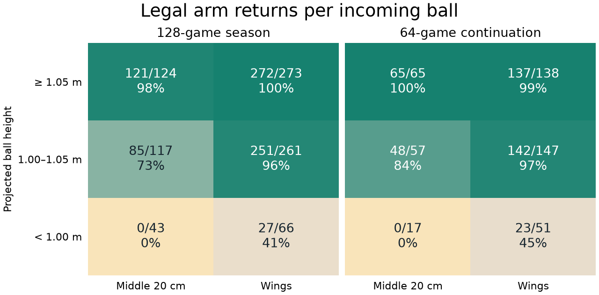

# Why low balls end rallies

In a 128-game season, **none of 43 low balls down the middle landed legally**. Eight touched the paddle and none of those eight left it traveling forward above 0.5 m/s. In the 64-game course containing the 63-return point, all 17 low central balls missed the paddle. In the first season the same arm returned 27 of 66 low wing deliveries, 85 of 117 middle-height central deliveries and 121 of 124 high central deliveries. Height and lateral position are extrapolated to a depth of −1.53 m from the actual receiving-line crossing. The middle is the central 20 cm, and low means below 1.00 m at that depth. The qualifier continues to draw from the original full range. [Counts, touches and terminal faults](location-coverage.json)

## What the arm had previously learned

Among 3,732 unique earlier answered examples with enough camera readings, the 40 lowest optically ranked examples on distinct releases all came from the wings at the observed receiving line. Each stored trajectory reproduced from launch. The lowest central examples landed near 1.01 m in the evaluator's measurement. These source cases exclude the releases in the subsequent qualification schedule. The program ranked by previous camera measurements and reward, and used joint encoders and the observed closest ball-to-paddle passage to extract the motion. [Original source selection](sources.json) · [Central sources](central-sources.json) · [Early wing library used in play](first12.json)

## Can reward alone find a new central joint movement?

A practice opponent varied its physical shot near three prior central returns. The learner was given the earlier measured game's command prefix and could alter the direct joint commands around its prior camera-estimated receiving phase. New motion coefficients were retained only for a native legal return that the opponent answered. Twelve exploratory movements on release 4283 found a return at x = +0.083 m and projected height 0.9993 m where the original commands missed. The same coefficients subsequently returned a different ball at 1.0069 m. Both full replays reproduced every physical event with zero penetrations in 5,696 CAD samples. Three target changes on the second case clipped to the same target and produced the same actual incoming ball.

The other two training releases produced no retained movement. The two final untrained perturbations on each release yielded one unchanged stock success and zero new rescues. In all, the practice used 546 physically executed branches and 24,048 control ticks including shared opening prefixes. This is local learning from a normal attained body in repeated simulation. It does not yet demonstrate a new long point from a normal launch. [All charged physical practice](central-scored-practice.json.gz) · [Independent replay, commands and camera-only motor samples](central-earned-replay.json.gz) · [Starting policy comparison](central-lesson.json.gz)

A separate practice teacher returned a lower central ball at x = −0.008 m and projected height 0.982 m by moving forward to strike it on the rise. The learner's ordinary late controller could score on the exact ball once given the attained posture. Four independent nearby draws still beat its three learned forecourt strokes. [Forecourt geometry, physically earned movements and transfer](../tt54_midline/README.md)

## How soon is the middle visible?

The camera model trained on 29 different practice releases using later observed flight as its target. When the arm's outgoing ball crossed the net, the forecast put five of six low central replies in the highest-risk quarter on the first held 24-game course. The model using the outgoing ball alone put three there. On the second 32-game course both placed four of eight in that quarter. In the highest-risk tenth they placed four and three respectively. A large early movement triggered on this forecast would also affect many ordinary arrivals. [Training and first assessment](court-forecast.json) · [Fresh confirmation](court-confirmation.json) · [Frozen model](court-forecast.npz)

On the earlier 63-return point, the arm returned four of five low wings, all seven middle-height center shots, and all 52 higher-center or middle/high-wing shots. No low center arrived during that point. Its last ball was a left wing at projected x −.215 m and z .969 m. The arm touched it and it left backward and downward. During the 128-game season, every one of the 43 low-center misses elicited a search, but only eight had even one candidate predicted to land. The ordinary controller's inability to find a workable movement was more common than incorrectly believing it already had one. [63-return game](../tt48_transfer/live-plain-12.json.gz) · [Season](../tt46_season/learning.json.gz)

Adding the previously earned central motions to the ordinary candidate search made 169 returns in 32 complete games, versus 196 for stock. An unmodified added motion was selected 23 times. Their success in isolated practice did not yield an aggregate gain on the broad course. [Full games using extra motions](context-games.json.gz)
