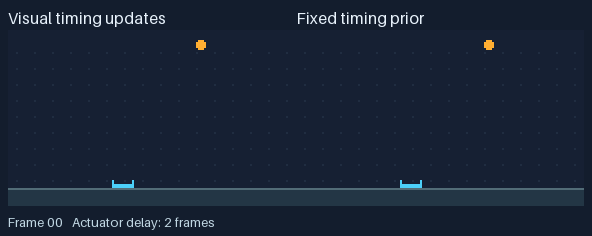

# From table tennis to fruit catching

A player moved a sliding basket to catch falling fruit. It tracked the fruit and basket from color-coded RGB, issued one signed rate per frame, and received a public score when the fruit crossed the basket. The fruit could veer mid-flight or bounce off a sidewall. Command delay ranged from zero to five frames, with an unannounced change during most falls. All groups had the same court, motor calibration, interception rule, wind starts, delays, and command noise.



## A carried timing prior

Equal-budget source players completed 42 table-tennis points on the same arms and serves. The varied player experienced changed racket response, noise, and delay. The ordinary player's equipment stayed at its standard settings. For each donor we pooled the table player's end-of-point optical delay estimates into a six-bin distribution. The varied practice estimates averaged 1.21 frames and the ordinary estimates 0.46. The timing prior was the only state carried from table tennis. The catch player updated it from the RGB basket motion and its own action history.

Each of two independent courses used 12 fresh player instances, with 18 falls per instance. All 36 ordered delay pairs occurred equally often across each course. The frozen player received the varied donor and used its fixed delay estimate throughout play. The cold player initialized with TT6's default zero-favoring prior and the uniform player gave each delay equal weight before seeing any target frames. [Matched course A](catch-transfer-prior.json.gz) · [Matched course B](catch-transfer-prior-confirm.json.gz)

| Entry and adaptation | Course A / 216 | Course B / 216 | First three per instance / 72 | Delay mean absolute error |
|---|---:|---:|---:|---:|
| Varied table tennis, adaptive | 133 | 131 | 46 | 1.08 frames |
| Ordinary table tennis, adaptive | 133 | 131 | 46 | 1.08 frames |
| Cold, adaptive | 133 | 131 | 46 | 1.09 frames |
| Uniform, adaptive | 134 | 131 | 47 | 1.08 frames |
| Varied table tennis, frozen delay | 125 | 118 | 43 | 1.71 frames |

RGB timing updates improved score by 21 catches across 432 falls relative to fixing the varied prior. A paired bootstrap over the 24 player instances gives a gain of 4.86 percentage points, with a 95% interval from 2.78 to 6.94. The varied, ordinary, and cold adaptive players caught exactly the same individual falls. The uniform prior added one catch. The result supports reusing the visual timing mechanism in a different game. It leaves a score advantage from table-tennis experience unestablished.

## Learning how the delay changes

We repeated the first two table-tennis visits and recorded camera-only likelihoods for zero through five frames of delay. The recorder checked the original physical action tapes and score receipts. The paired source inputs retained the first six points per visit. They include 871 informative frames from varied practice and 1,060 from ordinary practice, since different rallies had different lengths. A regularized hidden Markov model learned an opening delay distribution and the probability of moving between delays from those observations. On the catching games, the player updated its delay belief each frame, then updated the model between falls. The target-only Markov player used the same learner and started with a symmetric transition prior. [Varied camera evidence](catch-source-varied.json.gz) · [Ordinary camera evidence](catch-source-ordinary.json.gz)

Half the falls hid the basket from the camera in the final part of the flight. The fruit stayed visible through the last decision frame. The court matched all ordered pairs of delays in both visible and occluded falls. The source fit and target updates used the visual timing evidence and previous public commands. The evaluator used the hidden delay for scoring estimation error and the true crossing geometry for scoring catches.

| Timing model and source | Course A / 216 | Course B / 216 | Occluded falls / 216 | Delay mean absolute error |
|---|---:|---:|---:|---:|
| Markov, varied table tennis | 148 | 148 | 148 | 0.60 frames |
| Markov, ordinary table tennis | 146 | 147 | 145 | 0.61 frames |
| Markov, target only | 149 | 148 | 148 | 0.59 frames |
| VisualDelay, varied opening prior | 147 | 148 | 149 | 1.12 frames |
| VisualDelay, uniform opening prior | 147 | 148 | 149 | 1.11 frames |

The Markov observer estimated timing more accurately on the catching game. The target-only Markov learner caught 297 fruits and the varied donor caught 296. The paired 95% interval for the varied donor's score difference from the target-only Markov learner spans −1.16 to 0.46 percentage points. Learning actuator timing from the new game was enough to reach the best score in this comparison. The games share a delayed rate transport and a calibrated motor model, so the comparison covers reuse of visual timing on a new set of objects and actions. [Matched dynamics course A](catch-transfer-dynamics.json.gz) · [Matched dynamics course B](catch-transfer-dynamics-confirm.json.gz)

### Reproduce and verify

Run from the repository root with the project Python environment.

```sh
export PYTHONPATH=.:src
python -m scripts.experimental.tt7_transfer_trial /tmp/catch-a.json.gz
python -m scripts.experimental.tt7_transfer_trial /tmp/catch-b.json.gz --seed 30681199
python -m scripts.experimental.tt7_transfer_trial /tmp/catch-a.json.gz --verify
python -m scripts.experimental.tt7_transfer_trial /tmp/catch-b.json.gz --verify
python -m scripts.experimental.tt7_transfer_trial /tmp/catch-dynamics-a.json.gz --dynamics --seed 58719017
python -m scripts.experimental.tt7_transfer_trial /tmp/catch-dynamics-b.json.gz --dynamics --seed 67091383
python -m scripts.experimental.tt7_transfer_trial /tmp/catch-dynamics-a.json.gz --verify
python -m scripts.experimental.tt7_transfer_trial /tmp/catch-dynamics-b.json.gz --verify
```

All 4,320 action tapes reproduced the applied commands, catch outcomes, and final miss distances. The catch rule is a horizontal error of at most 5.5 pixels at the crossing. An evaluator-only action range check found 421 of 432 fruits reachable in the prior study and 422 of 432 in the dynamics study.

To regenerate the table-tennis camera evidence, use the [TT6 environment and optional component extractor](../tt6/README.md).

```sh
python -m scripts.experimental.tt7_transfer_source /tmp/catch-source-varied.json.gz \
  --reference artifacts/tt6/combined-carry.json.gz --evidence-per-visit 6 \
  --seed 3079812 --course gantry offset --predictive --cached-render --reflections
python -m scripts.experimental.tt7_transfer_source /tmp/catch-source-ordinary.json.gz \
  --reference artifacts/tt6/ordinary-practice.json.gz --evidence-per-visit 6 \
  --seed 3079812 --course gantry offset --predictive --cached-render --reflections \
  --phases ordinary ordinary ordinary ordinary ordinary ordinary ordinary
```
