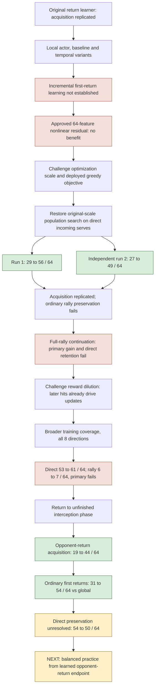

# Pong scaffold progress — 2026-10-22

The current visual/linear policy can learn strong direct interception without
backpropagation. That finding replicates. Opponent-return interception now also shows strong acquisition in one run.
Reliable interception across opening phases, sustained rallies and a continuously adapting general learner remain open.

Rates below are matched within each experiment. Absolute scores from different
fresh cohorts must not be read as a single learning curve.

| Experiment | Decisive result | What it changes |
|---|---|---|
| 64-feature fixed nonlinear residual | Start38, linear40, residual37 first returns/64 | No demonstrated benefit; not a general nonlinear-capacity verdict |
| Latent Gaussian score idea | Correct identity, retained update dispersion18–19x larger | Rejected before spending fresh training observations |
| Direct-only local actor |26→29/64, learning gate fails | Shorter credit horizon alone was insufficient with that update rule |
| Original-scale direct population, run1 |29→56/64; +42.19pp CI[29.69,54.69] | Strong acquisition, provisional80% threshold passes |
| Exact independent run2 |27→49/64; +34.38pp CI[18.75,50] | Acquisition replicates;80% threshold does not |
| Full-rally continuation |>=2returns15→17/64; direct60→55/64 | No qualified rally gain or direct preservation |
| Context-diverse all8 continuation |>=2returns6→7/64; direct53→61/64 | Secondary direct gain; rally primary still fails |
| Opponent-return interception |19→44/64; +39.06pp CI[26.56,51.56]; ordinary first31→54/64 vs GLOBAL | Strong acquisition and transfer; direct preservation54→50/64 fails noninferiority |

## What actually carried forward

The designated first direct-population endpoint r1theta9 is the scaffold start.
The original ARtheta112 remains the qualified global reference. Neither failed
full-rally endpoint is promoted or carried because a secondary result looked good.
All current experiments use the existing frozen generic vision/linear readout,
with no backpropagation or privileged policy observations. Explicit seed-defined
curricula and scalar own-hit rewards are declared scaffold assistance.

## Current decision

The completed opponent-return trial passed acquisition, original opponent-return
preservation, ordinary first-return gain, and ordinary all-return preservation.
Direct-skill noninferiority alone failed: −6.25pp, paired95%CI[−17.19,4.69].
That does not establish definite harm, but blocks the combined promotion gate.
The endpoint reached68.75% opponent-return,78.125% direct and84.375% ordinary
first-return success; the provisional80% requirement across all cohorts failed.

Both independent result checks passed with zero new observations or replay.
Cost:159,833 training transitions (155,738 used;4,095 partial),89,386 evaluation
transitions,1,759 initial images;1467.965s total (892.311 training,575.654 evaluation).
Six complete updates. No automatic global promotion or rally-completion claim.
Next selected experiment: balanced fresh first-contact practice from the learned
opponent-return endpoint, retaining its actual acquired weights. This is an
experimental scaffold carry, not qualified global promotion. Require new balanced
learning versus its own start plus phase retention and ordinary-game retention
against its own start. The original direct and global heads remain relevant phase
references. Exact opponent-return replication is deferred; this is integration
exploration conditional on a single opponent-return training run. Not yet launched.

Checked figure: `/workspace/m1b-experiments/pong-mechanism-review-20261022/rightward-result.png`.

Sources, exact budgets, costs and independent checks:
[population reassessment](../plans/2026-10-22-population-search-reassessment.md),
[current opponent-return protocol](../plans/2026-10-22-opponent-return-interception.md),
[general scaffold plan](../plans/2026-10-21-continuous-learning-scaffolds.md).
