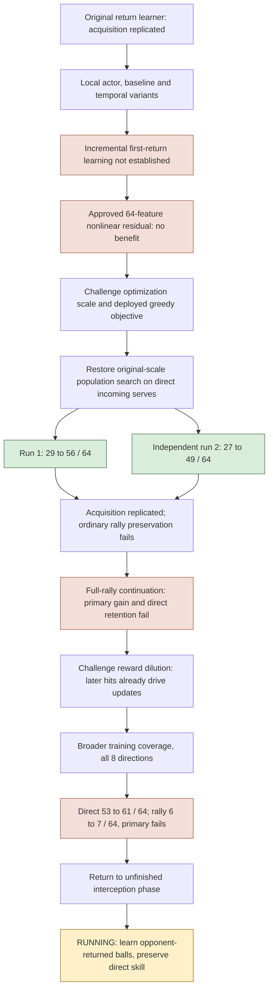

# Pong scaffold progress — 2026-10-22

The current visual/linear policy can learn strong direct interception without
backpropagation. That finding replicates. Reliable interception across opening
phases, sustained rallies and a continuously adapting general learner remain open.

Rates below are matched within each experiment. Absolute scores from different
fresh cohorts must not be read as a single learning curve.

| Experiment | Decisive result | What it changes |
|---|---|---|
| 64-feature fixed nonlinear residual | Start38, linear40, residual37 first returns/64 | No demonstrated benefit; not a general nonlinear-capacity verdict |
| Latent Gaussian score idea | Correct identity, retained update dispersion18–19x larger | Rejected before spending fresh training observations |
| Direct-only local actor |26→29/64, learning gate fails | Shorter credit horizon alone was insufficient with that update rule |
| Original-scale direct population, run1 |29→56/64; +42.19pp CI[29.69,54.69] | Strong acquisition, provisional80% threshold passes |
| Exact independent run2 |27→49/64; +34.38pp CI[18.75,50] | Acquisition replicates;80% threshold does not |
| Full-rally continuation |>=2returns15→17/64; direct60→55/64 | No qualified rally gain or direct preservation |
| Context-diverse all8 continuation |>=2returns6→7/64; direct53→61/64 | Secondary direct gain; rally primary still fails |
| Opponent-return interception | Running, fresh outcomes blind | Test an unfinished native phase before claiming general interception |

## What actually carried forward

The designated first direct-population endpoint r1theta9 is the scaffold start.
The original ARtheta112 remains the qualified global reference. Neither failed
full-rally endpoint is promoted or carried because a secondary result looked good.
All current experiments use the existing frozen generic vision/linear readout,
with no backpropagation or privileged policy observations. Explicit seed-defined
curricula and scalar own-hit rewards are declared scaffold assistance.

## Current decision

The current trial uses ordinary starts where the ball first travels toward the
opponent, and trains only through the learner's first contact. It separately tests
RIGHT acquisition, LEFT retention, original RIGHT preservation, overall first-return
gain and all-return retention. Absolute80% across all three cohorts is a separate
provisional threshold; independent training replication is still required.

If the new phase improves while direct ability survives, carry that evidence toward
broader interception and then rallying. If it improves by erasing direct ability,
retention remains the problem. A null does not by itself prove defective vision or
missing motor memory. Do not respond with an automatic neighboring-parameter sweep.

Sources, exact budgets, costs and independent checks:
[population reassessment](../plans/2026-10-22-population-search-reassessment.md),
[current opponent-return protocol](../plans/2026-10-22-opponent-return-interception.md),
[general scaffold plan](../plans/2026-10-21-continuous-learning-scaffolds.md).
