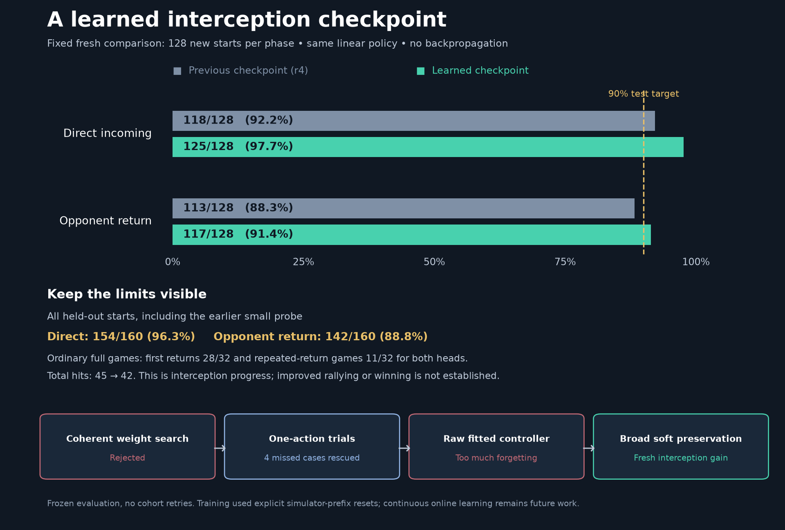
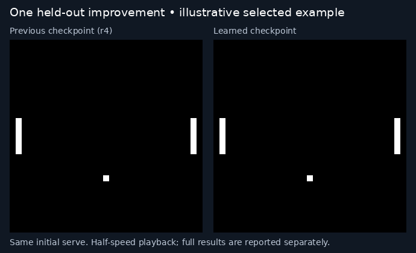

# First-interception checkpoint: genuine learning, scoped benchmark success

The saved non-backpropagation controller passed the fixed larger fresh interception target: **125/128 direct returns (97.66%) and 117/128 opponent-return hits (91.41%)**. The previous r4 controller returned118 and113 on those same starts. Two64-start cohorts perphase were fixed before execution; neither policy learned during evaluation and no cohorts were retried. Training is stopped at this operational milestone.

The limitation is material: including the earlier32-start probe, the learned head returned154/160direct starts (96.25%) and142/160opponent-return starts (88.75%). RIGHT performance varies across cohorts; this is not a distribution-wide90%guarantee or a replicated from-scratch learning recipe. In32ordinary fullgames perhead, both made28firstreturns and11multiple-return games. Total hits changed45→42. Sustained rallying, winning and continuous multi-game learning remain unproven.

## What finally helped

1. From64current training contexts, compare each alternative **single action** at four observed decision points, then resume the unchanged policy. Exact simulator/vision prefix resets make this cheap. Only actual return-versus-miss outcomes supply preference labels; equally successful actions are not ranked.
2. Four missed contexts were rescued. An analytic regularized fit learned all five corresponding repair-state choices, but an overly conservative radial cap erased them. We tested the defined raw fit instead of treating the suppressed update as a learning failure.
3. The raw controller deployed three of four repairs but disrupted too much existing behavior. Adding soft output preservation on33complete own-success trajectories reduced that interference. The final controller gained15practiced direct returns without net opponent-return loss, then improved both phases in the larger fresh comparison.

The policy remains one3×4389linear readout over the existing generic visual input. Fitting uses566optimizer coordinates, a closed-form solve and no backpropagation. There are no hidden ball/paddle coordinates, handcrafted target positions or expert action labels. Training does use explicit reset access; it is a scaffold for later continuous learning.

The local-action credit direction was informed by [Lagoudakis and Parr's classifier-based policy iteration](https://gwern.net/doc/reinforcement-learning/model/alphago/2003-lagoudakis.pdf). Their assumptions do not establish guarantees for our compressed visual observations. The root agent proposed/challenged directions and reviewed source, evidence and limits; the same Sol6.1XHigh agent independently challenged the proposals, implemented and executed them. Sol proposed the single-camera intervention and broad soft preservation; root identified the cap problem and refined tied-success handling. Agents paused while native workers ran when no further reasoning was needed.

## Saved result and cost

[Checkpoint, execution instructions and continuation recipe](/workspace/m1b-experiments/pong-interception-checkpoint-20261025/README.md). Raw weight SHA256: `184dd67a67999224dbe4eb5ff3ba3b86ebdf821d15f1486eef2432a56e99fb15`. Export includes raw weights, exact scaling, optimizer state, frozen visual prior and provenance. r4 remains separately preserved.

The final four allocations—causal discovery, rejected raw check, successful preservation check, and larger/full validation—cost228,475transition cameras and2,332initials over681.46allocation seconds. This excludes earlier learning, failed routes, preparation and orchestration; it is not a claim that training from scratch took11minutes. Discovery itself took47.0seconds and the final fit.158seconds. A separate exact runtime improvement measured1.077×whole-episode speedup. [Full chronological results](2026-10-25-practical-interception-results.md) retain the failures and costs.

The animation is one explicitly selected held-out direct-return gain, not aggregate evidence. Both frozen policies replayed their original native outcomes exactly on seed2047868701. The replay cost96OLDtransition cameras and twoOLDinitials, zero new candidate observations.

A later continuation should start from this head and preserve its earned interception skill. The next capability is sustained interception after the first return; RIGHT cohort variation and learning-recipe replication remain explicit limitations to address. No additional training, deployment or pull request is active.
