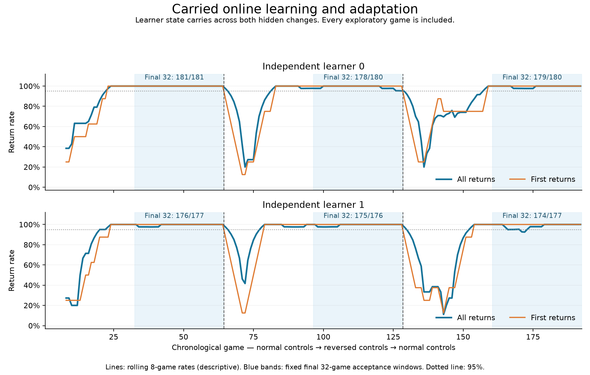

# Carried online learning and adaptation — 2026-10-30

**The defined scaffold passed:** two fresh learners acquired reliable Pong returns,
carried their learning across games, and recovered through two unannounced control
changes. The same learner continued throughout each stream; it was not retrained
or reset at either intervention. This is not full M1B completion.

Each stream played 64 normal-control games, 64 with reversed actuator polarity,
then 64 normal games again, against the same deterministic opponent (speed 0.65). Games ended at a score or 20 seconds. The plot includes
exploration and recovery failures. Its rolling 8-game lines are descriptive; blue
bands identify the prospectively fixed last 32-game scoring windows.

## Results during ongoing learning

| Phase, fixed last 32 games | Learner 0 | Learner 1 |
|---|---:|---:|
| Initial normal controls | 181/181 | 176/177 |
| Reversed controls | 178/180 | 175/176 |
| Normal controls restored | 179/180 | 174/177 |

These windows total **1,063/1,071 returns (99.25%)**: first returns 192/192 and
later returns 871/879. Every window exceeded 95% for both first and later returns,
with at least 144 later opportunities (required 100). No exploration was excluded
from a scoring window. All 384 live games, including initial exploration and
recovery, total **1,719/1,815 returns (94.71%)**, with 326/384 first returns.
The latter is the whole-learning-stream performance, not 99.25%.

Both learners began with zero reward evidence and independent neutral priorities;
their first choices were structures 3 and 5, not the known successful structure 4.
Their initial 16 exploratory games produced 18/33 and 18/32 returns respectively.
No fresh start was chosen based on its outcome.

## Why this is learning and adaptation

The learner updates success evidence on each actual own hit and failure evidence
on public negative terminal scores. Discounted evidence and a small uncertainty
bonus choose among 16 fixed anonymous visual-feedback structures. Choice is made
once per game; feedback updates happen during play, and the next game uses the
carried evidence. The exact implementation is a Beta/UCB-like heuristic, not a
claim to reproduce a textbook algorithm or its regret guarantees.

The primary learner was saved and JSON-restored after every game, against an
independent continuously running shadow. Evidence and random-state continuity
passed at every boundary, including both interventions. The learner receives
no phase flag, environment seed, physical-state label, expert action or future
outcome. Transient visual tracking resets normally between games. There is no
backpropagation. Own-hit reward is the explicitly permitted scaffold.

Matched controls on learner 0's exact scoring starts establish attribution:

| Control | Normal | Reversed | Normal again |
|---|---:|---:|---:|
| Clear learned evidence every game | 11/43 | 26/56 | 43/71 |
| Freeze actually acquired normal controller | — | 0/32 | 179/180 |
| Keep learning | 181/181 | 178/180 | 179/180 |

The frozen controller is competent under normal controls but fails under reversal;
the live learner recovers. Resetting knowledge prevents reliable acquisition.
Controls apply to learner 0 only; learner 1 is an independent learning replication.
All 32 normal-again live 0/frozen pairs have byte-identical event tapes and matching
public-input/action digests when executing the same selected controller.

Conservative recovery confirmation required two consecutive phase-anchored bins
of 25 opportunities each at >=95%. It occurred at phase games 28/22/35 for learner 0
and 28/19/27 for learner 1 (normal/reversed/normal). These are confirmation latencies,
not the first moment a good controller was selected. Reversion recovery does not
prove faster recall than a cold learner.

## What failed and how the direction was chosen

A parallel pilot compared capped recent evidence with a two-loss exploration
trigger against the discounted approach. Both acquired control and adapted, but
the capped method treated two ordinary losses after successful returns as a new
change and launched another 16-arm sweep. Its completed reversed-control scoring
window returned 15/30; the discounted method returned 92/92. The methods had different
starts, so this is development evidence, not a paired causal algorithm comparison.
We advanced the unchanged discounted method rather than tuning the failed trigger.

A cloud restart interrupted the pilot at 142/144 and 137/144 games. All 279 completed
records audited clean, but neither pilot was declared complete. Missing starts
were not replayed. Selection used that explicitly interrupted development record;
the subsequent confirmation used 384 new live starts and fixed criteria.

Parent orchestration selected the target, compared mechanisms, reviewed code and
chose the continuation. Sol 6.1 XHigh implemented/executed it; a second Sol 6.1 XHigh
challenged credit assignment and controls and independently audited the result.
[Research notes and primary project sources](../plans/2026-10-30-online-adaptation-challenge.md)
cover discounted bandits, change detectors, and materially different alternatives
(sensorimotor response learning and local reward-modulated perturbation). Those
alternatives were not run once this route showed useful progress.

## Cost, checks and scope

Confirmation completed 544 planned games in about 31 minutes, using 369,799 transition
observations plus 544 initial observations, within 544,000 transitions authorized.
The 28 focused learner/qualification/reporter tests passed. Independent audit verified
all 544 receipts and 61 source/assets, reward tapes, hidden-action mappings, state
continuity and matched controls. The inherited vision and controller parameters
stayed fixed; the learner's reward evidence deliberately changed.

This proves **online structural selection, carried learning and motor-remapping
adaptation** over inherited frozen vision and a strong feedback-controller prior.
It does not prove learning vision or feedback primitives from scratch, within-rally
policy switching, general adaptation to arbitrary games, winning strategy, or full
M1B. Learning the numeric feedback parameters or sensorimotor associations is a
substantive next extension; no further experiment was started after this pass.

[Machine-readable result](2026-10-30-carried-learning-summary.json) ·
[Independent audit](2026-10-30-carried-learning-audit.json) ·
[Execution costs/checkpoints](../plans/2026-10-30-carried-learning-execution-outcome.md).

Artifacts: `/workspace/m1b-experiments/pong-carried-qualification-20261030-r1`.
Final carried checkpoints: `replica0-live/checkpoint-latest.json` and
`replica1-live/checkpoint-latest.json` within that directory.
Spec SHA256: `fb058e6c8b71ee83e711b4c2bec766d5e1e423ff4227e04c25707cf8d578be4e`.
Reproduce the saved-data plot with `scripts/experimental/plot_carried_learning_result.py`.
