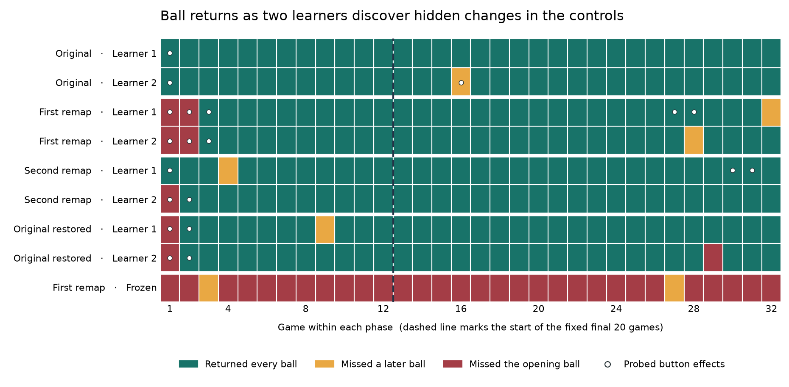
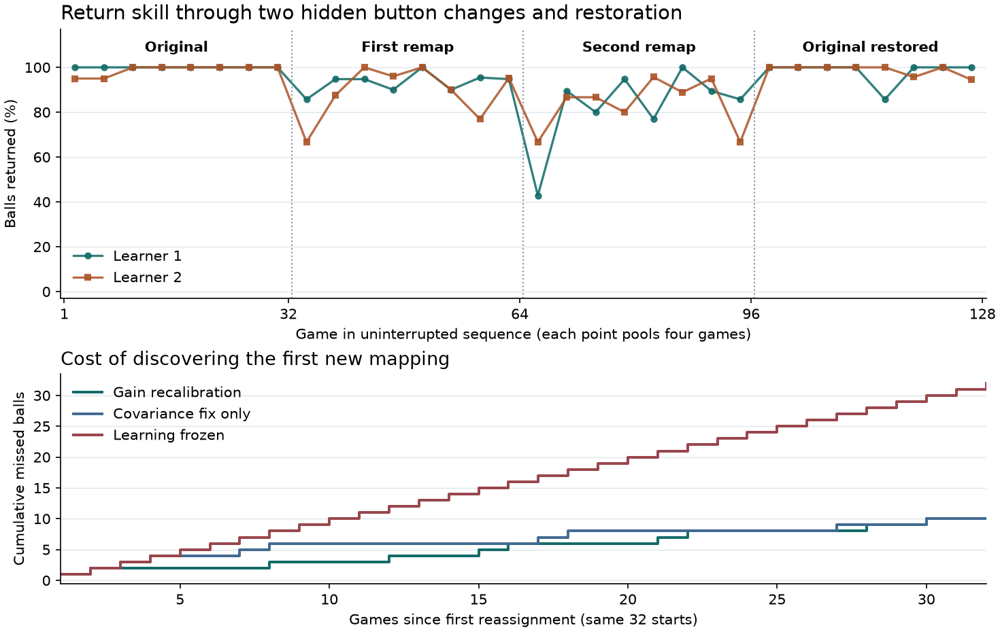

# Online motor discovery during Pong

The experiments change what each button does while the model is playing. The controller sees the same 64×64 camera and faces the deterministic opponent at speed 0.65. The interception objective stays the same. A match segment ends on a score or after 20 simulated seconds. The numerical learner carries its state from one segment to the next, including across unannounced changes. The first return tests the opening. Later returns test whether the controller can sustain a rally.

## Learning which button executes an interception

The strongest controller keeps the acquired visual interception policy. When its observed paddle motion conflicts with its intended motion, it tries the three buttons, measures the displacement each produces, and uses their ordering to execute subsequent decisions. Each probe holds a button for 14 settling frames and measures the following 10. The model can carry unfinished calibration across a point. It uses vision and its own actions to calibrate. The known interception objective, visual binding, opposing movement directions, and the expectation of an intermediate button are supplied. The model receives no change announcement, button mapping, physical state, expert labels, or backpropagation.

Two independent learners each played 128 consecutive segments with distinct starting and exploration seeds. A matched frozen copy played another 32. The first two columns include every attempt from the moment each phase started. The last two show the final 20 games of each 32-game phase, fixed before execution.

| Phase | Learner 1, all | Learner 2, all | Learner 1, final first · later | Learner 2, final first · later |
|---|---:|---:|---|---|
| Original controls | 177/177 | 182/183 | 20/20 · 90/90 | 20/20 · 92/93 |
| First hidden remap | 170/173 | 169/172 | 20/20 · 91/92 | 20/20 · 90/91 |
| Opposite hidden remap | 179/180 | 176/177 | 20/20 · 90/90 | 20/20 · 96/96 |
| Original controls restored | 175/177 | 170/172 | 20/20 · 94/94 | 19/20 · 89/89 |

The fixed criterion required at least 19/20 opening returns and at least 95% later returns on 78 or more later opportunities. It passed in **8/8** phases. The frozen copy returned **3/35** on the same starts as learner 1 during the first hidden change. Its live counterpart gained 89.7 percentage points across that phase. The two live models spent 1,048 of 247,211 camera steps (0.42%) probing. The complete 288-game comparison took 8.5 minutes on this machine.



### Recovery cost

The following numbers count from the moment each change took effect to the end of the second consecutive game with at least five returns. The clock is simulated time and includes missed openings. It measures sustained recovery and includes the time spent playing the successful rallies.

| Change | Learner 1 | Learner 2 |
|---|---|---|
| First hidden remap | 4 games, 43.9 s, 2 misses | 4 games, 43.5 s, 2 misses |
| Opposite hidden remap | 2 games, 40.0 s, 0 misses | 3 games, 42.7 s, 1 misses |
| Original controls restored | 3 games, 42.5 s, 1 misses | 3 games, 42.5 s, 1 misses |

### A control change outside the training sequence

With three new actuator forces (+0.88, −0.07, −0.74), the commands had unequal strengths and even the least-moving button caused drift. An independent 24-game comparison started from the same normal scout checkpoint in all arms. The live arm returned 22/24 opening balls and 107/107 later balls, versus 0/24 openings for the frozen arm. The same frozen checkpoint returned 133/134 on original controls. In the final twelve changed games the live model returned 70/70. This is one matched test of transfer to the new forces.

### A change during a rally

The baseline test switched controls four simulated seconds into each of 12 games. Until then each live/frozen pair had identical observed histories and actions. Both arms returned 4/12 first post-change balls. The live arm returned 4/7 later balls and the frozen arm 0/4. All four later live returns came from one game where the learner identified all three effects 2.26 seconds after the switch. It had yet to complete a new mapping before the next incoming ball on any of the 12 starts. [Mid-rally receipts and timing](2026-11-19-mid-rally-button-remap.md)

On the same 12 development starts, a shorter probe increased first post-change returns from 4/12 to 6/12. We kept the change fixed and repeated the comparison on 24 fresh matched starts. The standard controller returned 8/24 first and 15/19 later balls. Shorter probes returned 10/24 first and 22/26 later balls. The shorter version identified the mapping before the game ended in 6/24 trials versus 5/24, with just 3/24 identifying it before the first incoming ball in each arm. All 24 normal-play prefixes and first post-change contact times matched. Shorter probes accelerated successful calibrations, but the next milestone is to use partial action evidence soon enough to intercept the approaching ball.

The merged code independently reproduced all action hashes, contact events, and final learned states for six sampled qualification games, including two frozen controls. The release archive contains all 288 qualification receipts.

## What happened to the November 5 pilot

The pilot's trained fallback readout was missing from the restored experiment store. The original vision weights were available and verified. We ran two new learners with the same 96-coefficient estimator, a fixed button-1 request during unsupported tracking, and the inherited visual relation with unit scaling. This changes the fallback behavior after a remap. Under this setup, the original estimator achieved 385/385 returns on normal controls across the two learners, then 30/67 and 26/65 on a concealed three-button cycle. A frozen control managed 1/41. By the eighth remapped game in both replicas the estimator's covariance was indefinite. In the final restored phase the numerical controller chose only 380 of 61,612 actions. The inherited controller accounted for almost all choices. All 248 native games and their public replays completed.

An alternative used sustained visual prediction error to initiate fresh exploration. It improved a synthetic tracking task on six button orders but increased the total number of early misses in native Pong from 36 to 37. Eleven of 13 false alarms examined during normal play occurred near the paddle's travel limit.

## Retaining the learned timing of a button press

The next estimator bounded covariance and retained the acquired response over time. When poor visual predictions coincided with a missed opening, it briefly tried the three requests and estimated one continuous movement gain for each. It then updated the gains from visual displacement during play. The controller received its own hits and score at this stage. It received no physical state, remap labels or expert actions. All learning used direct numerical updates without backpropagation.

Two fresh learners each played 32 games in each row. The reliability target for the final 20 games required at least 19 first returns and at least 95% later returns on 78 or more later opportunities. The full counts include discovery costs.

| Phase | Learner 1, all | Learner 2, all | Learner 1, final 20 first / later | Learner 2, final 20 first / later |
|---|---:|---:|---|---|
| Original controls | 191/191 | 181/183 | 20/20 · 98/98 | 20/20 · 99/99 |
| First hidden remap | 147/157 | 142/154 | 19/20 · 80/85 | 18/20 · 79/84 |
| Opposite hidden remap | 112/129 | 107/124 | 15/20 · 65/68 | 17/20 · 58/65 |
| Original controls restored | 179/181 | 184/186 | 18/20 · 89/89 | 19/20 · 92/93 |

The matched acquired model with learning frozen returned 0/32 on the first remap. A copy with the covariance fix alone returned 139/149, including 19/20 first and 82/85 later in the final 20. The three-gain version recovered two consecutive rallies of five or more returns in four games versus six for that simpler copy. Both missed ten balls over the full phase. Only three of eight late reliability checks passed for the three-gain version. Across all arms, the comparison used 320 games, 240,560 camera transitions, and 505 seconds of wall time.



## Immediate transfer to a faster ball

From the same normal checkpoint we increased ball speed from 0.55 to 0.67. All three conditions used the same 12 new starts. The frozen controller returned 72/72 at normal speed and 80/81 at the higher speed. With learning enabled at the higher speed it returned 65/66. Each faster-ball arm missed one opening and returned every later ball it faced. The number of later opportunities depends on how the game unfolds. These results demonstrate immediate robustness to this speed increase. They provide no measured advantage for online updating on that change.

## Reproducing the comparisons

The repository contains the target-following relation. The held-out schedules, checkpoints, source hashes, dependency versions, and game receipts are in the [experiment archive](../../artifacts/m1b/2026-11-19-motor-learning.zip). To run a fresh gain comparison from the checkout, use one CPU thread per worker and an unused output directory. These commands require the project's Python environment.

```bash
export PYTHONPATH=src:scripts/experimental OPENBLAS_NUM_THREADS=1 OMP_NUM_THREADS=1
python scripts/experimental/run_pong_motor_recalibration.py prepare /tmp/pong-gain
# Use the spec SHA-256 emitted by prepare.
python scripts/experimental/run_pong_motor_recalibration.py run /tmp/pong-gain --spec-sha256 "$(sha256sum /tmp/pong-gain/spec.json | cut -d' ' -f1)"
```

To run the button-effect qualification, first run the scout or extract its `button-scout` directory from the archive. With the same environment variables as above, pass that directory to `prepare` and use its returned hash for `run`.

```bash
python scripts/experimental/run_pong_visual_intent_qualification.py prepare /tmp/pong-buttons --scout-directory /tmp/button-scout
python scripts/experimental/run_pong_visual_intent_qualification.py run /tmp/pong-buttons --spec-sha256 "$(sha256sum /tmp/pong-buttons/spec.json | cut -d' ' -f1)"
```

The full vision path remains available. The entity-only path shares the tracker and encoder computations that produce the observations used here. It matched those public observations over 175 recorded camera samples and accelerated the measured sensor operations by about 2.7 times. That timing covers the sensor operations only.
