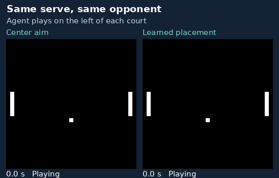

# Carried Pong learning across changes

The starting checkpoint could intercept an incoming ball and learn a new button arrangement over several points. This progression added three decisions at different timescales. The controller estimates what its buttons do from visible paddle motion, estimates when a request will take effect, and chooses where to meet an incoming ball using the outcome of earlier rallies. Its camera, object tracker and inherited interception policy are shared across the stages. All new updates use numerical filtering or score averages without backpropagation.

## Recovering controls during a rally

On 30 fresh matched starts covering five hidden button permutations and three switch times, the learner returned 27 first balls versus 12 for the shorter calibration and 13 for the frozen motor map. It returned 95/95 later balls. On ordinary controls its requests and observations matched the reference throughout. In two of the rescues, replaying the same start with partial identification disabled lost the ball. An independent continuous-gain learner also recovered 20/24 first balls after unequal actuator-strength changes versus 9/24 with shorter calibration. That learner was evaluated as a separate architecture. [Primary comparison](2026-11-19-rapid-recovery-qualification.md) · [Continuous actuator effects](2026-11-19-continuous-motor-effects.md)

## Learning when to move

A bank of visual movement models estimates the lag between a request and its visible effect. The controller projects motion already in the command queue when deciding when to stop. The first version did well with newly introduced lag but held the old estimate too long when normal controls returned. The revision uses visible motion earlier than the old model predicts to reconsider that estimate.

On 16 new three-point streams with hidden delays of 240 or 420 ms, the revised learner returned 21/32 first balls and 71/75 later balls. A controller with timing updates frozen returned 6/32 and 3/8. Among the 16 carried-delay openings, five were outside physical reach even under immediate maximum drive once the queue emptied. The learner saved all 11 reachable openings. After ordinary timing returned, it saved 16/16 openings and 16/16 first balls after another hidden remap. Within the 15 mid-rally games where it identified the exact delay, median identification took 1.03 seconds of game time. [Independent qualification and reach analysis](2026-11-19-timing-recovery-qualification.md)

## Learning shot placement from score

The learner practices on a proportional tracking opponent capped at 0.35 arena units per second. It can choose between centering the paddle and six signed offsets. These are available actions. Their values are estimated from terminal scores. The model shares evidence between visually similar arrival heights. No chosen-angle label, opponent miss label, or backpropagation enters the score update. A faster 0.65 opponent tests return reliability. Earlier native trajectory searches explain why these are separate benchmarks. [Practice design and opponent feasibility](2026-11-19-pong-score-placement-protocol.md)

The original scoring policy practiced for 96 chronological points. It made 141/143 returns and won 53 points after an own return, and 18 serves scored before the paddle hit the ball. Its 78 score updates excluded all 18 uncontested serves. On 32 independently prepared starts, the frozen learned values won 24 points after an own return, versus three for center and 14 for untrained fixed exploration. On the stronger opponent it returned 19/20 first and 30/33 later balls, below the 95% later-return target. [Original score qualification](2026-11-19-score-placement-qualification.md)

The following replay shows two frozen policies on the same serve against the same 0.35 opponent. It illustrates a scoring gain. The learned policy hits once and scores at 3.57 seconds. The center policy hits three times and reaches the 12-second cap. The replay reproduced the recorded action hashes for both policies.

The original checkpoint also played 12 fresh paired starts at each of three untrained opponent speed limits. At 0.33, 0.37 and 0.40 it won 8, 5 and 2 points after an own return, compared with 1, 0 and 0 for center. Both returned every incoming ball on these starts. The opponent sent back 0/8, 9/14 and 18/20 of the trained shots, respectively. The two gains at 0.40 are too few to establish a reliable advantage there.

## Continuous play across states

Each arm plays four successive blocks. The learner carries its numerical motor-order probabilities, selected delay and shot values across points. The arena resets the ball, camera history and unexecuted commands for each serve. It alone knows which opponent, button map and queue are active. The center comparison keeps motor and timing adaptation live.

On the original 12-point-per-block course, the scorer won 10, 9 and 10 points after an own return in ordinary play, after a hidden remap plus delay, and on returning to ordinary play. Center won 2, 0 and 2. On the intervening strong-opponent block, both saved 7/12 openings, then the scorer returned 8/14 later balls versus 34/35 with center. This exposed a failure that separate scoring and delay tests could miss. [Mixed-course runner](../../scripts/experimental/run_pong_mixed_course.py)

The safer revision reads the visible opponent's pursuit speed and the stability of the current crossing forecast before committing to a learned offset. The score table is byte-identical to the original 96-point endpoint. The same safety rule applies to trained selection, center and fixed exploration. It is an engineered rule for when to trust a shot. The learned part is which offset to choose.

On another 32 independently selected starts, the revision won 18 after an own return. Center won zero and fixed exploration won nine. Five points in each arm were uncontested serve wins and stayed in the 32-point denominator. Against the strong opponent it saved 32/32 first and 65/66 later balls, versus 32/32 and 76/76 centered. This met all scoring and retention criteria. On the earlier 0.33, 0.37 and 0.40 opponents the revision reproduced all 72 original trained and center action traces. [Independent confirmation](2026-11-19-score-placement-qualification.md) · [Safer placement mechanism](2026-11-19-pong-risk-aware-placement.md)

On a separate continuous course of 16 new points per phase, the same revision won 9, 5 and 11 points after an own return in the three scorable phases. It returned 36/44 later balls during the fast-opponent block with delay and remapping still active. Center returned 67/69. The visual safety rule reset its estimate of opponent pursuit between points. Replays also found that successfully reaching the intended edge shot could create a difficult ball to return on the next exchange.
