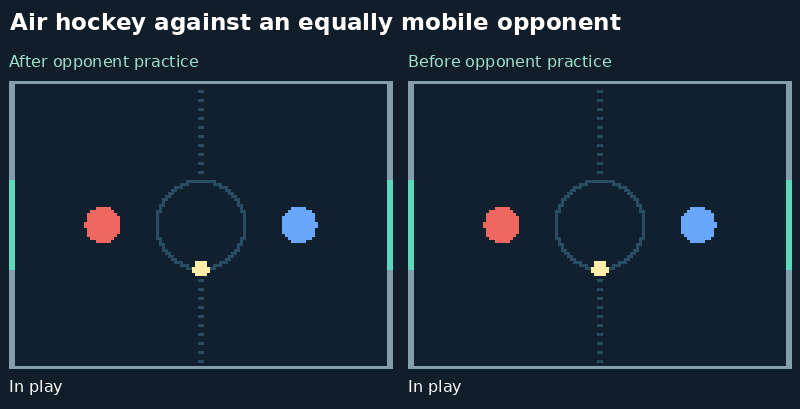
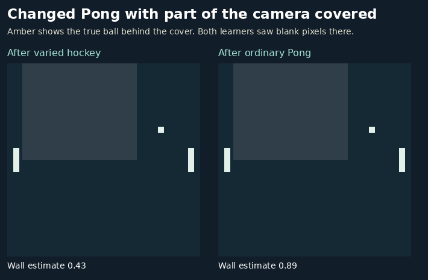
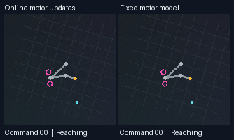

# Air hockey, changed Pong and the arm camera

This pass tests three distinct capabilities. Playing air hockey requires defending and scoring against a moving opponent. Cross-game transfer requires a difference in the receiving game on new starts. Motor adaptation on the arm requires a physical hold under new sensing or actuation conditions. All experiments ran in simulation without backpropagation.

## The hockey player learned to score

The game runs at 60 camera frames per second. Each round has a puck, two circular mallets free to move in both axes on their own half, solid end walls with goal openings, and velocity-dependent contact impulses. The player sees colored RGB pixels and the public goal score. The starting scaffold supplies color tracking, table geometry, an interception controller and five candidate shot placements. Ordinary score after visually inferred contact trains a table of shot values for different approach and opponent positions. The agent receives no evaluator hit flags or puck velocities.

After 400 practice rounds, we froze the player and played 288 new starts against a moving defender. The schedule includes direct and banked attacks, fast banked attacks, and a neutral puck at the center. The parked mallet conceded 185 points. All scoreless timeouts count.

| Deployed policy | Goals scored | Goals after own contact | Goals where learner touched puck last | Goals conceded |
|---|--:|--:|--:|--:|
| Same player before hockey practice | 215 | 210 | 166 | 9 |
| Fixed center shot, with Pong wall estimate | 261 | 258 | 202 | 4 |
| After hockey practice | **269** | **267** | **228** | 5 |

Practice improved last-touch goals by 21.5 percentage points against its starting state [paired 95% interval 14.6, 28.5] and 9.0 points against the fixed-center policy [3.1, 15.3]. Opening saves remained essentially unchanged. Practice mainly affected how shots finished.

In 16 first-to-seven matches per opponent, the deployed player swept both the training-style laneguard and a second tracking guard. Goals were 112–0 and 112–1, respectively. All starts were neutral moving center-line faceoffs. The pre-practice and fixed-center agents also swept both opponents. Against the second guard the fixed-center player finished its matches sooner. Wins alone conceal substantial competence in the common controller before hockey training.

A stronger test gave both sides the same movement speed, RGB camera and controller family. We swapped sides on 48 new faceoffs. The laneguard-trained player scored 8 goals and conceded 22 against the untrained shot policy, with 66 timeouts. Against fixed-center play it scored 5 and conceded 8, with 83 timeouts. Training on the scripted opponent left a real weakness against another mobile player.

We continued the carried learner through 360 practice points against equally mobile frozen opponents. It learned from public goals which of seven approach and shot choices to use. A deeper bank shot earned enough reward to be selected in all four visible contexts. On 192 new side-swapped points against the two rival policies it scored **40 and conceded 9**, compared with **14–22** before that practice and **16–12** for center shots. The paired net-goal gain per point was 0.203 [0.109, 0.297] versus the carried policy. All 40 goals followed at least one learner contact, with the opponent making the final touch on every goal. There were 143 timeouts. This is a repeatable scoring tactic against these rival policies. Direct finishing and converting more drawn points remain open.

The animation shows the earliest registered goal from that course, versus the same equally mobile opponent on the same faceoff. The adapted learner made seven contacts and scored on a deflection after 410 frames. Its carried counterpart timed out after 540.

[Offline match replay and checkpoints](../../artifacts/air-hockey-camera/README.md)

## What came from Pong?

During 64 real Pong points played by the archived controller, eight visually resolved wall collisions gave a fitted wall restitution of 0.969. The receiving hockey controller uses that value to extrapolate a bank. On ordinary banked serves, mean error in the predicted crossing was 0.011 table-width units with the learned estimate and 0.137 from a broad reset centered on 0.5. A supplied perfectly elastic wall model scored 0.008.

Across 800 disjoint, matched hockey starts, the Pong estimate yielded **567 last-touch goals**, versus 529 from the broad reset and 568 from the ideal elastic model. The paired advantage over the broad reset was 4.75 percentage points [1.63, 8.00]. Each policy saved exactly the same 441 openings. Experience supplied a useful physical estimate. A correct engineering default matched it.

In a separate test, Pong also learned the signs of hidden vertical motor commands in 32/32 streams. Carrying the sign into hockey avoided 16 wrong-way actions across the 32 starts. Fresh hockey learners corrected the sign in one informative movement and issued identical actions on all 96 subsequent points. The carried sign offered no demonstrated scoring gain.

## What came back to Pong?

We compared learners starting with the same Pong motor checkpoint, normal wall estimate and early actions. Some had also played air hockey on surfaces with different rebound speeds. During native Pong, a camera observer estimates how much of the ball’s perpendicular speed a wall preserves. The physics engine privately modifies this coefficient. It supplies no change flag.

In 16 clear-camera courses, hockey experience brought the first estimate revision forward in 13 compared with ordinary Pong practice alone and in 14 compared with equal extra ordinary Pong. First partial-bounce error averaged 0.165 after hockey versus 0.319 and 0.335, respectively. Extra Pong on **equally varied surfaces** reached 0.163. After a complete rebound, all active learners could read the new wall well. All four saved 120/128 first balls and won three points, with many timeouts. [Full clear-camera analysis](2026-11-20-air-hockey-pong-wall-transfer.md)

We then carried only **how quickly to revise an estimate**. From the next bounce in each source game we measured how well five candidate update rates predicted the observed trajectory. Varied hockey and equally varied Pong independently favored a rate of 0.90. Extra ordinary Pong favored 0.08. We discarded the source coefficients themselves. Every learner entered changed Pong with the same ordinary-Pong wall estimate. On a separate two-change course with a clear camera the fast learner tracked the physical change much more closely, while opening interceptions changed little. Direct observation can correct a paddle’s trajectory even when its earlier model was wrong.

For a partial-view test we covered the upper-left part of the camera and kept the paddles and lower wall visible. The simulator continued to run native Pong. Each course started with a visible lower-rail bank and included four upper-rail banks per stream. An estimate learned on the visible rail could now determine whether the paddle reached the unseen ball in time. These are four-second points with a narrower paddle, a fixed cover and two visible learning opportunities per course.

| Source of update rate | First hidden balls returned, run 1 | First hidden balls returned, independent run 2 |
|---|---:|---:|
| Varied air hockey | **225/256** | **222/256** |
| Extra ordinary Pong | 21/256 | 10/256 |
| Equally varied Pong | 225/256 | 189/256 |
| Fixed intermediate update rate, 0.45 | 146/256 | 119/256 |
| Always use the latest complete bounce, rate 1.0 | 229/256 | 226/256 |

Both runs tested hidden coefficients 0.41 and 0.73, each across 32 streams with four upper-rail openings. The second run used independently practiced source states and new target seeds. With a normal elastic wall, hockey practice saved 117/128 and 113/128, against 119/128 and 117/128 after extra ordinary Pong. Only the adaptation rate transferred in this comparison. Hockey and ordinary-Pong learners started each course with identical numerical beliefs. A lower-wall bounce informed their subsequent upper-wall play. In both runs varied hockey selected 0.90, extra ordinary Pong selected 0.08, and varied Pong selected 0.90 and 0.70. The fixed rate of 1.0 slightly exceeded the learned rate on opening interceptions in these covered conditions. Source gameplay provided one way to select a useful behavior without being told the future wall coefficients.

On covered openings on the changed walls the hockey-trained rate also gave 65 scoring wins against 20 from the ordinary-Pong rate in the first run, and 53 against 10 in replication. Intermediate gain yielded 90 and 66 wins despite fewer opening saves. Intercepting a difficult ball and converting it to a scoring shot remain different skills. These results do not establish a hockey-specific advantage over equally diverse physics experience.

The replay follows the first scheduled covered opening on the 0.41 wall. It reproduces both controllers' command counts, opportunities, returns, scores and learned numerical estimates. The amber ball behind the cover is available only in this evaluator overlay. The fast learner returned two balls and reached the time cap. The slow learner missed its opening. A higher update rate can also amplify image noise when the wall is stable.

A second candidate transferable skill was the relation between striker offset and outgoing angle. On ordinary Pong, carrying the hockey estimate improved a generic planner from 2/12 own-return wins to 7/12. The archived Pong scorer won 12/12. Against a faster opponent the hockey estimate won 2/12, tying its wrong-sign control, while the archived scorer won 6/12. Reciprocal Pong angle transfer into hockey failed to beat a wrong-sign control against either guard. The body and collision geometry matter when transferring shots.

## The arm relearned how actions move its camera image

A textured RGB image shows the three links, painted tip, two identical target rings and a reference. The controller uses the observed tip relative to the reference to suppress camera translation. Using only images and its own command history, it fits a local mapping from commands to image motion and compares four possible delays. A persistent prediction failure or lack of movement can trigger a new 14-command calibration. All calibration actions count. The hidden change combines camera rotation and translation with altered channel directions, coupling, gain, speed caps and a one- to three-command delay.

| Over three reaches after an unannounced combined change | Physical holds | Mean capped commands |
|---|---:|---:|
| Keep the old calibration fixed | 34/192 | 87.22 |
| Start over every reach | 192/192 | 39.81 |
| Detect discrepancies and carry the learned calibration | **191/192** | **31.08** |
| Tell the learner exactly when to reset, then carry calibration | 192/192 | 29.56 |

On the first changed reach, adaptation took 43.36 commands versus 38.36 for fresh calibration, including the time spent detecting a problem. On the next two reaches the adaptive arm held 128/128 targets at 24.95 commands against 40.54 when starting over. Across the course it saved 8.73 commands per reach [7.72, 9.72] versus starting over and used 938 calibration commands versus 2,842. On a stable camera and drive, adaptive and fixed averaged the same 16.89 capped commands for the first reach. Separate camera-only and drive-only tests each reached 96/96 with adaptation.

With four carriage practice reaches and fresh arm motors, a separately learned near/far preference produced 63/64 paying first holds versus 37/64 with reset or masked source reward. Carry completed all 64 first reaches and saved an average 10.52 commands [6.28, 15.06] relative to reset, which finished 61. Source practice cost 63.38 carriage commands per stream. [Watch the RGB reward-transfer trial](assets/2026-11-20-rgb-arm-reward-transfer.webp)

## A moved RGB camera and a previously acquired goal

We loaded the 64 archived five-coefficient visual reward models from the carriage experiment. Within each stream, the scoring rule stayed the same while the task moved to a three-joint arm on a new layout. The camera sees two similar pink targets, the tip and a reference. The rule can favor a direction or a quadratic combination of directions relative to the reference. A camera rotation can therefore make a good but uncorrected model systematically select the wrong point. No target labels from the arm were used to adjust these weights.

Three fixed, color-coded marks visible in a source registration exposure and the current RGB view supplied point correspondences. A fitted affine transform mapped candidate offsets into the old camera coordinates. Known colors and marker matching are supplied. Registration takes one view and zero motor probes. All comparison arms controlled a new body from visible tip displacement, with a fresh online motor model. Every command, held position, wrong trip and camera dropout counted. The evaluator privately verified four continuous physical ticks inside the target.

| First reach, 64 independent rules and starts | Paying marker was first physical hold | Mean arm commands to reward | Finished |
|---|---:|---:|---:|
| Carried preference, current registration | **56/64** | **24.06** | 64/64 |
| Same preference, stale camera registration | 34/64 | 29.27 | 64/64 |
| Fresh preference, current registration | 34/64 | 30.72 | 64/64 |
| Shuffled source feedback, current registration | 33/64 | 30.70 | 64/64 |

Current registration saved 5.20 commands relative to stale [paired 95% interval 2.03, 8.97] and 6.66 against fresh [2.72, 10.78]. With the camera left in place, stale and updated registration tied at 57/64 and 1,584 total actions. Earlier engineering runs refined optical scale and segmentation. The figures above use new target layouts after the renderer was frozen. This test presumes identifiable landmarks, a planar scene and roughly affine image motion. The learned component comes from actual carriage reward experience and online motor identification. The color detector is hand written.

[Previous carriage weights and source practice](../../artifacts/body-transfer/README.md)

## Research context

The Robot Air Hockey Challenge separates defending, striking and preparing the puck from tournament play. We use both individual points and first-to-seven matches to measure interception and scoring independently. Our two-dimensional game is purpose-built and uses its own dynamics. Image-based visual servoing motivates measuring motor adaptation using camera displacement while scoring endpoint success independently in world coordinates. [Robot Air Hockey Challenge](https://proceedings.neurips.cc/paper_files/paper/2024/file/12ba5de27afcff1a5c796de4a6392154-Paper-Datasets_and_Benchmarks_Track.pdf) · [Chaumette and Hutchinson, Visual Servo Control](https://faculty.cc.gatech.edu/~seth/ResPages/pdfs/ChaHut06.pdf)

[Research plan](../plans/2026-11-20-air-hockey-and-camera.md)
