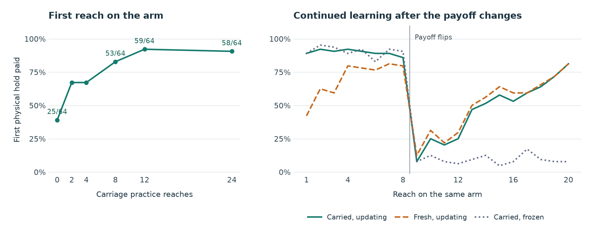
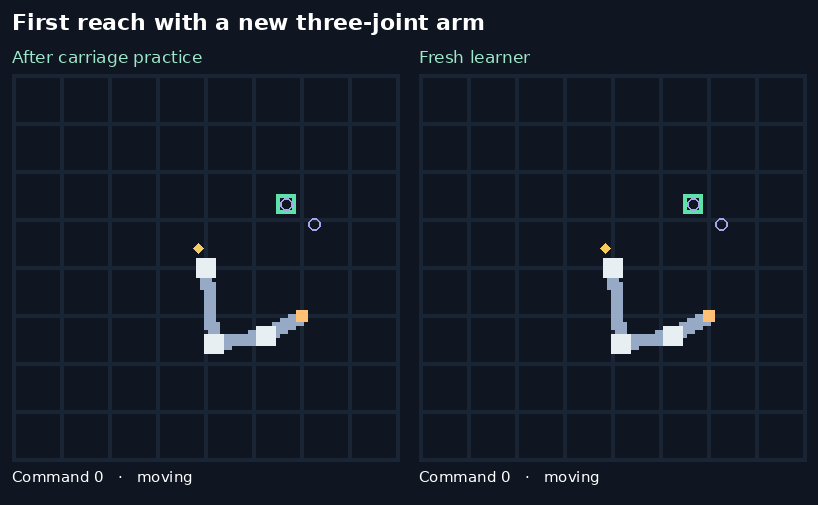
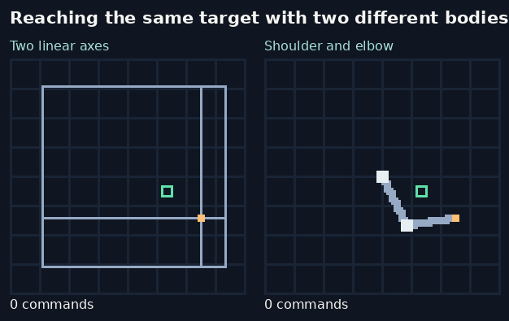

# What transfers from a carriage to an arm?

The source body is an XY carriage with two linear actuators. The receiving bodies include a two-joint arm driven by velocity commands and a three-joint arm driven by relative position commands. Independent streams practice on the source and then meet the target hardware in simulation. Every reported reach requires physically holding a target for four consecutive ticks. Each command, including exploration, consumes one 40 ms tick. Each reach has a 96-tick horizon.

These experiments introduce a non-backpropagating controller for this research question. It does not load Pong or Breakout weights. The body learner fits the consequences of its actions online with recursive least squares. It acts from observed marker motion and goal error. The scorer can inspect true joint configurations and contacts after play. The policy receives marker images with designated tip, candidate and reference channels, along with ordinary scalar reward in the reward-transfer runs. The high-level controllers know the action-space dimension, and their motor estimates start fresh when the action dimension changes. Candidate identification and a reaching primitive are supplied.

## What carried when we removed the near/far labels?

Each independent stream has a hidden visual payoff rule. In half the streams a linear projection favors one direction in the image. In the other half a rotated quadratic form determines which marker pays. The evaluator draws new coefficients for each stream. The learner sees two identical markers, a visible reference, its tip, and scalar reward. It computes five generic features of each candidate’s image offset from the reference (x, y, x², xy, y²) and learns to rank the pair by discounted least squares. The learner knows that exactly one marker pays. A physical hold worth zero can therefore supply evidence for the other candidate. It receives neither the rule family nor its coefficients.

After 24 source carriage reaches, only five learned coefficients cross to the three-joint arm. Each arm starts its own motor model from zero. Source and target use independent layouts with the same initial payoff rule. All four controls saw the same starting postures, marker layouts, tie choices, motor seed and rewards conditional on action.

| First reach on the new arm | Carried | Reset | Source rewards shuffled |
|---|---:|---:|---:|
| First chosen marker was the paying one | 59/64 | 28/64 | 35/64 |
| First physically held marker paid | 57/64 | 27/64 | 35/64 |
| Completed within 96 commands | 64/64 | 64/64 | 64/64 |
| Mean arm commands to reward | 22.59 | 31.34 | 29.16 |

Carry saved 8.75 arm commands relative to reset [5.66, 11.81] and 6.56 relative to shuffled source rewards [2.98, 10.05]. Both linear and quadratic families individually showed a first-reach command reduction. Over eight target reaches the carried learners made 467/512 correct initial choices versus 363/512 from reset. All intervals are paired bootstraps over independent task streams. This isolates knowledge about which visible goal to pursue while allowing each receiving body to discover its own actuators.

The payoff inverted silently on reach nine, with no reset of utility or motor state. The carried learner picked correctly on only 5/64 switch trials. Over the last four trials it reached 180/256 correct first choices while a frozen utility achieved 22/256. Reset-and-updating reached 182/256. Both updating controllers completed 1,280/1,280 reaches overall. The transferred controller eventually adapted, with a substantial initial cost when its knowledge became wrong. Over the full 20-reach target course, the carried arm saved 1,533 actual commands versus reset. The source practice across all streams cost 20,692 commands.

The left panel is an independent efficiency check on 64 new streams. Each practice dose uses an exact prefix of the same recorded source experience. The right panel shows first physical holds in the 64-stream primary test above. Contact metrics can differ from intended choice if the arm holds another candidate en route.

| Prior carriage reaches | Mean source commands | First hold paid on the arm | Arm completed | Mean capped arm commands |
|---:|---:|---:|---:|---:|
| 0 | 0.0 | 25/64 | 61/64 | 34.95 |
| 2 | 36.1 | 43/64 | 64/64 | 27.11 |
| 4 | 66.8 | 43/64 | 62/64 | 29.38 |
| 8 | 122.8 | 53/64 | 63/64 | 26.69 |
| 12 | 176.8 | 59/64 | 63/64 | 25.00 |
| 24 | 332.9 | 58/64 | 63/64 | 25.00 |

Doubling source practice from 12 to 24 yielded the same mean first-reach cost on these starts. Twelve is an observed point on this curve. The sample does not establish an optimum. A timeout used its full 96 commands and scored 97 on the capped comparison.

## Can the learner recognize when its prior has gone stale?

On 96 additional streams we gave the receiving learner a simple decision. After three consecutive strongly contradicted predictions, it can restart just the utility estimate and replay those three observations. Its motor model continues learning throughout. The detector and the ordinary adaptive baseline start from the same carriage-trained weights. Changes are unannounced, with eight unchanged trials followed by sixteen test trials.

| Course (32 streams each) | Streams that triggered after the boundary | First physical holds paid over the following 512 trials, detector / ordinary updates | Mean paired command savings per trial [95% interval] |
|---|---:|---:|---:|
| Stable payoff | 0/32 | 449 / 449 | 0.00 |
| Payoff inverted | 10/32 | 299 / 277 | 0.89 [0.37, 1.45] |
| Independently drawn replacement payoff | 7/32 | 374 / 370 | 0.14 [−0.13, 0.49] |

Both controllers completed all 2,304 target reaches. Across these streams the detector never reset before a change or on the stable course. When it fired after a change, its median delay was three reaches. The new random rules disagreed with the old rule on 45% of presented layouts. Gradual updates handled much of that change already, and the additional restart showed no clear aggregate advantage. This is useful evidence for selectively forgetting a broken expectation. Robust discovery of arbitrary changes remains open.

## A reward association survived a change in body

In the first task, two candidate markers look alike. A third visible marker serves as a reference. Each source world pays for holding either the candidate nearest to that reference or the one farthest away. Candidates and reference move to new positions on each trial. Four carriage trials teach a one-bit preference using ordinary score, zero until success. Only that preference transfers. All receiving motors, uncertainty and exploration state start equally fresh. A matched control replays the source experience with its rewards masked.

| New body, 64 independent streams each | First physical hold paid, carry | First physical hold paid, reset / masked | Mean commands on the first reach, carry / reset | Mean paired savings, 95% interval |
|---|---:|---:|---:|---:|
| Two-joint arm with rewired channels | 64/64 | 34/64 | 27.97 / 40.00 | 12.03 [7.34, 16.86] |
| Three-joint arm with relative position commands | 64/64 | 37/64 | 20.17 / 28.77 | 8.59 [5.63, 11.78] |

Both learners eventually succeeded on all 64 first reaches in each comparison. The practical benefit was avoiding an unrewarded trip with an unfamiliar arm. Source practice cost about 56 carriage commands per stream. It buys fewer interactions on the receiving arm, with a higher total interaction count on this short task. The camera uses a conservative five-tick dwell test to infer a failed choice from repeated zeros. In every case the evaluator verified a true hold, and no paying candidate was rejected. An earlier development run used an explicit held-contact event. Its separate receipt identifies it as a diagnostic.

After four target reaches, the payoff reverses with no advance signal. On the switch itself the carried learners first held the previously rewarded target on 63/64 two-joint starts and 62/64 three-joint starts. Every stream recovered within that trial. On the next layout they physically held the new paying target first on 63/64 and 64/64 starts, respectively. The same motor and reward learners continue across all eight receiving-body trials.

The replay shows the first registered three-joint stream (86400). The left arm earned reward after 26 commands. The right arm held the other target at command 26 and earned reward at 34. The purple rings mark the candidates and the gold diamond marks their reference. Arm geometry and trails are evaluator overlays. Both replay action sequences and contact records match the saved experiment.

## How much of a motor model transfers?

Each of 24 independent streams practiced 24 reaches per source body. The first reach on each new body measures immediate benefit. The same learner then continued on three further reaches. Every transferred controller had an independently paired fresh and frozen comparison. The frozen comparison disables updates and exploration, so it measures performance of direct reuse.

| Source → target | First-reach commands, carry / fresh | Mean paired saving [95% interval] | First holds, adaptive carry / fresh / frozen |
|---|---:|---:|---:|
| Carriage → two-joint arm | 19.83 / 21.54 | 1.71 [−0.17, 4.00] | 24 / 24 / 16 |
| Carriage → rewired arm | 27.71 / 32.71 | 5.00 [−1.54, 14.13] | 24 / 23 / 0 |
| Arm → same arm with changed actuator response | 21.54 / 28.83 | 7.29 [4.46, 11.75] | 24 / 24 / 24 |
| Arm → changed response and rewired controls | 28.12 / 32.71 | 4.58 [−1.33, 12.42] | 24 / 23 / 4 |

All 24 learners saved commands on the arm with altered actuator response while retaining channel correspondence. A different body was a harder transfer. By reaches two through four, carriage-to-arm carry and reset averaged 15.13 and 15.11 commands. The primary evaluation simulated 57,969 command steps in 5.26 seconds on the experiment host. The intervals use paired bootstrap resampling of independent streams.

In a second test each controller paid for the same four calibration pulses. A learned two-by-two mapping could align exchanged actuator channels with an existing arm model. Across two batches of 32 matched starts it saved 1.34 commands over fresh learning on the rewired arm [0.55, 2.13] and 1.45 [0.53, 3.06] on altered arm geometry. Directly using the prior on altered geometry was already 0.56 commands faster than adding the adapter. Applying that adapter to carriage-to-arm transfer yielded 0.06 [−0.08, 0.22]. The machinery helped where a reusable spatial motor map existed.

The right-hand arm follows the first held-out carriage-to-arm action sequence. The left illustrates the same carried state controlling a carriage on the same target.

## Did carriage practice teach a better exploration strategy?

We compared 16 exploration schedules on carriages with varied gains and channel orientations. The source-selected schedule used uncertainty to explore and omitted mandatory startup pulses. We froze the choice before running 64 new matched starts on each of three arm variants. Both it and the untrained uncertainty-based baseline completed 192/192 reaches. They averaged 25.65 and 25.58 commands, respectively. The paired saving was −0.07 [−0.45, 0.34]. Four fixed startup pulses cost about two additional commands. Source training consumed over 51,000 commands. There is no measured advantage here over the strong untrained strategy.

## Relevance to an eventual SO-101

The three-joint simulation varies initial posture behind the same endpoint image, limits joint travel and speed, and converts relative requests to joint-position setpoints using simulated encoders. The published SO-101 follower interface exposes joint positions and configured cameras, and accepts calibrated joint position targets. A future test should put source and target simulations behind that interface, measure the effect of camera jitter and actuator delay, and learn from the commands actually applied. Measure first-reach cost, sustained task success, recovery after an unannounced change, and how much prior practice is needed. Here the bodies are planar, the markers are segmented, and the reward and camera coordinate conventions are shared. Physical SO-101 performance is untested. [LeRobot SO-101](https://huggingface.co/docs/lerobot/so101) · [Follower implementation](https://github.com/huggingface/lerobot/blob/main/src/lerobot/robots/so_follower/so_follower.py)

Uncalibrated visual servoing provides a precedent for estimating control effects from image displacements. Cross-embodiment reward learning provides a precedent for testing a task representation separately from the actuators that realize it. The algorithms implemented here use incremental least squares and reward associations, without backpropagation or demonstrations. [Hosoda and Asada](https://doi.org/10.7210/jrsj.14.313) · [Cross-embodiment Inverse Reinforcement Learning](https://proceedings.mlr.press/v164/zakka22a.html)

[Experiment plan](../plans/2026-11-20-cross-body-transfer.md) · [Receipts, checkpoints and reproduction commands](../../artifacts/body-transfer/README.md)
