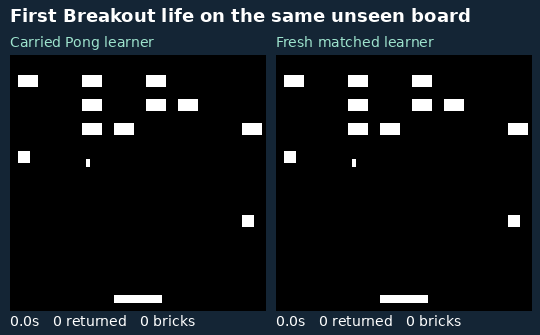
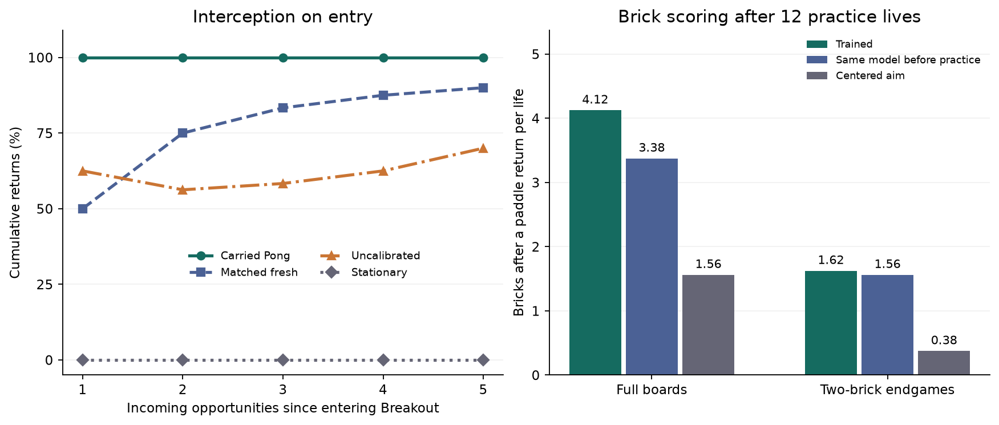
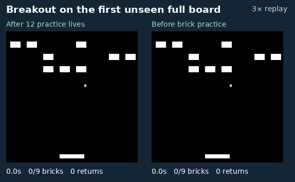

# What Pong experience carries into Breakout

The learner carried its interception skill into Breakout, learned to steer rebounds into bricks and kept scoring when switched back to Pong. The practiced rebound model cleared 12/12 unseen full boards. A single saved controller subsequently cleared a new board and won its next Pong point in one continued session. [Watch a full board](assets/2026-11-20-breakout-board-clearance.gif) · [Load the saved session](../../artifacts/m2/README.md)

The starting learner had played 96 Pong practice points and a 64-point course with changes to the controls and opponent. We loaded that exact saved state before showing it a Breakout frame. Both games use a 64×64 binary camera, three movement requests and the same paddle actuator. Breakout moves the paddle to the bottom of the screen, removes the opponent and adds destructible bricks. A life starts on a new board with the ball coming toward the player. All controllers use the same fixed visual tracker. All reported learning runs without backpropagation. [Source checkpoint](../../artifacts/m1b/2026-11-19-pong-after-mixed-course.json) · [Transfer plan](../plans/2026-11-20-pong-breakout-progression.md)

## Finding the paddle

With the camera turned 90°, 180° or 270°, the learner tried its buttons and looked for a rail that moved in response. It identified the correct rail on 72/72 unseen starts, in a median 0.333 seconds. Its first decision identified both the paddle and ball within two pixels on 65/72 starts. It returned 47/72 openings compared with 24/72 passive, then 44/47 later balls compared with 6/24 passive. Probing has a cost on the original orientation. The aligned prior returned 24/24 upright openings, while the learner that had to find the rail first returned 17/24. The adapter assumes a long thin paddle, a small moving ball and a quarter-turn geometry. [Role study and visibility audit](2026-11-20-rotated-pong-role-transfer.md)

## Entering an unseen game

Each of eight independent courses had 16 chronological lives on unfamiliar boards. Each opening required the paddle to move. The first-five column counts the first five actual opportunities of **each course**. A sustained rally requires three consecutive returns in one life. Time starts at course entry and includes earlier lost lives. Courses with no rally are charged the entire 160 seconds available. The table uses all 128 lives per arm for the last column. [Sealed protocol](../plans/2026-11-20-arcade-transfer-qualification.md)

| Starting state in ordinary Breakout | First ball of course | First five | Courses sustaining a rally | Mean game seconds to rally, capped | Returns across all lives |
|---|---:|---:|---:|---:|---:|
| Full Pong state, learning active | 8/8 | 40/40 | 8/8 | 9.65 | 324/341 |
| Pong motor and interception, score table cleared | 8/8 | 40/40 | 8/8 | 7.82 | 415/415 |
| Full Pong parameters frozen, role can align | 8/8 | 39/40 | 8/8 | 9.66 | 322/339 |
| Full Pong parameters and original orientation fixed | 0/8 | 0/40 | 0/8 | 160.00 | 0/128 |
| Matched fresh controller | 4/8 | 36/40 | 8/8 | 8.66 | 404/408 |
| Fresh controller that must estimate its own motion constants | 5/8 | 28/40 | 7/8 | 31.59 | 308/351 |
| Stationary paddle | 0/8 | 0/40 | 0/8 | 160.00 | 0/128 |

Pong experience prevented opening mistakes on four courses. The matched fresh controller started with the right direction on the other four and tied on all five opportunities. Full transfer therefore missed two original criteria. It needed to improve a majority of courses and sustain a rally sooner. Its acquired shot strategy also allowed more misses through ordinary play than the version with cleared shot scores. One measured trade-off was 446 bricks after an own return for full transfer versus 432 for motor and interception alone. Both versions saved their first ball on every course and the aligned frozen policy also did so. Early competence is evidence that an existing skill can be reused immediately once the objects are aligned. The fresh control retained the same family of numerical motion templates and could learn the missing motor and relation choices quickly.

A separate 48-life stress cohort changed button mapping, actuator timing, or both. On the first five opportunities per course, full transfer returned 4/20, motor and interception returned 6/20, and matched fresh returned 10/20. Their return counts over all 48 lives were 38/77, 47/83 and 46/82, respectively. The full learner sustained a rally in two of four courses and fresh did so in three. Simultaneously changing game and controls is a harder transfer problem.

The replay uses the very first registered ordinary life and displays exactly the binary camera each learner received. Both regenerated request sequences matched their recorded hashes. The carried learner intercepted three balls, broke two bricks and played to the ten-second limit. Its paired fresh learner missed at 1.08 seconds.

The seven-arm comparison completed 1,232 lives and 357,093 camera decisions, representing 1.98 hours of game time in about 7.3 minutes on four CPU workers. The runner preserved failed lives and audited physics-equivalent openings across every paired arm. [Blind results and source hashes](2026-11-20-breakout-blind-transfer.md)

### Why the changed controls fooled the learner

We replayed one difficult stress course where the learner started missing immediately. The unmodified run reproduced all 12 action sequences and state hashes. After one short, scoreless life, it reversed its belief about which direction to chase the incoming ball and kept that reversal for the remaining eleven lives. Holding only that direction fixed between lives raised the total from 2 to 13 returns and rescued the first ball in five lives, while losing two openings the original had saved. In the original, both visible roles were localized to within two pixels on all 108 sampled pre-contact decisions. The active button order was wrong on six of the ten missed openings. This selected course gives a concrete hypothesis for future work: use observed movement to diagnose the buttons and timing before changing a previously successful pursuit relation. [Exact replay, reachability and intervention](2026-11-20-breakout-stress-diagnostic.md)

### Reusing Pong offense only when its target is visible

For a new sealed comparison, we kept the whole Pong checkpoint but enabled its offensive contact offset only when the camera could see a moving opposite rail and a distinct third track. Everywhere else, the controller continued interception and timing. Across eight new six-life Breakout courses the carried learner returned 40/40 early opportunities and **153/153 overall**. Its Pong shot values and pursuit memory were unchanged from entry. When tested back in Pong, the gate applied a nonzero offensive offset on 88 frames in three ordinary starts.

Each physical course also ran two same-family reset copies, one per possible starting direction. They returned 21/40 and 32/40 early opportunities, or 53/80 together, versus 40/40 carried. Equal-weighting the two reset copies per course gave a 33.75-point early advantage for carry, positive in all eight courses. Warm reached three consecutive returns in 8/8 courses and reset in 13/16 copies. Mean failure-capped time was 8.75 versus 18.25 game seconds, with substantial uncertainty over eight physical courses. The positive-direction reset alone attained all eight and took 8.72 seconds. Three censored negative-direction reset courses contributed to the pooled time difference. Unrestricted legacy carry returned 40/40 early opportunities too, yet took 14.66 seconds to sustain. Different placements alter how far the ball travels. Counts of missed balls and seconds to a third return measure different things. This follow-up uses new starts and a changed controller. The original fully carried test remains a failed rapid-transfer comparison. [Prespecified follow-up](../plans/2026-11-20-visual-placement-confirmation.md) · [Paired results and uncertainty](2026-11-20-visual-placement-confirmation.md)

## Learning to score against bricks

We tested two ways to use the carried interception skill. The reward-only learner estimated which contact offsets broke visible bricks. The second learner also watched the incoming and outgoing ball paths at its paddle. It used those observations to estimate how a contact offset changes the rebound angle. Both learners started with a geometry model that proposes visible rectangles as targets and reflects candidate trajectories off the walls. Each learned policy was compared with its own identical untrained geometry model on matched new boards. Only the evaluator received the true collision and brick identities.

| Frozen test on new boards | Practiced | Same model before practice | Centered aim |
|---|---:|---:|---:|
| Reward only, 16 ordinary full boards, 16 s limit | 82 bricks | 73 | 74 with raw pursuit, 27 with forecasting |
| Reward only, 32 more full boards, 12 s limit | 123 bricks | 112 | 120 with raw pursuit, 57 with forecasting |
| Visual rebound and reward, 12 full/sparse boards, 12 s limit | 36 bricks | 26 | 17 with forecasting |
| Visual rebound and reward, 32 more full/sparse boards, 12 s limit | 92 bricks | 79 | 31 with forecasting |

The reward-only learner played 20 practice lives. Its ordinary gain over the blank geometry model was 20 bricks across 48 held-out lives, and both arms made every return. Its gain over raw centered pursuit was smaller. In a separate cohort with twelve commands of hidden delay, the trained model scored 52 bricks versus 56 for its prior. Training on ordinary controls gave little evidence for better scoring under delay.

The visual rebound learner played 12 practice lives, totaling 124.44 seconds of game time. It observed 29 rebounds and received 27 shot-score updates. All 29 detections matched real paddle contacts on independent evaluation. On the 32-life confirmation it produced 17.06 post-return bricks per game minute versus 13.33 before practice and 4.94 for forecast-centered aim. It made 110/110 returns. Its paired advantage over its own prior was 0.41 bricks per life, with a 95% paired bootstrap interval of +0.06 to +0.78. The full boards accounted for 66 versus 54 bricks. On the two-brick endgames the totals were 26 versus 25. The large sparse-board gain in the initial scout did not repeat. This is a learned calibration from public motion and score. The code still supplies the candidate targets and ray geometry.

Four practice lives gave the visual learner seven observed rebounds. That intermediate model scored 33 bricks on 12 confirmation starts versus 31 before practice and 36 at the final endpoint. Its gain over the blank model remained uncertain. In a separate 16-life cohort with six commands of hidden lag, the final model scored 46 bricks versus 39 before practice and 29 centered, returning 57/57 balls. Its advantage over the prior was clearer per minute than per life. [Reward-only comparison](2026-11-20-breakout-brick-placement.md) · [Visual rebound receipts](../../artifacts/m2/2026-11-20-breakout-visual-rebound.zip) · [Frozen visual rebound state](../../artifacts/m2/2026-11-20-breakout-visual-rebound-checkpoint.json)

### Clearing complete boards

In a separate comparison, each of 12 unseen nine-brick boards allowed a 75-second life. The visual rebound model cleared **12/12** without a loss and returned 124/124 balls. The identical model before practice cleared 6/12 and lost its other six lives. Forecast-centered aim cleared 3/12 and timed out nine times. The trained model cleared every board in 22.8–46.5 game seconds. With a full 75-second charge for failures, mean time to clear was 31.58 seconds after practice, 56.65 before practice and 70.91 centered. The paired clearance gain over the untrained model was 50 percentage points, with a 95% paired bootstrap interval of +25 to +75 points.

The first scheduled board is shown at approximately 3× speed. Both learners received the same opening. Their later trajectories diverged because of the shots they took. Replaying from their frozen states reproduced both complete request hashes and every brick event. [Whole-board results and receipts](2026-11-20-breakout-clearance.md)

## Keeping both skills while switching games

The first alternating learner used the simpler score-only endpoint from 20 lives of practice. A normal end-of-life reset delivered a new camera image. Its shape rule recognized two opposite paddle rails or a rectangular target array, which selected an existing scoring memory. It received no game ID, layout seed, button map, collision count or schedule. The interception relation, motor estimates and timing could carry across games.

In each original course the learner missed the initial incoming Pong serve after probing for its paddle. It immediately inverted its pursuit relation. With a single shared state on each 36-life course, ordinary and conflicting controls both yielded **zero returns in either game**. Separate Breakout-only continuations returned 108/109 and 108/110 on those same starts. A diagnostic replay showed that providing the correct rail on the first frame saved both opening Pong serves. We kept all of these runs.

The revised controller asks what the camera actually supports before changing a previously successful relation. It looks for a sustained button request followed by visible paddle movement in the expected motor direction. If that movement took it away from both the ball and its projected crossing, a scoreless natural end can count against pursuit. A source-trained relation requires evidence from two such lives to change. The paddle and ball tracks, actuator map and delay must be stable during the observation. In an independent eight-life counterexample we intentionally reversed the saved pursuit direction and kept the correct actuator mapping. The revisable learner corrected itself after two observed failures, saved the next six openings, and returned 20 balls. The matched learner locked to the wrong starting sign returned zero. [Independent recovery receipts](../../artifacts/m2/2026-11-20-arcade-pursuit-revision.zip)

We then paired all three arms on new starts, using the same visual-rebound checkpoint and the same recall settings in each comparison. Every course alternated six Pong points with six Breakout lives three times, for five switches. The ordinary course used matching controls. In the conflicting course Breakout reversed the buttons and delayed requests by six camera commands, while Pong kept its original controls. On that course the learner could retrieve a previously verified motor/timing belief when the same visual scene returned. Every retrieved belief remained open to updates from new observations.

| Re-entry blocks | Guarded Pong returns | Guarded Breakout returns | Scores on re-entry | Isolated reference, Pong / Breakout |
|---|---:|---:|---|---|
| Ordinary controls | 13/14 | 77/79 | 9 Pong wins after a return, 64 bricks | 13/14 and 78/80 |
| Conflicting controls | 21/21 | 82/82 | 9 Pong wins after a return, 80 bricks | 21/21 and 82/82 |

Both courses met the prospective retention criteria. Across the opening five opportunities in each of the two re-entry blocks per game, the guarded learner saved 9/10 Pong and 10/10 Breakout on ordinary controls, then 10/10 in each game on conflicting controls. The otherwise matched learner with the old direction-update rule saved only 1/12 Pong and 0/12 Breakout across conflicting re-entry blocks and scored zero in both games. The conflicting isolated and mixed guarded decisions matched on 35/36 lives, including every re-entry life. These are paired observations on two 36-life courses. They establish that a single continuously updated state can retain both skills under the tested switches.

During the conflicting course, the Pong shot table gained 15 visits, the brick model gained 104 observed-rebound updates and 100 score updates, and the shared controller retained its pursuit direction. The updates continued on the corresponding game lives. Finally, we loaded the saved ordinary mixed controller, gave it a new full board, and then switched it to a Pong point. It cleared all nine bricks in 35.65 seconds with 11/11 returns, then won the next Pong point after a return in 3.56 seconds. Independent reloads produced identical action and state hashes on both lives. [Alternation results](2026-11-20-arcade-alternation-results.md) · [Load the continued controller](../../artifacts/m2/README.md)

## Next milestones

1. **Learn which visible changes earn reward.** The current program proposes rectangles as brick targets and uses a hand-written rule to distinguish opposing rails from target arrays. Keep the qualified motor and rebound skills, put two banks of targets on the same board, and silently change which bank pays. A learner that discovers the objective should redirect its shots after observing the score consequences and remember the previous rule when it returns. Compare shots and rewards per opportunity against the frozen former objective on unseen layouts.
2. **Separate changes in controls from changes in appearance.** The mixed course lets scene geometry predict which motor map to recall. Randomize mapping and delay independently of appearance, including changes within a life. Measure how many errors and camera frames the learner needs to detect a stale prior, and whether it still scores after recovering. Models of sensorimotor context that weight predictions by how well they match the observed movement give a concrete alternative to fixed visual scene selection. [Haruno, Wolpert and Kawato](https://pubmed.ncbi.nlm.nih.gov/11570996/)
3. **Test a different implementation of Breakout.** Change resolution, palette, paddle size and bounce characteristics, then test an emulator version with its additional serve and life mechanics. Freeze the learned state before first exposure and compare its first returns and brick yield with a matched reset. The current evidence is for two closely related custom camera environments with shared paddle physics.
