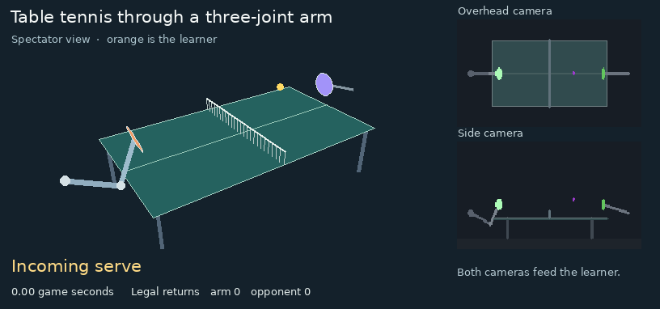
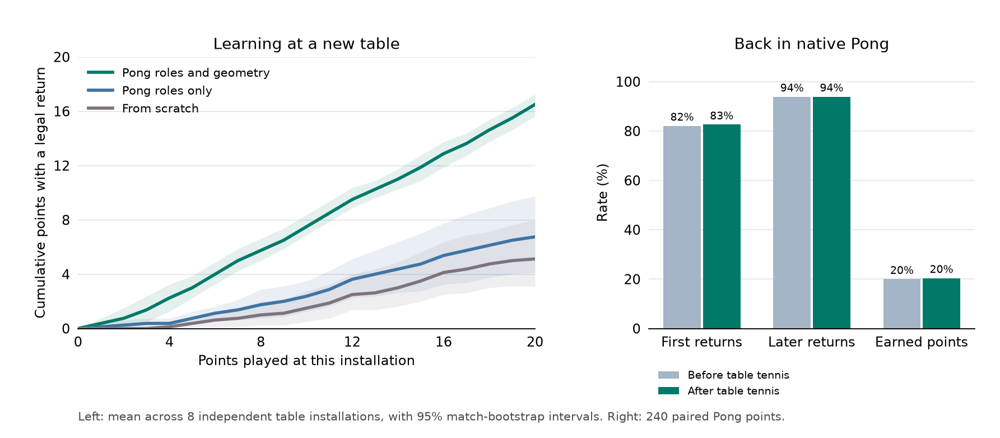
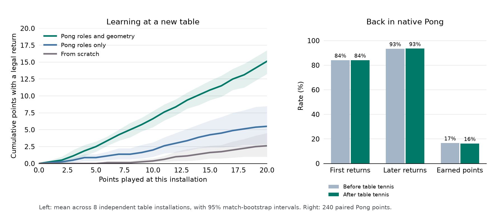

# What Pong experience taught a three-joint table-tennis arm

A player trained on native Pong landed **132 of 160** opening returns against a semi-random 3D opponent. A player learning the entire controller at the table landed **41 of 160**. All eight Pong-trained players made a legal return within five points. The median was **point three**, versus **point eight** from scratch. The arm started each course without knowing how its new actuators moved its racket.

This recorded example comes from the **first receiving point** of the fifth course. The arm probed its joints, landed the incoming ball, returned the opponent's reply and won the point. It used 198 simulation frames. It is a selected success from the measured cohort. The animated perspective is for the spectator. The two small cameras are what the learner saw. [Verified winning action tape](../../artifacts/tt3/discovered-winning-rally.json.gz) · [A separate rally from a full legal serve](assets/2026-11-21-table-tennis-full-serve.webp)

## Removing the scoring cue and the instructed bounce rule

The final source learned to find candidate interactions from actual Pong score times. Every anonymous track had the same ten generic measurements, including motion change, appearance change, disappearance, edge proximity and distance to the nearest other track. A derivative-free fit learned which combination predicted a score. The fit never received the name or identity of the scoring object and never received the older hand-selected witness. In 20 fresh score windows and 80 neutral windows, its AUC was 0.999. Its assignments agreed with the old cue on all 20 score windows. The three-way 24-point table comparison showed that shuffled attribution could also support returns, so it does not establish an independent performance advantage of this classifier. [Reward attribution experiment](2026-11-21-pong-reward-time-roles.md)

Using those newly learned roles, the source learned numerical spatial preferences in 1,200 native Pong points. It then screened and refined its candidates on 584 further native points. Only ordinary public point score selected the final spatial policy. The receiving game used the fitted attribution model to update roles, a fresh motor estimator, unrestricted candidate meeting times, and a secondary visual-continuation timing objective. Across each course the learner kept its state and paid for its probes, misses and points. No backpropagation, external demonstration, explicit object identity or score-to-object lookup was used.

| Eight new table courses, 20 points each | Legal openings in first 8 | Legal openings in last 12 | Legal openings overall | Points with ≥2 legal arm returns | Points won |
|---|---:|---:|---:|---:|---:|
| Complete Pong experience | 46/64 | 86/96 | 132/160 | 10 | 23 |
| Pong visual roles, fresh geometry | 14/64 | 40/96 | 54/160 | 7 | 11 |
| Only the source reward-attribution model | 10/64 | 39/96 | 49/160 | 7 | 11 |
| Everything learned at the table | 8/64 | 33/96 | 41/160 | 4 | 8 |

The frozen Pong source retained four score-ranked proposals. The two fresh-geometry controls started with six independently sampled proposals. This intervention tests the learned proposals and their outcome evidence together. The first successful point typically ended by 3.55 simulated seconds for the trained arm and 7.09 for the fully fresh arm. Actual landing occurred earlier within that point. The first-eight advantage over the fully fresh arm was 59.4 percentage points (95% paired match-bootstrap interval 40.6–78.1). The trained arm used 160 explicit probe frames, versus 740 for the fully fresh arm. All four conditions and all 640 physical points took 103 wall-clock seconds on three workers. The 160-point trained trajectory set took 95 CPU seconds. The arm still converted just 12 further legal shots after the rival landed 54 replies. Scoring and sustained returns remain much weaker than opening interception. [Final schedules, controller states, and matches](../../artifacts/tt3/discovered-cycle.json.gz)

The state that emerged from the first prespecified 20-point course returned directly to native Pong. On 240 identical starting points, it saved **165/201 → 166/201 first balls**, **246/262 → 247/263 later balls**, and earned **48 → 49** points after its own return. All three passed the predefined retention test. Of the 240 Pong action sequences, 110 changed. The remembered one-dimensional policy preference stayed in place while updated visual evidence changed executed behavior. The paired 95% match-bootstrap intervals for the changes were [0.0, +1.6], [−2.0, +2.0], and [−2.5, +3.3] percentage points. The estimates support retention. The uncertainty intervals allow little or no change. During that same table course the arm landed 21 legal returns and won three points.

The complete point-boundary arm checkpoint was restored on the next serve. Every command, contact, landing and score matched the uninterrupted player. It includes the learned local camera associations, the 512-cell body map, the motor regression, the timing and payoffs, and random generator states. [Restorable arm checkpoint](../../artifacts/tt3/three-joint-player.json.gz)

The restored player continued the **same course through 64 table points**. It landed openings on **52/64**, made **13** further legal shots across 31 legal rival replies, sustained **11** points, and won **13**. Back on the same 240 native Pong points, first saves were 166/201, later saves 247/264 and earned points 47. Against the original rates of 82.1%, 93.9% and 20.0%, the longer continuation scored 82.6%, 93.6% and 19.6%. It passed all three retention criteria again. This addresses the longer-practice failure in the single-utility baseline. [64-point continuation and paired Pong results](../../artifacts/tt3/discovered-long-cycle.json.gz)

## Earlier numeric cycle with the supplied scoring cue

The refined visual policy landed legal returns on **121/160** points across eight new seeded courses and appearances. It sustained **21** rallies, made **23** additional legal returns after the opening, and won **13** points. The control with the same Pong visual roles and fresh geometry landed **44/160**, sustained seven rallies and won four points. The control with fresh roles and geometry landed **21/160**, sustained two rallies and won two points. All eight trained arms recorded a first legal return by point five. Their time series include every miss. Points 9–20 produced 81/96 legal openings for the trained player, 33/96 with only the roles and 20/96 from scratch.

This cycle combined a numerical spatial policy selected on additional **Pong-only** score trials, fresh arm identification, body-conditioned outcome estimates, and online learning over earlier or later meeting positions. It allowed camera meeting times on both sides of a predicted bounce within a 1–50-frame grid and a band around the starting depth. The timing learner received ordinary score and a small repertoire of candidate delays, with a separate intrinsic signal for visible continuation. The numerical position preference had learned lateral and anticipation gains of 1.04 and 1.12 in its selected source proposal. The remaining 3D components, new body and joint effects were observed at the table.

The actual state from the first prespecified 20-point table course went back into **48 fresh matched native Pong installations, five points each**. It returned 164/195 first balls both times, 254/272 later balls before and 258/276 after, and earned 40 versus 39 points. The paired changes were 0.00 percentage points for first returns, +0.10 for later returns, and −0.42 for earned-point rate. All passed the original predefined noninferiority margins. Three legal arm returns and three opponent replies occurred in the actual course whose learned state went back into Pong. The rally reached the simulator's five-second point cap. [Complete cycle and comparison](../../artifacts/tt3/refined-unrestricted-cycle.json.gz) · [Watch that rally](assets/2026-11-21-table-tennis-numeric.webp)

## What transferred in the first four points

The numeric learner practiced ordinary Pong with randomly relabeled actions, rotated or reflected cameras, and a common foreground color. It learned which visual changes followed its own actions, which motions were associated with paid events, and numerical preferences over relative position and anticipated motion. At the table it received two registered RGB views, three bounded joint-rate controls and signed point rewards. A real contact, clearance over the net, and a landing on the opponent's half were required for a legal return. A semi-random physical opponent could return it again. The learner received no simulator coordinates, bounce flags, identities, annotations, trajectory examples, or contact bonuses in this comparison.

| Initial experience | First 8 points, legal opening | Last 6 points, legal opening | Whole course | Points won |
|---|---:|---:|---:|---:|
| Learned roles and learned numeric geometry | 46/80 | 44/60 | 90/140 | 18 |
| Learned roles, fresh numeric geometry | 16/80 | 25/60 | 41/140 | 14 |
| Fresh roles and geometry | 0/80 | 4/60 | 4/140 | 0 |
| Learned roles, reversed geometric gains | 0/80 | 0/60 | 0/140 | 0 |
| Learned roles, hand-set linear extrapolation | 57/80 | 49/60 | 106/140 | 13 |

These were whole courses with the same 10 schedules across conditions. The controls got the same motor learner, camera registration, online learning and point boundaries. The table kept its appearance during each match. The learned player's median first successful point was three. Median elapsed game time through the end of that point was 3.38 seconds, which includes probing and preceding misses. Across ten match clusters, taking out learned geometry reduced first-eight return yield by 37.5 percentage points (paired bootstrap 95% interval 25–50). The engineered extrapolator was a strong benchmark. The trained player's 90 opening returns yielded 40 legal opponent replies and zero legal second returns on this particular schedule. Opening play and sustained play required separate work. [Full schedules and matched points](../../artifacts/tt3/numeric-qualification.json.gz)

A separate camera-only route fitted numerical behavior to trajectory surprises near the action-contingent track in native Pong. With signs and positions intact, it produced a legal return on 10/16 fresh table points, including one sustained exchange and two wins. Shuffling corresponding source event positions produced 0/16. Its short native Pong recheck was weak, so this experiment establishes what predictive information those events contain. [Optical fit and controls](2026-11-21-pong-optical-event-fit.md)

## Returning an opponent's reply

In the original stroke, the dominant failure was a hard rising reply. An evaluator reconstructed eight legal incoming replies and found that all entered the arm's workspace. The player touched six and drove all six long. That led to two different fixes.

* **Changing the meeting position.** The player can predict motion from pixels, infer repeated reversal surfaces, estimate its reachable locations from joint commands, and compare meeting times. On eight identical opponent launches with identical preceding commands, meeting deeper converted four legal second shots and produced a third shot. Meeting at the original position converted zero. With online timing values fitted from six 16-point practice games, the learned choice produced five repeated legal exchanges in 48 new points, versus one with neutral timing. It won three points versus six. Its training objective gave credit for a visible near-to-far continuation and a smaller weight to ordinary score. This intrinsic credit can fire on a shot that ultimately lands out. [Identical-launch replay](../../artifacts/tt3/recovery-same-openings.json.gz) · [Learned timing and fresh controls](../../artifacts/tt3/recovery-learned.json.gz)
* **Changing racket velocity at contact.** A trial that used only ordinary point score selected a small cushioning movement. It produced a legal second return on a new schedule and tied the baseline at one point won in 36. One exact matched launch changed outgoing depth speed from 3.99 to 2.25 m/s and converted a long ball into a legal shot. [Point-score trial](../../artifacts/tt3/active-stroke-score-selected.json.gz)

The first timing study supplied a rule restricting proposed meeting times to after an observed or predicted rebound. Removing that restriction still allowed repeated legal play. In a short independent study, 56 practice points selected neutral timing. On the next 28 points it produced two repeated exchanges and three wins. A fixed deeper timing produced four repeated exchanges and three wins. [Unrestricted candidate times](../../artifacts/tt3/recovery-unrestricted.json.gz)

## Returning to the original game

A single shared score for a movement preference can cause interference. In the original numeric learner, the exact state after a 14-point table match improved native Pong returns. A separate 48-point match drove the same learner toward a different preference and reduced later native Pong returns from 115/159 to 80/134. Restoring just the score preferences in a diagnostic recovered 114/158, pinpointing the problem. [Paired native checks, controls, and reproduction](2026-11-21-numeric-pong-retention.md)

The body-conditioned learner kept both a shared score estimate and estimates grouped by the number of independent movement directions its commands produced on camera. Source evidence still guides an unfamiliar body. A table stroke can acquire its own value after the new body responds differently. In the six-relation experiment, all 54 points in the continued path updated the model. The arm won five of 40 held-out table points, landed 24 legal returns, and sustained two rallies. The player then returned to the original 36 native Pong matches with the actual updated role and utility state.

| Native Pong, same 180 points | Before the arm | After the arm | Paired change, 95% match interval |
|---|---:|---:|---:|
| First returns | 122/160 | 122/160 | 0.0 pp [−1.9, +1.9] |
| Later returns | 172/183 | 167/180 | −1.2 pp [−3.0, +0.0] |
| Points earned after its own return | 35/180 | 38/180 | +1.7 pp [−0.6, +3.9] |

All three passed the predefined noninferiority test. The point estimate for later returns dipped slightly. Forty-three action sequences and nine point outcomes changed. The six predefined movement relations are a stronger programmer prior than the numerical search above. With this same body-conditioning approach and zero table practice, the trained player made a legal return on 16 of the first 24 points in fresh courses. The roles-only control made 9 and the fully fresh control made zero. When all three received the same independently score-selected stroke, those counts were 19, 14 and 1. That stroke cost six candidates × 14 real points, 84 total. [Actual post-practice checkpoint](../../artifacts/tt3/pong-post-table-body-conditioned.json) · [Retention test](../../artifacts/tt3/pong-retention-body-conditioned.json.gz) · [432-point matched comparison](../../artifacts/tt3/body-conditioned-transfer.json.gz)

## How much help the learner got

* **Built in.** Connected regions, correspondence between two orthographic cameras, short-term trajectory fitting, motor regression, hypotheses about controllability and motion relevance, a family of geometric target functions, bounded probes and a point-reset signal. The original role learner uses an engineered cue for a visible object disappearing or clipping at the edge when a native Pong score occurs. The numeric target family includes a predicted meeting plane. It can learn to ignore, follow or move away from a track, but it cannot invent an arbitrary objective outside that family. The arm and native paddle have different motor executors. The signed placement bias is local to its original visual basis.
* **Learned.** Weights for anonymous motion tracks, relative spatial and velocity gains, evidence for alternatives from actual point scores, action-to-motion maps from visible joint effects, scene-local reidentification, estimates of recurring visual acceleration and reversals, and some receiving stroke/timing preferences. No backpropagation was used. The state passed from Pong contains numerical estimates. The successful arm identity and the relevant moving track are rediscovered from the new scene. Learned scene colors remain local to a match.
* **Physical setting.** This is simulation. An articulated arm controls racket width, depth and height. The standard wrist linkage stabilizes its face. Physics uses gravity, a table, a net and moving rigid-face collisions at 240 Hz. The two 60 Hz cameras are registered, flat-color and unobstructed. The arm starts each point back in a repeatable pose. The standard opening starts with a ball in flight. In the alternate full-serve setting a 24-frame preparation interval precedes a physical two-bounce serve. On the 72 full-serve points, the numeric player returned 38, versus 22 from scratch, and won six versus five. A programmed extrapolator returned 51 and won six. [Full-serve benchmark](../../artifacts/tt3/full-table-serve.json.gz)
* **Fragility.** On 48 deliberately split high/low serves, learned visual flight estimates landed 10 returns, ordinary local estimates landed seven, and fixing the requested height landed zero. A faster moving distractor remained a problem. On target exploration, a probe rhythm learned in Pong saved no probe commands and bound the arm 3.1 frames later on average than independent random probes. Fast transfer of interception is better established than a general improvement in exploration. Adding a fourth rate-controlled wrist with shuffled channel order identified the visually redundant channel, but reward-only wrist exploration yielded 11 point wins in 96, the same as leaving it still. [Height intervention](../../artifacts/tt3/table-height.json.gz) · [Distractor and role tests](../../artifacts/tt3/visual-roles.json) · [Probe comparison](../../artifacts/tt3/exploration.json.gz) · [Fourth actuator](../../artifacts/tt3/wrist-novel-actuator.json.gz)

## Changing the objective and the earlier button experiment

With ordinary winning and losing reversed, both the updating and locked players could get the maximum reversed score simply by losing. A more informative test paid a terminal scalar for landing a legal return, then covertly flipped its sign. In the late phase, the updating learner met the new objective on 48/50 points versus 24/50 with frozen preferences. Holding or moving away became advantageous. The unchanged-payout control still landed 27/50. This demonstrates adjustment to a changed public objective within a supplied action family. Legal landing was explicitly defined as the payout only in this experiment. [Score reversal](../../artifacts/tt3/reward-score-reversal.json.gz) · [Landing reversal](../../artifacts/tt3/reward-landing-reversal.json.gz)

The earlier arm-operated Pong controller also ran with 3.6–5.2 mm switch travel and known 50 ms camera latency. It won 12/16 simulated matches versus 3/16 from fresh Pong experience. Removing delay compensation also gave 3/16. [Physical switch travel in simulation](2026-11-21-axial-travel-and-camera-latency.md)

Against a separate rally-practice partner, 102/109 legal shots from the geometric reference received a legal reply, compared with 88/119 for the standard rival. This partner placed the ball to both sides at a median longitudinal speed of 2.56 m/s. On 64 paired table points, the trained RGB player returned 47 openings and the fresh player six. The trained player touched 41/44 later legal replies but landed only three. Learning to time the opening is a much stronger result than mastering shot placement on a changing return. [Opponent and all points](../../artifacts/tt3/partner-robustness.json.gz)

The player in these experiments is a numerical research scaffold built in the Fly-Connectome repository. Native Pong supplies game physics. The RGB tracker, geometric proposals and motor fits supply the controller. These results concern that controller. Performance of the measured fly spiking network on this transfer remains untested. Source practice includes independent matched trials and population selection. At the receiving table the model updates chronologically within each course. The Pong retention assay uses the saved shared role and utility state and measures fresh identification of the native actuators in each paired match. This experiment does not establish an arbitrary-game learner from an uninterrupted, unstructured stream.

The preserved one-direction outcome profile is deliberate. The actor reidentifies the native action map when it returns, selects this profile from its observed motor response, and uses the role weights updated by the table experience. Scene-local colors, the 3D motor model, and the table timing state stay specific to that body.

The experiments draw on earlier work on learning controllable visual features and learning persistent object interactions across settings. The empirical comparisons here come from this repository's own simulators. [Contingency awareness in Atari](https://ojs.aaai.org/index.php/AAAI/article/view/8321) · [Schema Networks](https://proceedings.mlr.press/v70/kansky17a.html) · [Checkpoints and reproduction commands](../../artifacts/tt3/README.md)
