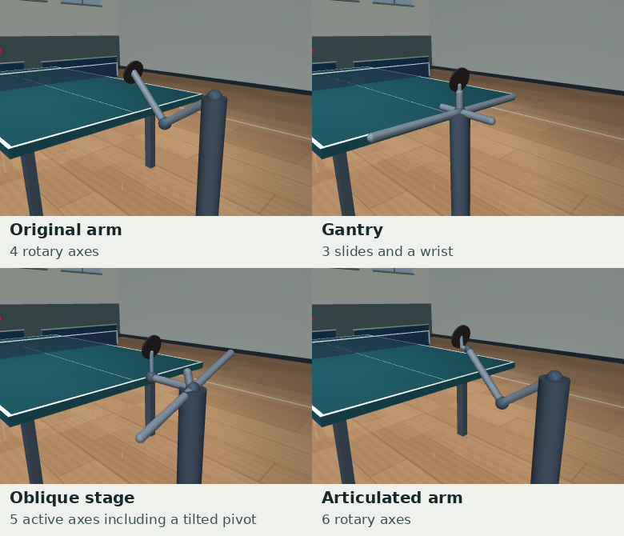
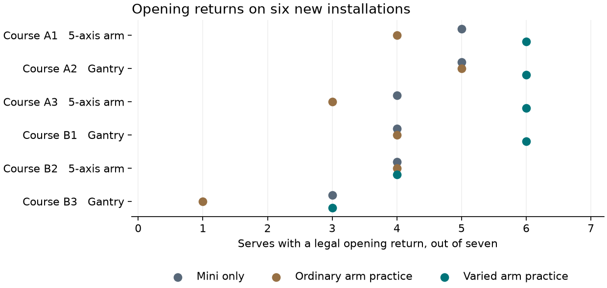

# What table-tennis practice carries to a changed arm

A player that had completed 42 points of varied hall practice landed a legal opening return on 31 of 42 **new** receiving points, compared with 25 of 42 for the same player entering from the mini-table checkpoint. Both players kept learning during the test. The practiced player also sustained 14 points against seven and landed 50 legal returns against 32. Six installations across two independently seeded courses changed the motor wiring, camera and ball starts. They used the same two physical arm families seen during practice. [Forward course A, practiced](../../artifacts/tt6/forward-experienced.json.gz) · [Course A, mini-only](../../artifacts/tt6/forward-cold.json.gz) · [Course B, practiced](../../artifacts/tt6/forward-repeat-experienced.json.gz) · [Course B, mini-only](../../artifacts/tt6/forward-repeat-cold.json.gz)

[Watch an actual first-person point with softer rubber, Gaussian command noise and two unannounced delay changes. The player lands two legal returns and wins.](../../artifacts/tt6/combined-rally.mp4)

## How much did remembering help?

The primary training sequence visited three installations twice. A new installation permitted up to eight 34-command camera probes. During play, rubber could soften between points, and actuation delay and noise could change mid-rally. The repeated seven-point schedule comprised two ordinary points, one with softer rubber, two with softer rubber and a changing delay, one with regular rubber and a changing delay, and a final ordinary point. In the combined condition the delay went from one to three frames and back to one at 30 Hz. Noise standard deviation changed from 2.5% to 6% to 3.5% of full command. The opponent always served. Each group saw the same serve and disturbance seeds. A point was capped after 140 control steps. An opening counts only after the learner's shot clears the net and lands legally on the opponent's side.

| Player on the 42-point sequence | Openings | Legal returns | Points with a second return | Wins–losses–capped | Probe episodes |
|---|---:|---:|---:|---:|---:|
| Continues learning across installations | 32 | 46 | 12 | 17–19–6 | 34 |
| Starts each installation over from the same mini donor | 22 | 29 | 7 | 15–23–4 | 48 |
| Remembers body maps, fixes stroke response and actuator timing | 24 | 42 | 18 | 9–17–16 | 34 |

On the 12 points combining all three disturbances, the carried learner returned 8/12 openings and won six. Restarting gave 4/12 and three wins. Fixing stroke and timing gave 2/12 and two wins. On easier points the fixed controller sometimes sustained longer exchanges. The carried learner recognized two returning body maps in one probe each, about 1.1 simulated seconds versus 9.1 seconds for eight full probes. It refitted the third. All 126 scored command tapes reproduced the applied commands and physical outcomes. A repeat of the carried course reproduced all 42 action hashes. Loading its fifth checkpoint reproduced all seven subsequent point records exactly. [Carried](../../artifacts/tt6/combined-carry.json.gz) · [Restarted](../../artifacts/tt6/combined-restart.json.gz) · [Fixed](../../artifacts/tt6/combined-frozen.json.gz) · [Load the player](../../artifacts/tt6/README.md)

On the two new courses both players paid exactly 21 probes per course and learned online throughout. Course A improved from 14/21 to 18/21 openings and from four to eight wins. Course B improved from 11/21 to 13/21 openings with five wins in both groups. Across both courses the practiced player finished 13–17 with 12 capped points, versus 9–32 with one capped for the mini-only player. The saved player can already transfer across installations when its earlier local motor maps have to be replaced. Six installations do not establish a general scaling law.

### Does the type of practice matter?

The ordinary-practice control played the **same 42 serves on the same arms with the same probe budget**. Only its racket, noise and latency conditions stayed ordinary. The random-stream control started from the mini donor and copied only the varied checkpoint's policy random-generator state. No test course reused practice starts. All four players learned throughout each evaluation. Results aggregate six new installations.

| Prior experience | First two openings at each new installation, out of 12 | All openings, out of 42 | Points with a second return | Legal returns | Combined-disturbance openings, out of 12 |
|---|---:|---:|---:|---:|---:|
| Varied hall practice | 11 | 31 | 14 | 50 | 9 |
| Equal ordinary hall practice | 7 | 21 | 10 | 36 | 5 |
| Mini only | 9 | 25 | 7 | 32 | 6 |
| Mini with matched random-generator state | 10 | 24 | 6 | 31 | 4 |

Varied practice helped early play at new stations, sustained returns and openings under simultaneous disturbances. All four groups required identical numbers of probes on these new wirings. This comparison tests the whole learned state. It does not isolate rebound, timing, and shot preference contributions individually. [Ordinary practice](../../artifacts/tt6/ordinary-practice.json.gz) · [Ordinary A](../../artifacts/tt6/forward-ordinary.json.gz) · [Ordinary B](../../artifacts/tt6/forward-repeat-ordinary.json.gz) · [Random-stream A](../../artifacts/tt6/forward-rng.json.gz) · [Random-stream B](../../artifacts/tt6/forward-repeat-rng.json.gz)

### Does more experience keep helping?

Each checkpoint below is a snapshot from the same chronological training trajectory. Each evaluation starts a fork at that checkpoint and plays the same 42 previously unseen serves. Evaluation experience is never fed back into training. The second 42 practice points used three additional, disjoint installations of the same arm families. All twelve installation visits form one continuous ledger.

| Prior varied hall points | Openings on 42 test starts | Total legal returns | Sustained points | Wins–losses–capped |
|---:|---:|---:|---:|---:|
| 0 | 25 | 32 | 7 | 9–32–1 |
| 21 | 28 | 40 | 10 | 10–25–7 |
| 42 | 31 | 50 | 14 | 13–17–12 |
| 84 | 27 | 38 | 9 | 12–23–7 |

The 84-point checkpoint retains seven camera-fitted motor maps and still exceeds the starting player on these four performance measures. It regresses from the 42-point checkpoint. The most recently adapted stroke speed rose from 0.073 to 0.096 metres per control frame between these snapshots, although the player faced the same six installations at test. This motivates distinguishing the most recent stroke on a particular arm from an initial stroke appropriate on an unfamiliar arm. [21-point checkpoint](../../artifacts/tt6/continual-player-21.json.gz) · [21-point A](../../artifacts/tt6/forward-half.json.gz) · [21-point B](../../artifacts/tt6/forward-repeat-half.json.gz) · [42 additional practice points](../../artifacts/tt6/additional-practice.json.gz) · [84-point checkpoint](../../artifacts/tt6/continual-player-84.json.gz) · [84-point A](../../artifacts/tt6/forward-extended.json.gz) · [84-point B](../../artifacts/tt6/forward-repeat-extended.json.gz)

One attempted remedy remembers the median commanded speed of visually observed opportunities that ended in a public win at each installation. It enters an unfamiliar arm at the median of those remembered values and continues to adapt. With all 84 points of experience this still returned 27/42 openings and landed 38 legal returns, exactly tying the recent-speed initializer on both measures. On a newly seeded 21-point course both returned 16 openings. The pooled initializer had 21 legal returns versus 24 for recent speed. Changing only the initial stroke speed did not recover the lost performance. [Learned entry memory](../../artifacts/tt6/stroke-entry-memory.json.gz) · [Matched course A](../../artifacts/tt6/forward-pooled.json.gz) · [Matched course B](../../artifacts/tt6/forward-repeat-pooled.json.gz) · [New course, pooled](../../artifacts/tt6/newcourse-pooled.json.gz) · [New course, recent](../../artifacts/tt6/newcourse-last.json.gz)

### Can it win a longer game with changes?

Two fresh installations played first to 11, win by two, with up to 420 control frames per point. Conditions were shuffled within each seven-serve block. The practiced player lost 9–11 on the gantry and 4–11 on the offset arm. Mini-only lost 7–11 and 2–11. All four games finished, with no capped points. Groups share identical starts and disturbances until one game ends. Their different lengths preclude a paired comparison of every subsequent return. Improving early interception has yet to produce reliable match wins under these changes. [Practiced games](../../artifacts/tt6/games-experienced.json.gz) · [Mini games](../../artifacts/tt6/games-mini.json.gz)

We also let the player update its next stroke while the rally was still in progress. Once the first shot appeared to leave the racket, a temporary estimate of the current rubber changed the next stroke speed from the observed outgoing flight. This won the first gantry game **11–9** and lost the offset game **7–11**. On two independent installations, the same change lost **0–11** and **8–11** versus **2–11** and **10–12** for the between-point reference. On the earlier 21 matched short starts it reduced openings from 18 to 15. The experiment remains available with `--rally-response`. Its advantage in the first game did not replicate. [First games](../../artifacts/tt6/games-rally.json.gz) · [Independent within-rally games](../../artifacts/tt6/games-confirm-within.json.gz) · [Independent reference games](../../artifacts/tt6/games-confirm-between.json.gz) · [Short starts](../../artifacts/tt6/forward-rally.json.gz)

## Which adaptations have direct evidence?

| Change | Intervention and observed effect |
|---|---|
| Different mechanisms | On the four-axis gantry and five-axis oblique stage, the visually fitted controller landed 27/28 openings across four separate installations. Reversing the learned motor signs produced zero contacts. Silencing the fifth joint reduced sustained points from six to three on the offset arm. Shared multi-arm practice and mini-only practice both returned 27/28. [Body trial](../../artifacts/tt6/body.md) |
| Returning motor wiring | The four-joint receiver compared camera motion against possible actuator permutations and signs during the serve. Across 24 revisits to changed wiring, remembering used 228 probe commands versus 376 for fresh identification, a 39% reduction. It returned 21 of those 24 openings versus 20. All probes consumed in-game time. [Three streams](../../artifacts/tt6/recall.json.gz) · [Native-renderer confirmation](../../artifacts/tt6/recall-native.json.gz) |
| Hidden motor delay | At two stations, delay jumped from zero to five frames (167 ms) and back. During the eight high-delay points the player that adjusted its stroke timing from camera evidence landed ten legal returns on six starts. Both fixed-timing controls lost all eight without a legal return. The two wins in this phase came at one station. On a milder four-frame course, learning improved returns and the fixed controller won more points. [Timing comparisons, noise schedules and replay](../../artifacts/tt6/timing.md) |
| Racket response | Learning from the observed outgoing arc recovered 21/21 openings through repeated rubber changes, versus 16/21 with a fixed stroke. On a harder 18-point station varied mini practice returned 13, ordinary mini practice 16 and a generic fast update 14. With longer optical reacquisition on new serves the counts were 14, 12 and 14. Varying source rubber did not reliably beat the generic update. [First course](../../artifacts/tt6/racket.json.gz) · [Harder course](../../artifacts/tt6/racket-confirm.json.gz) · [Reacquisition](../../artifacts/tt6/racket-reacquisition.json.gz) |

## Does transfer survive a genuinely new joint geometry?

Two five-channel arms retained the same public interface width but changed four physical axis directions by 13–19 degrees relative to the standard offset arm. The same five-step commands moved the tip 1.8–7.1 cm differently on paired fixtures. Each player received eight stereo probe episodes per installation and fitted its motor map from scratch. The 42-point varied-practice player landed legal returns on **8/14 points**, versus **3/14** for mini-only. The improvements came from both fixtures, 5/7 versus 3/7 and 3/7 versus 0/7. It sustained two points versus zero and won two points, tying mini-only on wins. Neither group returned the opening on its first two points per station. Transfer helped after interacting with the new geometry.

In a separate equal-budget comparison, eight points of practice on two smaller, disjoint axis tilts yielded 5/14 legal openings on the held geometries, versus 3/14 after eight points of ordinary-axis practice. Both spent 544 calibration commands before the held phase. Ordinary practice sustained one point, and tilted practice sustained zero. [Axis layouts, exact motion audit and comparative results](../../artifacts/tt6/axes.md)

## What broke on six rotary joints?

The articulated receiver has six independently commanded rotary axes, an offset blade, a wrist turn and a canted wrist roll. On one ordinary installation the camera-fitted player returned 5/6 serves. The main predictive controller then returned 0/7 at the first visit to a harder installation and 1/7 on its later revisit. The camera located the racket, but a large mismatch with its motor prediction caused the servo to discard accurate sightings. A shorter-horizon servo that accepts coherent camera motion recovered 4/7 on the original failed visit, including three ordinary points and the delay point. It still missed the soft and mixed points. Earlier learned stroke settings failed to beat fixed settings on either of two independent eight-point courses. [Ordinary installation](../../artifacts/tt6/rotary.json.gz) · [Hard course](../../artifacts/tt6/combined-rotary.json.gz) · [Stroke variations and negative results](../../artifacts/tt6/rotary-adaptation.md)

A single controller can select the short or predictive servo using the weakest direction in its camera-fitted response. On the previously studied rotary starts it returned 5/14 versus 1/14 with universal predictive control. At a new rotary installation both returned 1/7. The selector is available as an experiment. The predictive controller remains the reference used for the 42-point comparisons. [Selector and disjoint check](../../artifacts/tt6/servo-selection.md)

Clipping a planned command after optimization left other joints unable to compensate for saturation. A solver enforcing motor rate and cumulative excursion limits redistributed the first command on 50 of 80 near-interception frames. On 16 fresh six-joint starts this reduced legal openings from seven to five. The original solver remains the default. [Matched bounded-control trials](../../artifacts/tt6/bounded-mpc.md)

The physical event audit found short, forward launches and small yaw errors on failed contacts. A stroke that continued through visual occlusion helped some development starts. On eight new mixed starts, the inherited stroke reached six legal openings versus five with forced follow-through, one with added lift, and two with both. On a separate mixed point the inherited six-joint player landed two returns and won. Across ten further mixed starts with repeated conditions, selecting strokes from RGB and public score returned seven openings versus six with a fixed stroke. Both went 0/8 on the separate repeated soft points. [First-person six-joint win](../../artifacts/tt6/contact-rotary-rally.mp4) · [Physical launch audit](../../artifacts/tt6/contact-audit.json.gz) · [Matched interventions](../../artifacts/tt6/contact-follow-through.json.gz) · [Blocked conditions](../../artifacts/tt6/contact-blocked.json.gz)

The softened shots are physically reachable with this six-joint arm. An evaluator-only search changed a few bounded commands around the recorded contact frame. It recovered six of eight failed soft serves on the blocked course. At a separate installation, one fixed, single-frame shoulder-and-elbow pulse recovered two of three failed serves when the evaluator supplied the true contact time. Replaying all eleven successful witness tapes reproduced their legal landing coordinates. The deployable version estimated when and how to pulse from RGB and the fitted motor map. It tied the inherited player at **4/10** on fresh soft serves, gaining one serve and losing one. This localizes the remaining problem to delivering a useful impulse at the right instant from vision. [Evaluator-only reachability](../../artifacts/tt6/contact-feasibility.json.gz) · [Live vision test](../../artifacts/tt6/contact-optical-pulse.json.gz)

## What the player learns and what we supplied

The player sees calibrated first-person stereo RGB, its previous commanded rates, public point rewards and the number of supported action channels. It fits a local model of blade position and pitch, settling curves for individual actuators, a belief over command delays and a stroke-speed correction from observed ball flight. The score ledger and rebound observations carry between points. During motor commissioning the evaluator announces a boundary and permits probes. It never supplies motor signs, joint angles, the rubber setting, or the delay schedule to the player. The dedicated wiring experiment initiates identification during the serve at every point. Detecting arbitrary mechanical replacement while a rally continues remains a different task.

Ball and blade tracking, stereo calibration, the local model family, the far-half landing objective and the stroke planner are engineered. Motor fitting uses regression, timing uses visual prediction errors, and shot preference updates use public rewards. No backpropagation is used. The short predictive controller plans eight steps from those fitted responses. All results are simulated. Context inference in human motor learning and measurements of racket–ball bounce across rubbers motivated separate tests of recalling a known body and inferring a changed contact response. [Contextual inference](https://www.nature.com/articles/s41586-021-04129-3) · [Racket–ball measurements](https://arxiv.org/abs/2604.11349)

## Native Pong and runtime

Across 180 matched native Pong starts, the shared state before and after the 42-point hall course saved 126/160 and 129/160 opening balls. Later returns rose from 188/215 to 195/206. Earned points rose from 36 to 41. A control carrying only the changed visit counts reproduced every post-course action. This establishes retention on these starts. After the entire 84-point trajectory the post-course Pong controller produced the same aggregate results as after 42 points. Its count-only control again reproduced the post-course actions. The improvement can be explained by changed preference counts without attributing it to new arm physics knowledge. [Full-trajectory retention](../../artifacts/tt6/pong-retention-84.json.gz) [Pong retention and count-only control](../../artifacts/tt6/pong-retention.json.gz)

Caching the static hall while retaining floor reflections reduced CPU time from about 66–74 ms to 18–21 ms per stereo frame. All 6,856,704 sample pixels on four arms matched the standard MuJoCo renderer exactly. The separate faster development mode omits live floor reflections and has small pixel differences. The primary and forward courses used the exact-reflection mode. [Renderer benchmark](../../artifacts/tt6/render-benchmark.json) · [Checkpoint and rerun commands](../../artifacts/tt6/README.md)

## Next experiment

Keep the 42-point checkpoint as a reproducible reference and continue training on a separate copy. On the six-joint arm, the practical target is to learn when enough forward and upward racket velocity actually arrives at contact. A contact-timed intervention is already known to work in the simulator. Train the timing choice on preceding stereo ball and blade motion and the public outcome, then compare it with the unmodified controller on fresh, sustained soft-rubber runs and complete games. Preserve the return and probe-cost checks on the simpler arms and repeat the native Pong retention test. Continual improvement needs to hold across later checkpoints as well as the first few dozen practice points.
