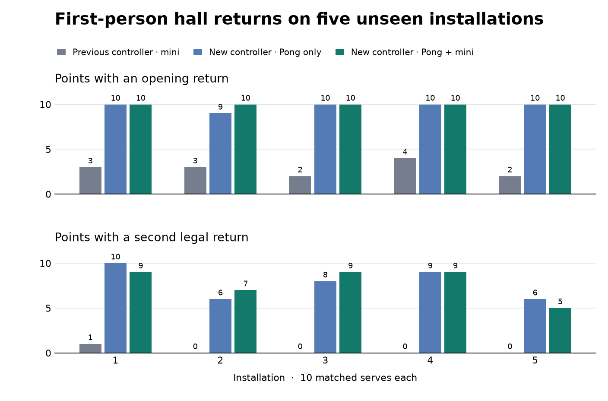

# First-person table tennis in the shaded MuJoCo hall

The arm landed the opening ball on all 50 points across five new hall installations. On 39 of those points it also returned the opponent’s reply. The strongest evidence of learning is the arm’s motor calibration. On four installations, erasing the learned channel order and signs took the same controller from 24/24 legal opening returns to 0/24. Mini practice contributed much less to the final hall performance.

[Watch a full point through the player’s left eye](assets/2026-11-21-hall-learned-rally.webp) · [Watch the earlier mini player from first person](assets/2026-11-21-mini-table-first-person-rally.webp) · [Run the saved player on a new serve](../../artifacts/tt5/README.md)

## Matched games across five installations

Each row reports what happened on the same 50 scheduled serves. A legal return must land on the other side of the net. A sustained point requires two legal returns by the learner. Short points had a 140-command limit at 30 Hz. The 32 timeouts for the mini-trained player are scoreless. The opponent can return successive balls and can also miss.

| Controller and prior experience | Openings returned | Sustained points | Total legal returns | Wins | Losses | Timeouts |
|---|---:|---:|---:|---:|---:|---:|
| Previous controller, Pong and mini | 14 | 1 | 15 | 5 | 45 | 0 |
| New controller, Pong only | 49 | 39 | 90 | 15 | 5 | 30 |
| New controller, Pong and original mini | 50 | 39 | 93 | 15 | 3 | 32 |

The original mini donor practiced with overhead and side cameras. All three conditions here received first-person images in the target hall. The earlier player’s most common failure was missing the arriving ball. Physical replay of the earlier 40-point course found 25 misses, five contacts that landed on its own half, one that went to the floor, and nine successful returns. At the missed crossings, median absolute lateral and vertical errors were 13.8 cm and 10.5 cm. We replayed 294 recorded action tapes through MuJoCo, including all 50 of the new player’s points and all 50 matched Pong-only points. Every physical point result matched its receipt. [Replay audit](../../artifacts/tt5/physical-replay-audit.json.gz) [Previous player on matched serves](../../artifacts/tt5/temporal-baseline.json.gz) · [New players on those serves](../../artifacts/tt5/hall-qualification.json.gz) · [Original 40-point course](../../artifacts/tt4/native-hall-confirmation.json.gz)

## Playing to 11

Two further unseen installations played receiving games to 11, win by two. The player carried its learned statistics across serves within each game. The opponent served every point. On the first installation the arm won 11–2, landing 49 legal returns over 13 points. On the second it won 11–5, landing 86 returns over 18 points. Each of the two scoreless timeouts at the second installation contained 11 legal returns by the arm and 11 by its opponent before the 20-second limit. Every one of the 22 winning points included a legal return by the arm. [Full game records](../../artifacts/tt5/long-hall-games.json.gz) · [Watch the 11-return rally](assets/2026-11-21-hall-eleven-returns.mp4)

## What the arm learns

The receiving arm sees two shaded 192×144 RGB images, its preceding command and public point rewards. It receives a camera calibration and an approximate two-link arm model. Four public action channels have hidden order, signs and gains. During brief motor probes the policy measures where the racket moves, estimates blade pitch from its silhouette, and fits body dimensions, actuator assignment, gain and lag. It uses that fit to command a timed stroke. While playing it tracks the ball between sightings and across bounces, carries observed bounce ratios between points and updates its choice of timing and position corrections. The fit uses robust least squares. No stage uses backpropagation.

The player is given ball and blade geometry, table dimensions, a gravity and drag model, and an objective of clearing the net and landing on the far half. Projection, stroke planning and visual ball selection embody substantial table-tennis knowledge. Public rewards update preference statistics, but the separate visual role attribution rule made zero updates during the 50-point qualification. The benchmark establishes visually learned control of a new arm. It leaves open whether an agent can learn the stroke objective and optics from experience or adapt when a previously working arm changes mid-game. [Vision](../../scripts/experimental/tt5_vision.py) · [Arm fitting](../../scripts/experimental/tt5_player_body.py) · [Player](../../scripts/experimental/tt5_player.py)

## First-person transfer from mini to hall

On the first six matched serves at each of three hall installations, the player that had practiced the mini game through first-person cameras sustained all 18 points and won six. A player with fresh preference tables and the same stroke planner sustained 14/18 and won four. The mini player made 38 legal returns against 34 from fresh, 33 from Pong-only, and 37 from the externally viewed mini. Every condition paid for the same eight camera probes. These points overlap the primary qualification. [First-person mini and fresh players](../../artifacts/tt5/first-person-source.json.gz) · [Watch the mini-trained player win a hall point](assets/2026-11-21-mini-to-hall-first-person.mp4) · [Saved mini-to-hall player](../../artifacts/tt5/first-person-mini-to-hall.npz)

An independent check then introduced four new installations and 24 new starts per source. The first-person mini player returned 23/24 openings and sustained 21/24. Pong-only returned 24/24 and sustained 21/24. Fresh returned 24/24 and sustained 19/24. Total legal returns were 45, 45 and 44 respectively. The two additional sustained points versus fresh came from one installation. The larger initial advantage shrank, and mini practice provided no consistent advantage over Pong-only with this planner. [Independent source comparison](../../artifacts/tt5/first-person-confirmation.json.gz)

## Cost of learning a new station

* Eight probes cost 272 commands, or 9.07 seconds of simulated movement per installation. Cutting directly to three probes succeeded on four of the five primary installations. The fitted controller returned 24/24 played openings across those four and the erased motor map returned 0/24. Six scheduled points on the fifth installation could not start in either condition. [Matched calibration and erasure](../../artifacts/tt5/short-calibration.json.gz)
* On four further installations, the player checked the optical fit after three, five and eight probes. It required five probes once and three probes on the other three. That cost 476 commands across the four installations, 56% fewer than paying for eight everywhere. It landed 24/24 openings and sustained 23/24. The median setup took 3.4 seconds of simulated motion, the maximum 5.7. Including the first serve, the median time from a new installation to a legal return was 5.0 seconds of simulated movement. The four calibrations actually took 9–35 seconds of wall time on the shared CPU, including rendering and fitting. [Adaptive calibration and full games](../../artifacts/tt5/adaptive-commissioning.json.gz)
* A saved between-point checkpoint reproduced the entire next action sequence and point outcome after loading. A separately seeded serve then yielded one legal return without any fresh motor probes. The checkpoint applies at the calibrated installation. The development renderer reduced median CPU time for a stereo step from 66.7 ms to 23.5 ms over four interleaved trials. It uses coarser visual tessellation and changes RGB by 4.4 levels out of 255 on average. All reported qualification points use original shading. [Checkpoint and commands](../../artifacts/tt5/README.md) · [Renderer measurements](../../artifacts/tt5/render-speed.json) · [MuJoCo primitive tessellation](https://github.com/google-deepmind/mujoco/blob/3.3.7/src/render/render_context.c)

## Domain changes and alternative hypotheses

* Changing the room to the studio and narrowing the stereo baseline from 28 to 16 cm exposed an optical failure. Two stations returned all 12 opening balls. The third could not fit the arm with the usual tracker. Applying a motion-supported outline to its already paid probes let it play and return 3/6. With that recovery the three stations covered 15/18 openings. As the fallback was introduced after this failure, these six points are a targeted recovery test. [Initial studio test](../../artifacts/tt5/changed-camera-studio.json.gz) · [Same failed station and six starts](../../artifacts/tt5/studio-fallback.json.gz)
* Racket paint can resemble the hall. On 58 separate audit frames per appearance, using a motion-supported outline increased the number of blade centers within 45 mm from zero to 58 for sky blue, zero to 36 for dusty blue, and zero to 58 for ochre. Four other appearances retained their previous counts. On the dusty-blue installation this enabled four played points, all with a second legal return. On teal, both optics issued identical commands across four points. Color varied by installation, and every within-installation optics comparison used identical images for calibration and identical serve schedules. [Seven appearances and action tapes](../../artifacts/tt5/recolor-outline.json.gz)
* The velocity reversal visible during mini practice supported a potential transferable impact coefficient. The estimate was 0.887 from 27 samples in the externally viewed mini and 0.863 from 21 first-person samples. Applying 0.887 in the new hall in place of the standard 0.80 gave 18/18 opening returns with each method. Total legal returns changed from 37 to 36, sustained points from 16 to 17, and wins stayed at six. That is insufficient evidence for replacing the default. [Mini image measurements](../../artifacts/tt5/mini-impact.json) · [Receiving comparison](../../artifacts/tt5/source-impact-test.json.gz)
* An optional online strike-position correction used visual blade crossings to infer misses. On the final development installation it accepted zero updates. The frozen and enabled players produced identical commands, 17 legal returns and eight sustained rallies over eight points each. It remains a development option. [Paired development receipt](../../artifacts/tt5/optional-residual-development.json.gz)

## Pong after the hall course

We took the exact shared option coefficients, choice counts and reward totals before and after the first ten-point hall qualification, verified the ten chronological updates, then ran both states on the same 180 native Pong starts. First returns went from 128/160 to 129/160, subsequent returns from 194/210 to 190/202 and points won after a return from 41 to 45. The shared state passed all three existing retention criteria. In a separate control we kept the post-hall choice counts while omitting hall rewards. That reproduced every post-hall native Pong action tape. The hall experience changed which option Pong preferred, but the result gives no evidence that the values of the table-tennis rewards made Pong better. This comparison transfers the shared numeric state into the native Pong controller. [Pong retention receipt](../../artifacts/tt5/pong-numeric-retention.json.gz)

## Physical scope

The target is a simulated four-axis arm striking a physical ball in MuJoCo. The preceding simulator audit fitted ball flight to measured SpinDOE trajectories and checked bounce height, net interaction and stationary controls. Both cameras are fixed at the player’s head. A seeded opponent has access to simulator state and attempts most incoming returns. The simulator still uses a disk racket and synthetic cameras, with no measured contact, latency or servo data from an actual robot. [Arena validation](2026-11-21-realistic-table-tennis-transfer.md) · [SpinDOE](https://github.com/cogsys-tuebingen/spindoe)
