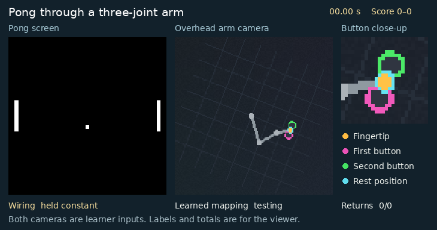
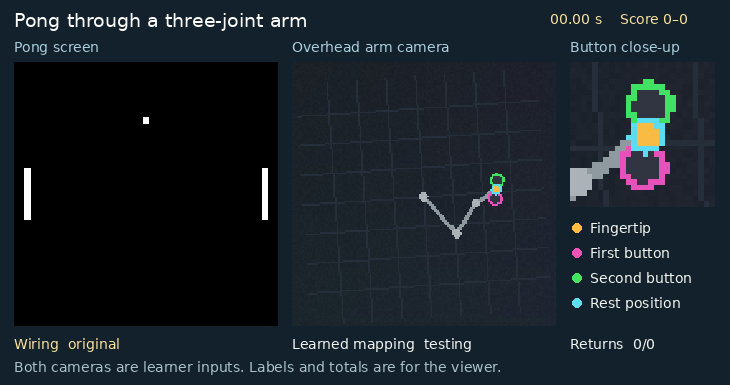

# Playing Pong through a three-joint arm

The player first practiced actual Pong with ordinary up/down inputs. We then removed that input path. It saw a Pong screen and a separate overhead view of an arm beside two colored buttons. It could issue only three bounded relative joint commands. Both the game and the simulated arm ran at 120 Hz through every exploratory movement, miss and point. The arm, its learned motor model and the inferred wiring carried across points within each receiving match.

The final carried player won **24 of 24 held-out first-to-three matches**, at the arm's original joint speeds. A fresh Pong learner with the same arm and physical timing won 12 and reached the time cap 12 times. The carried learner saved 93 of 100 incoming balls and scored 56 points after an actual return.

The replay is the earliest scheduled match in which all three points followed an arm-driven return. The arm returned 6/7 and won 3–1. The first scheduled match is also available in the records. There it returned 1/3 and won 3–2, earning one point after a return. The ball remained live while the arm identified the switches. The two original cameras appear side by side, with a magnified crop of the switch panel. We replayed all issued joint commands in a fresh arm and game and matched the physical presses, opportunities, returns and scores tick by tick.

## What was already known

The supplied game scaffold separates the white ball and paddles, provides wall reflection geometry, proposes candidate vertical lead factors and shot offsets, and converts a desired paddle position into a requested direction. Direct gameplay teaches which lead predicts a future, visible ball crossing and which offsets earn native point rewards. Source practice interleaves 24 game instances sharing these statistics and uses no backpropagation. This experiment uses a fresh, separately qualified visual Pong checkpoint.

The arm scaffold supplies RGB marker identities, the two target locations and a neutral position as visual concepts. Physical locations vary with pose, board placement and camera. It fits how three joint commands change the fingertip’s image position by discounted least squares. The app never sends a desired game direction to the Pong simulator. Two successive samples inside a touch pad close its physical switch, and moving outside a larger radius releases it. Both hidden wiring orientations appear in equal numbers on held-out courses.

## Separate practice

Across 72 interception-focused and 288 shot-placement practice points, the direct player used 40.4 minutes of simulated game time. Its checkpoint contains 648 observed crossings and seven outcome-scored shot choices. A wall-reflection hypothesis family and the game-axis/controller conventions are part of the scaffold. On 96 paired fresh starts against the deterministic opponent at speed 0.35, the policies produced the following outcomes.

| Direct controls, frozen policy | Returns / incoming | Points scored after an own return | Points lost | Timeouts |
|---|---:|---:|---:|---:|
| Before either stage | 198/239 | 27 | 40 | 20 |
| After interception practice, centered shots | 340/349 | 6 | 9 | 72 |
| After shot-placement practice | 92/113 | 64 | 21 | 2 |

Each policy also received nine points without touching the ball. On paired starts, the scoring improvement over the fresh state was 38.5 percentage points (95% bootstrap interval 26.0–51.0). The learned interception-only strategy improved the return fraction by 14.6 points (10.6–19.1). Deliberately aiming off-center subsequently shortened rallies and increased scoring.

The arm had a separate optional 80-tick (0.67 s) reaching exercise against scattered visual marks, with no Pong or wired buttons. On 64 panel layouts at original joint speeds, this shortened median first-press time from 12 ticks to 5. Switching buttons took a median 14 ticks either way. The original servo angular-rate limits were 1.48, 1.63 and 1.93 radians/s. The prior reaching experiment issued commands at 25 Hz. Here the servo preserved those speed caps and time constants while accepting commands and camera updates at 120 Hz. A 4.8× gearing variant also worked in the arm-only test. All headline game results below use the original gearing.

## What transferred to the arm?

On 32 paired streams at original joint speeds, every active player found the right wiring before its first incoming ball. This first experiment assumes the two switches have opposite effects, so one sufficiently clear response can identify the pair. With prior reaching practice the median first physical press happened after five ticks (0.042 s) and correct wiring after 24 ticks (0.20 s). With the same Pong checkpoint and fresh arm motors the medians were 11.5 and 28 ticks. A first successful return took a median 2.53 game seconds for the full player, among the 30/32 streams where it returned at least once.

The game was first to three points with a 20-second cap. Fresh agents used the same online learning rules as the practiced ones. Each row had the same 32 starting serves, arm scenes and wiring assignments.

| Prior skill used through the arm | First incoming balls returned | All returns / incoming | Points scored after an own return | Points conceded | Matches won / lost / capped |
|---|---:|---:|---:|---:|---:|
| Pong scoring and reaching, both updating | 19/32 | 109/158 | **36** | 49 | 6 / 7 / 19 |
| Reaching, fresh Pong learner | 20/32 | 151/182 | 19 | 31 | 4 / 2 / 26 |
| Pong scoring, fresh arm motor | 18/32 | 106/153 | 27 | 47 | 4 / 10 / 18 |
| Both fresh | 20/32 | 153/179 | 9 | 26 | 2 / 2 / 28 |
| Pong interception only, with reaching | **26/32** | **176/191** | 5 | **14** | 1 / 0 / 31 |
| Reactive ball pursuit, with reaching | 20/32 | 114/178 | 20 | 64 | 3 / 10 / 19 |
| Buttons physically disconnected | 10/32 | 30/122 | 9 | 92 | 2 / 29 / 1 |

With the same practiced arm, prior Pong scoring added 0.53 earned goals per match (paired bootstrap interval 0.16–0.91). The benefit was visible on the first point (13 vs 8 earned goals across the 32 starts) and on subsequent points (23 vs 11). It also cost returns and increased concessions. Freezing the trained game policy at transfer still produced 35 earned goals. Interception practice alone improved the return fraction over reactive pursuit by 28.1 percentage points (21.7–35.1). It saved 16/22 opening balls outside the stationary paddle's reach, compared with 11/22 for reactive pursuit and 0/22 with the switches disconnected. Some balls naturally rebound off a stationary paddle. Disconnecting the buttons gave exactly the same input sequence and points as parking the arm on all 32 starts.

On a separate 16-stream first-to-three course we extended the cap to 120 seconds. With original control timing, Pong plus reaching practice won 7, lost 9, and capped 0. Reaching plus fresh Pong won 5, lost 10, and capped 1. Earned goals were 30 versus 22, and mean match durations were 29.3 versus 71.1 game seconds. The uncertain win-rate difference (+12.5 percentage points, paired interval −18.8 to +43.8) motivated the physical-control experiment below.

## Adapting scoring to physical control

One candidate used visual paddle errors and the public score to shrink the requested shot offset when the arm was imprecise. On 16 new first-to-three matches with a 20-second cap, it scored 25 points, conceded 20 and returned 56/76 balls. The original full controller scored 22, conceded 24 and returned 56/80. Its paired margin gain of 0.44 points per match had an interval of −0.13 to +1.13.

The decisive change was to use the time until the ball would arrive. The original game controller always allowed a fixed stopping distance for the paddle. When a ball was close, the paddle could travel only part of that distance before the collision. Also, moving the arm away from a button took time while the held button continued driving the paddle. We used camera-estimated ball flight, paddle velocity and fingertip occupation to account for both effects. This timing rule is engineered and was selected on eight development starts. Three development variants scored 6, 9 and 16 earned goals for the original timing, arrival time alone and arrival time plus a held-button allowance, respectively. The learned game coefficients, shot values, joint map and wiring still come from experience.

We then fixed the rule and played 24 new paired first-to-three matches, with a 90-second cap. Each controller got the same reaching practice, hidden wiring assignments and opening geometries. The carried and fresh Pong learners both continued updating on the arm.

| Original-speed arm, 24 new matchups | Wins / losses / caps | Points for–against | Points after an own return | Returns / incoming | Median game seconds |
|---|---:|---:|---:|---:|---:|
| Prior Pong practice, arrival and release timing | **24 / 0 / 0** | **72–7** | **56** | **93/100** | **16.1** |
| Fresh Pong learner, same arrival and release timing | 12 / 0 / 12 | 53–19 | 37 | 446/465 | 79.1 |
| Prior Pong practice, original timing | 13 / 11 / 0 | 49–48 | 32 | 106/154 | 15.2 |

Relative to the fresh Pong learner, the practiced one added 0.79 earned goals per match (paired 95% interval 0.46–1.13) and raised the fraction of scheduled matches won by 50 percentage points (29–71). The fresh learner held long rallies, returned a slightly larger fraction overall and saved the same 18/23 opening opportunities. It ran out of time more often. One opening match ended before any incoming ball arrived for either player. Against the original timing, the trained player gained 1.00 earned goals per match (0.54–1.46). These intervals resample matched starts, with equal weighting per match. True binary contacts and private game state were used only for the physical simulator and audit.

## Changing the wiring while the ball was in play

We also removed the shortcut that assumes the second button must do the opposite of the first. The new learner estimates a signed displacement for each visible button separately. It observes fingertip overlap and the paddle’s recent motion, estimates which press produced that motion, and rechecks a button when the two estimates conflict. It knows Pong has an up action and a down action. It has to observe evidence for both before accepting a complete mapping.

On 16 additional paired streams we reversed both buttons at seven game seconds, without telling the player. Fifteen changes fell within a point, one at a new serve. This was a harder defensive course with opponent speed 0.45. The Pong policy was frozen and identical on both arms. The comparison locked the two button estimates immediately after the initial acquisition. The physical arm ran at its original speeds throughout.

| Independent effect estimates | Before reversal, returns | After reversal, returns | After reversal, concessions |
|---|---:|---:|---:|
| Keep learning | 21/35 | **44/64 (69%)** | **20** |
| Lock after learning the first wiring | 21/35 | 13/99 (13%) | 86 |

All 16 learned both initial effects, median 0.73 s and maximum 0.90 s. All 16 relearned both after reversal, median 1.18 s and maximum 1.73 s. Each time is the first instant from which both effects stayed correct to the end of that phase, with at least a further second of play. The post-switch return-rate gain was 55.6 percentage points (paired interval 41.8–69.0). Both players continued to face the consequences of their behavior. A controller that missed quickly started more points and faced more incoming balls during the same 15 seconds. On the first scheduled stream, disconnecting the switches yielded zero mapping assignments across all 2,640 ticks.

## What the original archived Pong player did

We also connected the previously published Pong controller to the same arm. This preserved its archived visual/interception stack, motor and timing priors and scored shot table. Both policies consumed the same 64-pixel native camera sampled from the current raster at 30 Hz. On eight matched first-to-three games at speed 0.35, the archived shot policy and its forecast-center control each won two matches. They scored three and four points respectively after making a return. The larger scoring qualification used the newly trained strategy. This small course did not establish a scoring benefit from carrying the historical shot table into the new body.

## Does the arm need 120 camera frames per second?

On 12 new matched streams we compared the 120 Hz arm camera/control loop to a simultaneous 30 Hz arm and Pong camera/control loop. With slower cameras, the learner read no new arm image between decisions. Its previous relative joint command was held and applied to the 120 Hz servo. Each new point supplied an initial image. Both groups used the same 80-tick original reaching practice, originally observed at 120 Hz. The deterministic opponent stayed at 0.35. The match cap was 55 game seconds.

| Camera and action rate, original gearing | Wins / losses / caps | Earned goals | Returns / incoming |
|---|---:|---:|---:|
| Practiced Pong, 120 Hz arm and 30 Hz game | 11 / 1 / 0 | 28 | 51/60 |
| Practiced Pong, 30 Hz for both | **10 / 2 / 0** | **27** | 55/70 |
| Fresh Pong learner, 30 Hz for both | 4 / 2 / 6 | 16 | 157/170 |

Prior Pong experience added 0.92 earned goals per match at 30 Hz (paired interval 0.33–1.58). Reducing camera/control cadence for the practiced player changed earned goals by −0.08 per match (−0.58 to +0.42). This independent course also shows that the player can lose under its original 120 Hz setup. Further steps toward a physical arm include unmarked visual targets, measured camera latency and actual button travel.

## Does the camera matter at the harder speed?

On a separate 12-match course against the 0.45 opponent, the full-view controller at original gearing returned 39/57 incoming balls (68%). Masking the ball from the pursuit policy reduced that to 13/46 (28%). The button learner retained its usual paddle visibility check in both cases. Of 11 openings outside a stationary paddle's reach, full-view play returned five, and masked play returned zero. Learning an extra arm-release delay from the camera gave 36/52 returns. Its measured change against fixed timing was +0.8 points (paired interval −12.4 to +14.1). None of these conditions scored a point after its own return against that opponent.

## Physical scope

The arm is a planar three-joint simulation with a marked fingertip. A press depends on fingertip position, consecutive contact samples and release hysteresis. Real button travel, contact force, depth estimation, camera transport delay and SO-101 hardware have yet to be tested. The game and arm use separate cameras and supplied object identities. Transfer here refers to reuse of learned game evidence with a newly learned visual motor and button association. All changes to scores, contact logs and wiring labels in the replays are evaluator annotations. Neither the game nor the arm controller reads those annotations when issuing actions.

[Trained checkpoint, experiment records and reproduction commands](../../artifacts/arm-pong/README.md)
