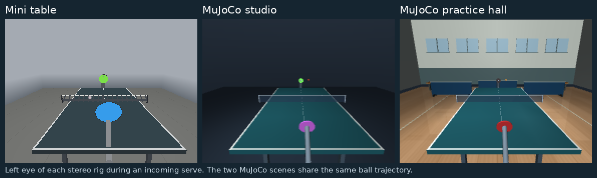
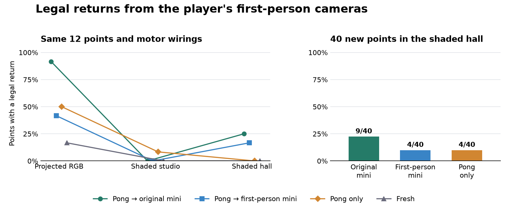

# From mini table tennis to a MuJoCo racket arm

## What the mini player brought to a new body

The previously saved Pong-to-mini player earned legal returns sooner and rallied longer on a new four-actuator table. Its best transfer came from the original mini simulator's overhead and side cameras. A second player that practiced the mini game through stereo cameras at the player's head also learned to play there, but its checkpoint carried a less useful stroke preference.

Every condition saw anonymous RGB image pairs, issued four signed commands, and received ordinary point scores. The learner fitted action-response regressions and updated score and timing statistics online without backpropagation. Opponent misses could win a point, so the primary outcome is the number of points on which the learner sent at least one ball onto the opponent's side legally. A sustained point requires two separate legal returns by the learner, including a return of the opponent's reply.

### Playing the mini game from the player's head

Two learners started from the same native Pong checkpoint on each of two 20-point courses. The original external camera baseline reproduced all 40 archived action traces. The default player-eye rig used two 160×120 cameras 16 cm apart at the player's end. Both eyes looked down the length of the table.

| Mini practice condition, 40 points each | Landed a return | Sustained points | Wins |
|---|---:|---:|---:|
| Original overhead and side cameras | 30 | 6 | 7 |
| Player-eye cameras | 25 | 0 | 7 |
| Player-eye cameras, post-bounce meeting rule | 26 | 2 | 7 |
| Player-eye cameras, 192×144 and 30 cm apart | 29 | 4 | 8 |

The last two rows reuse the openings to investigate the missed second returns. The wider rig also has higher resolution, so this comparison cannot assign credit to one optical change. Each point included exploration. Saving the default first-person learner and reloading it reproduced its next point's commands exactly. [Winning first-person mini point](assets/2026-11-21-mini-table-first-person.webp) · [Two-return mini rally](assets/2026-11-21-mini-table-first-person-rally.webp)

### Changing the table, arm and controls

The original arm has three kinematic axes. The receiving arm uses four torque-limited position servos with inertia and a mechanically coupled wrist. An installation secretly permutes the four command channels and changes their signs. The player fits a signed action-to-motion map from its own camera observations and probe actions. It cannot use the target's joint positions, ball state, contact events, action wiring, object IDs, or the opponent's plan. The target uses a regulation 2.74 × 1.525 m table, 15.25 cm net, 40 mm, 2.7 g ball and a 15.2 cm diameter racket. MuJoCo steps at 480 Hz, with 30 Hz commands and cameras. The ball exchanges impulses with the table, net, floor and both rackets. The opponent attempts returns using a seeded controller.

The transferred state includes visual role weights, the learned score-time classifier, numeric shot preferences, table timing values and a dimensionless estimate of bounce speed. The control algorithm supplies calibrated stereo, a nominal gravity prior and table plane, an incoming-motion cue, a bounded stroke region and a swing template to every group. It learns the motor mapping at the new station. The receiving controller has a new body adapter and stroke implementation. Carrying those learned values measures reuse of experience within a structured player. The target development work included separate smoke runs and 160 scored points to select a common swing before evaluating unseen installations. The experiment assumes camera geometry and a swing template; it leaves independent discovery of those components open.

### Matched main test on the new physics

Six unseen installations per receiving camera view, with 12 scored points each. Each installation began with ten probe episodes, about 360 commands or 12 seconds of simulated interaction. Those probes were paid before the first match return in every group. The camera used a fast projected RGB renderer at 96×72 per eye for this comparison. The ball motion, servos and legal point scoring were the same MuJoCo implementation used by the shaded test.

| Receiving camera | Source practice | Points with a legal return / 72 | Total legal returns | Sustained points | Wins |
|---|---|---:|---:|---:|---:|
| First person | Pong → original mini | **45** | **58** | **12** | 20 |
| First person | Pong only | 25 | 28 | 3 | 11 |
| First person | Fresh | 18 | 21 | 3 | 9 |
| First person | Pong → mini first person | 23 | 27 | 4 | 17 |
| First person | Original mini, reverse learned timing evidence | 23 | 24 | 1 | 14 |
| Overhead and side | Pong → original mini | **43** | **60** | **16** | 22 |
| Overhead and side | Pong only | 31 | 38 | 6 | 15 |
| Overhead and side | Fresh | 26 | 35 | 9 | 15 |

The original mini player landed a return on the first scored point on 5/6 first-person installations, compared with 1/6 for Pong-only and 0/6 fresh. Across the 12-point courses it improved over Pong-only by 6, 2, 1, 8, 1 and 2 successful points respectively. A paired bootstrap over the six installations gives a mean gain of 3.33 successful points per 12, with a 95% interval of 1.33 to 5.50. Reversing the timing evidence in the same mini checkpoint reduced sustained points from 12 to one. This isolates a contribution from timing while leaving the other transferred state in place. Target games used a 140-command point cap (4.67 s). Nine of the original mini player’s 72 first-person points timed out, versus two for Pong-only. A timeout adds no win. The entire matched suite ran in about 127 seconds on the shared cloud machine. [Action tapes, seeds and per-installation results](../../artifacts/tt4/tt4-paired-projected-transfer.json.gz) · [Three-return first-person replay](assets/2026-11-21-projected-table-first-person.webp)

## Physical checks

* We fitted free-flight drag and spin coefficients on 97 real SpinDOE flights. On 37 separate shots with measured initial speeds of 3.8–12.9 m/s, the actual MuJoCo integration predicted ball position about 100 ms ahead with 37 mm median error. Gravity alone gave 91 mm. A drag-only continuous model gave 37 mm and the fitted drag-plus-spin model gave 36 mm. The data provide stronger support for drag than for the separate spin coefficient. [Source dataset](https://github.com/cogsys-tuebingen/spindoe) · [Calibration and held-out receipt](../../artifacts/tt4/measured-flight.json)
* A 30 cm drop rebounded to 22.8 cm. As a separate reference, 155 measured table bounces had median vertical speed restitution of 0.90. The simulator's soft-contact duration and penetration remain approximations. The net is a compliant fixed obstacle, the racket is a circular disk, and both eyes stay fixed during a point. We have no measurements of the racket rubber, servo response, camera latency, or spin after racket contact for this installation. [ITTF technical dimensions and bounce standard](https://documents.ittf.sport/sites/default/files/public/2026-02/2026_Statutes_v1_consolidated_clean.pdf) · [Drop, net and gameplay controls](../../artifacts/tt4/arena-audit.json)
* On 40 matched openings the stationary racket made 11 contacts and the random arm made three. Neither landed a legal return. The privileged scripted controller landed 174 legal returns and sustained 34/40 points. There were 15 time-limit endings in this control. Hidden physical state was used only by the opponent, the scripted positive control and the post-play evaluator. [Control receipt](../../artifacts/tt4/arena-audit.json)

## What transferred from first-person mini practice?

A further comparison changed only the mini donor. On three new target installations the player with 192×144, 30 cm stereo mini practice landed a legal return on 20/36 points, with 28 total returns and eight sustained points. The regular first-person mini donor produced 17/36, 18 total returns and one sustained point. The matched Pong-only player produced 3/36, three returns and zero sustained points. The receiving player-eye rig remained at 96×72 and 16 cm for every donor. Relative to regular mini practice, the wider donor's total-return differences by installation were +7, −3 and +6. Its better source performance and target rally depth justify testing it further. The source camera settings and the particular training histories vary together. [Matched donor comparison](../../artifacts/tt4/tt4-paired-wide-source-transfer.json.gz) · [Wide-rig checkpoint](../../artifacts/tt4/mini-first-person-wide-player.json.gz)

We also isolated motion prediction. An independent local predictor saw 24 passive mini points and learned the displacement of anonymous image tracks from their next four RGB observations. At the new table it received the last four observations of a moving track and forecast its position 133 ms ahead without target fitting. Only the evaluator used true ball position to identify which candidate track to score after play. A missing track counts against coverage. None of these forecasts or labels were supplied to the gameplay controller.

| Shaded receiving view, 16 held-out points | Available four-frame ball tracks | Linear extrapolation mean error | Mini-trained local forecast | Points with lower mean error |
|---|---:|---:|---:|---:|
| First person | 392/625 windows | 27.7 cm | 22.7 cm | 16/16 |
| Overhead and side | 418/625 windows | 22.6 cm | 15.3 cm | 16/16 |

A constant correction learned from the mini data performed worse than linear extrapolation. The useful information depended on the track's position and velocity. First-person errors remain large relative to the 7.6 cm racket radius. The physics audit starts with measured positions and spin; this diagnostic instead starts from a few noisy camera observations and includes bounces. [Per-shot forecasts, coverage and paired intervals](../../artifacts/tt4/optical-forecast.json)

## Native shaded camera test

The native renderer produces shaded surfaces, highlights and partially occluded blades. A furnished practice hall additionally supplies wood grain, windows, bench and barrier edges, different lighting, and red/black blades with a white or orange ball. The hall and studio produce the same physical trajectory under identical actions. The fast renderer, shaded studio and shaded hall were matched on the same 12 individual starts, motor wirings and optics. The receiving camera resolution was 192×144 per eye and baseline 28 cm, a fixed robot stereo rig. The mini first-person source had been trained with the narrower 16 cm baseline.

| Source | Projected RGB, landed / 12 | Shaded studio, landed / 12 | Shaded hall, landed / 12 |
|---|---:|---:|---:|
| Pong → original mini | 11 | 0 | 3 |
| Pong → first-person mini | 5 | 0 | 2 |
| Pong only | 6 | 1 | 0 |
| Fresh | 2 | 0 | 0 |

The first-person mini checkpoint landed two returns and won one of its hall points after the opponent replied. The wide-rig mini checkpoint also landed a return on 3/12 hall points, drew three legal replies and sustained none. In a separate four-point shaded overhead/side test both mini sources landed returns on 2/4 points and sustained one. There was only one installation in that external-view test. [Same-seed projected comparison](../../artifacts/tt4/native-study-projected-control.json.gz) · [Shaded studio](../../artifacts/tt4/native-studio-transfer.json.gz) · [Shaded hall](../../artifacts/tt4/native-hall-transfer.json.gz) · [First-person hall win](assets/2026-11-21-native-hall-first-person.webp) · [External-camera rally](assets/2026-11-21-native-external-table-rally.webp)

### Independent hall confirmation

On five new installations and eight scored points apiece, the player with original mini experience landed **9/40** openings, versus **4/40** for both native Pong alone and first-person mini practice. Its total was ten legal returns, including one sustained point and three wins after a return. Both other players landed four returns and had zero sustained points and two earned wins each. The original mini player's gain over Pong-only by installation was +2, +2, +1, 0, 0. On the fifth installation every group missed all eight. The first-person mini player's differences were +2, +1, −2, −1, 0. Its showcase win demonstrates that the full path can work; its larger result ties the Pong-only baseline.

Each station used eight charged probe episodes (about nine seconds of simulated interaction) before scoring began. The original mini player reached the racket-contact stage on 15/40 points, compared with 14/40 and 13/40 for first-person mini and Pong-only. There remains a sizable gap both in reaching the ball and in converting contact into a legal landing. These results support limited simulated transfer across bodies and cameras. Reliable play in the furnished hall, and transfer to a physical robot, are still open. [Five-installation action receipt](../../artifacts/tt4/native-hall-confirmation.json.gz)

### A camera change that helped one source

On two additional studio installations, the player estimated the stationary background from the most frequent RGB values in the *same eight motor-probe episodes* already used to learn the arm. Both image pipelines were then tested on identical observations at calibration and the same eight point openings. For the original mini player, the number of points with a legal return rose from 1/8 to 4/8, with five total returns and one sustained point. The first-person mini player moved from 1/8 to 2/8, Pong-only from 2/8 to 0/8, and fresh from 0/8 to 1/8. This provides a way to improve the observation pipeline without adding training frames, though the improvement varied with the source player. Re-running the experiment reproduced all 32 action tapes exactly. [Paired vision comparison](../../artifacts/tt4/native-temporal-paired-comparison.json) · [Shaded first-person studio rally](assets/2026-11-21-native-studio-first-person.webp)

The transfer code, simulation, checkpoints, action tapes and exact reproduction commands are available in the [experiment directory](../../artifacts/tt4/README.md).
